# Super Robot Taisen Alpha — English Translation

[](https://github.com/Nrlemo/Super-Robot-Wars-Alpha-PSX-English-Ver/releases/tag/v1.01)
[](https://github.com/Nrlemo/Super-Robot-Wars-Alpha-PSX-English-Ver)
[](https://github.com/Nrlemo/Super-Robot-Wars-Alpha-PSX-English-Ver/releases/tag/v1.01)

-purple)

[](https://github.com/Nrlemo/Super-Robot-Wars-Alpha-PSX-English-Ver/issues)
[](https://github.com/Nrlemo/Super-Robot-Wars-Alpha-PSX-English-Ver/commits/main)

English fan translation of **Super Robot Taisen Alpha** for the original PlayStation (PSX).

A complete, playable English release featuring translated dialogue, menus, battle quotes, and graphical text.

**Current release:** [v1.01](https://github.com/Nrlemo/Super-Robot-Wars-Alpha-PSX-English-Ver/releases/tag/v1.01)


<p align="center">
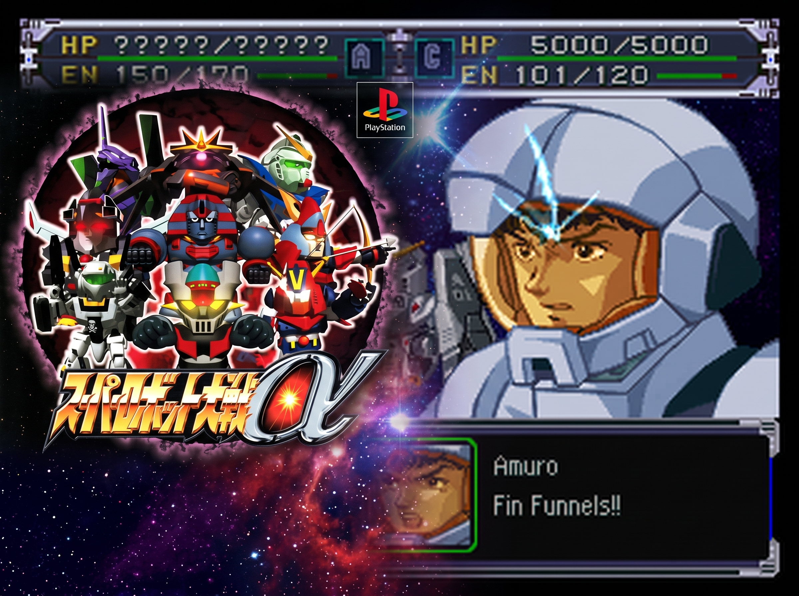
</p>

**Latest release: [v1.01](https://github.com/Nrlemo/Super-Robot-Wars-Alpha-PSX-English-Ver/releases/tag/v1.01)** — fan translation of *Super Robot Taisen Alpha* (PlayStation, 2000) into English.

The first complete, playable English build of **Super Robot Taisen Alpha** (PlayStation, 2000) — the crossover that brought Mazinger, Getter Robo, Gundam (UC and AU), Evangelion, Macross, Dancougar, Dunbine, L-Gaim, Gunbuster, Brain Powerd, the Masou Kishin and the Banpresto originals together for the first time on PSX.

**Every line of dialogue is translated and inserted**, and the game boots and plays in English from the title screen to the battle animations. Please report anything that looks wrong (see *Reporting problems* below).

### We need your support! 💫

While every line is translated and the game is fully playable from the title screen to the battle animations, we are looking for players to test this build on emulators and physical consoles. 💥

Grab your original Japanese ISO, check the README.md for the quick xdelta patching instructions, and help us polish this masterpiece! Please report any visual bugs🐛, or text issues on our GitHub.

**AND CONSIDER SUPPORTING FURTHER DEVELOPMENT!** 

<a href="https://www.buymeacoffee.com/Srwa_en" target="_blank"></a>

## What's new in v1.01

Fixes from player reports:
- Stage 11 prologue and nearby scenes: *Tutti* is now **Tyutti**, *Lord Fail* is **Lord Feilord**, *Yanlon* is **Yang-Long**, and Koji's line about Masaki reads *"Has that guy Masaki regained consciousness!?"* ([#10](https://github.com/Nrlemo/Super-Robot-Wars-Alpha-PSX-English-Ver/issues/10)).
- Stage 13 epilogue: Amuro now says *Lieutenant Sleggar* and Sleggar answers *"You can drop the formalities."* instead of the confusing "Mr." exchange ([#11](https://github.com/Nrlemo/Super-Robot-Wars-Alpha-PSX-English-Ver/issues/11)).
- Two untranslated unit-stat labels are now English: *Armor+400* and *Limit+30* ([#13](https://github.com/Nrlemo/Super-Robot-Wars-Alpha-PSX-English-Ver/issues/13)).

More fixes ([#16](https://github.com/Nrlemo/Super-Robot-Wars-Alpha-PSX-English-Ver/issues/16)):
- Names are now consistent everywhere: *La Vie en Rose* (was *Rabian Rose* in Scenarios 21–23), *Full Vernian* (was *Full Burnern*), *Irmgard* (was *Irmgult*), *Raidiese* (was *Rydeath*) and *Human Instrumentality Project* (was *Huma Human…*).
- *Room of Guf* is now *Chamber of Guf*.
- Benkei's *Mt. Daisetsu Oroshi* is now *Daisetsuzan Oroshi*, like everywhere else.
- Ryoma's attack shout is *Stoooner Suuuunshiiiine!!*.
- *Self-Destruct* is shortened to *Self-Dest.* in the spirit list so it no longer sticks out of its box on the Pilot Stats screen.

Saves (memory card) from v1.00 and the release candidates should load fine in v1.01.

## Changelog

### v1.00

**Story scenes type out again.** Dialogue in the intermission scenes was appearing all at once; it now types out letter by letter like the Japanese original, with the speaker's name shown first, and the characters' face animations play while the text is typed. ([#5](https://github.com/Nrlemo/Super-Robot-Wars-Alpha-PSX-English-Ver/issues/5))

**Fixes from player reports:**
- *Aphrodite A* and *Diana A* (Sayaka's robots) are spelled the same everywhere — dictionaries, unit screens and dialogue ([#1](https://github.com/Nrlemo/Super-Robot-Wars-Alpha-PSX-English-Ver/issues/1)).
- Typos and line-break fixes in Scenarios 50, 60 and 64 ([#4](https://github.com/Nrlemo/Super-Robot-Wars-Alpha-PSX-English-Ver/issues/4), [#6](https://github.com/Nrlemo/Super-Robot-Wars-Alpha-PSX-English-Ver/issues/6), [#7](https://github.com/Nrlemo/Super-Robot-Wars-Alpha-PSX-English-Ver/issues/7)).
- *Coach* is capitalized when used as a title, and the Combine menu no longer overlaps when combining into SRX — it now reads *N combinations left* ([#8](https://github.com/Nrlemo/Super-Robot-Wars-Alpha-PSX-English-Ver/issues/8)).
- *Fuyutsuki*'s "Huma Human" is now *Human*; the *Great General of Darkness* is shortened to *Great Gen. of Darkness* as a speaker name.
- Spirit command abbreviations in the unit summary (*Val*, *Mrc*, *Snp*, *Fls*…) so they fit their boxes.

**Small visual fixes:**
- The *Yes/No* prompt when saving is centered on the cursor.
- *Wpn. Stats* fits its box on the status screen.
- The button icons in the *Counter* menu and on the *Choose a Preset Character* screen no longer overlap the text.
- In the name editor, lowercase letters with tails (g, j, p, q, y) are drawn whole, the nickname has 8 underlines, and a stray "=" is gone.
- Changing the face on the character screen no longer turns *Gender* back into Japanese.
- The character dictionary shows *Nick* instead of a leftover kanji label.
- The five items of the title-screen *Options* menu are now centered.
- The titles of the unlockable videos in *Demo Select* are translated.

Saves (memory card) from the release candidates should load fine in v1.00.

## What is translated

| Content | Status |
|---|---|
| Intermission scenes (`SCRIPT.BIN`, 45,712 lines) | ✅ 100 % |
| Map dialogue (`SNMSG.BIN`, 32,288 messages) | ✅ 100 % |
| Battle quotes (`BXCLIST.BIN`, 18,128 lines) | ✅ 100 %, three style passes |
| Defeat and suspend quotes | ✅ 100 % |
| Pilot names (469), units (486) and weapons (692 names) | ✅ |
| Character and robot dictionaries (350 + 449 entries) | ✅ |
| Menus: title, intermission, status, map, battle, save/load, options, name entry | ✅ |
| Stage titles (128), prologue, terrain and place names, map labels | ✅ |
| Graphics: battle effects, barriers, copyright screen, map location boxes, UI labels | ✅ (most; see known issues) |

**~96,700 lines of dialogue** in total, plus menus and graphics.

**Technical work behind it:** a new English font with a **variable-width font (VWF)** routine patched into the executable (~55 characters per line instead of 20 full-width kana), a raised on-screen text-object limit, re-implemented LZSS compression for the unit/dictionary archives, and a rebuild of the disc image with files allowed to grow.

**Style:** names and attack calls follow the official Western localizations of each series where they exist (Gundam, Evangelion, Macross…), otherwise standard Hepburn. Menu and system terms follow the English *Super Robot Wars OG* releases (*Will*, *Accel*, *Luck*, *Fury*…). A canonical glossary of 1,739 terms keeps names consistent across all files. Each character keeps their voice and verbal tics (Shinobu's *Let's do this!*, Asuka's *You idiot!?*, Masaki's cats' *~nya*…).

## Not translated (by design)

- FMV videos, sound test track names and song lyrics.
- The ending credits (staff names stay as in the original).

## How to apply

You need your own dump of the original Japanese disc. **The patch only works on this exact image:**

| | |
|---|---|
| Game | Super Robot Taisen Alpha (Japan) (v1.0) — SLPS-02636 |
| File | `Super Robot Taisen Alpha (Japan) (v1.0).bin` (single track, 646,374,288 bytes) |
| MD5 | `8cc4b3af159d26d11cad46b136a5c833` |
| SHA-1 | `cfce3c7a76f64269387fbb7b77e3bcfe41b723c6` |

1. Download `SRWAlpha_EN_v1.01.xdelta` and `Super.Robot.Taisen.Alpha.English.v1.01.cue` from the [Releases page](https://github.com/Nrlemo/Super-Robot-Wars-Alpha-PSX-English-Ver/releases/tag/v1.01).
2. Apply the patch to the Japanese `.bin`:
   - **Windows / macOS / Linux (GUI):** [Delta Patcher](https://github.com/marco-calautti/DeltaPatcher) or the [Rom Patcher JS](https://www.marcrobledo.com/RomPatcher.js/) web page.
   - **Command line:**
     ```
     xdelta3 -d -s "Super Robot Taisen Alpha (Japan) (v1.0).bin" SRWAlpha_EN_v1.01.xdelta "Super Robot Taisen Alpha (English v1.01).bin"
     ```
3. Name the patched file `Super Robot Taisen Alpha (English v1.01).bin` (that is the name the `.cue` points to) and keep both in the same folder. You can rename the `.cue` freely; if you rename the `.bin`, edit the `FILE` line of the `.cue` to match.
4. Load the `.cue` in your emulator. Tested with **PCSX-Redux**, **DuckStation** and **RetroArch**. Real hardware / ODE has not been tested yet.

`SHA1SUMS` lists the expected hashes. Patched image: SHA-1 `e7ec5e26b84993d3305695587c2a7eff63884463`, MD5 `365a82fa5ef24b1cc1d7041a1e68df44` (646,442,496 bytes).

> **Memory cards:** saves from the Japanese version load fine, but the protagonist's and partner's names are stored on the card, so they will appear in kana. Start a new game for the English names.

## Known issues

- Digits in dialogue use the fixed 8 px width, so numbers look a bit spaced out.
- Some long battle-quote blocks (the *Show* pilots) have not been checked in game yet.
- A final style read-through (battle quotes per pilot, scenes against the running game) is still to come.
- Three dictionary entries still use older spellings (*T-LINK Field*, *Grungust Type-2*, *Dogos Gear*); the rest of the game uses the final ones.

## Reporting problems

Please open an issue with: the scenario number (or the scene), a screenshot, and what you expected. Text cut mid-word, Japanese text left on screen, freezes and wrong names are the most useful reports at this stage.

## Translate it into your language

This repository also contains the **translation kit**: every tool used to make this translation and the English script
as a starting point, without any game data (the Japanese text is extracted from your own disc). Anyone can fork it and
translate the game into another language.

- **[TRANSLATING.md](TRANSLATING.md)**: the three requirements (fork this project, don't modify the thanks/dedication
  screen, and link [Buy Me a Coffee](https://buymeacoffee.com/srwa_en)).
- **[docs/TRANSLATION_GUIDE.md](docs/TRANSLATION_GUIDE.md)**: the complete manual, from setup to publishing your patch.

---

Fan translation, not affiliated with Bandai Namco / Banpresto. No game data is distributed here: only a patch, the tools and the translated text. Please support the official releases.

<a href="https://www.buymeacoffee.com/Srwa_en" target="_blank"></a>

## Screenshots

<p align="center">
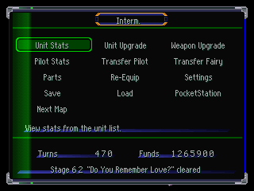
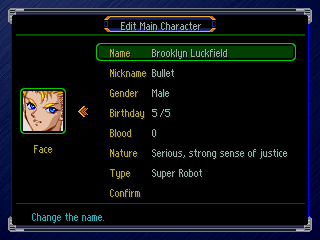
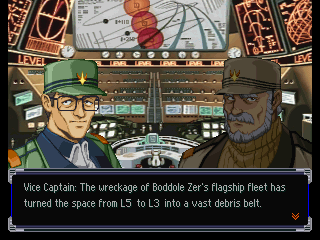
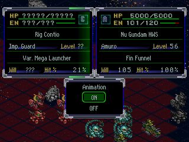
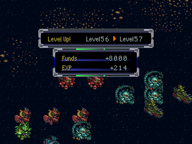
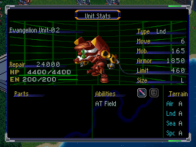
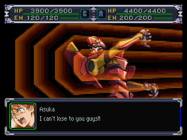
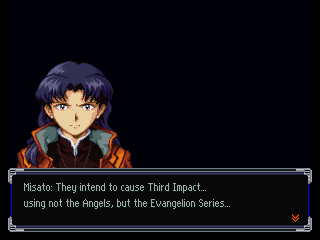
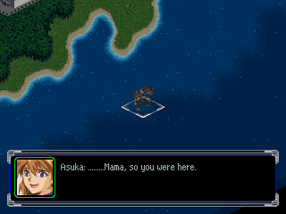
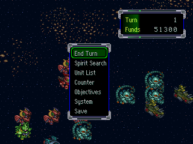
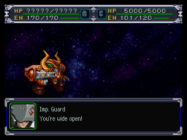
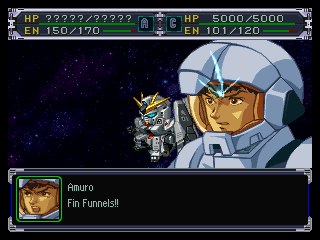
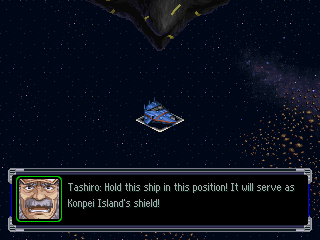
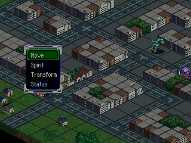
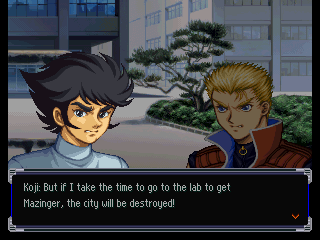
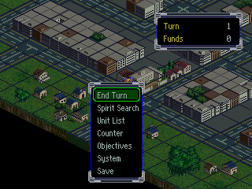
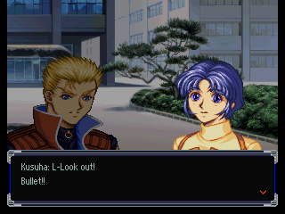
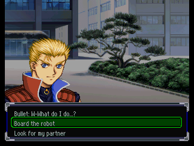
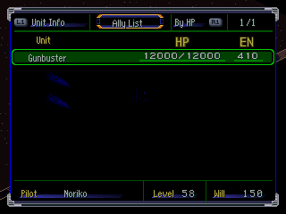
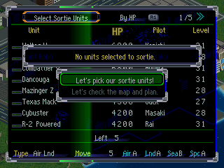
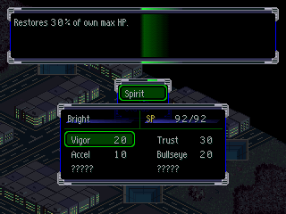
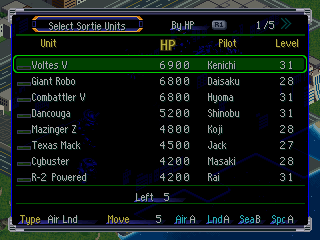
</p>

## Acknowledgments

This project relies on the work of many people. What follows is what we actually used as a source, reference, or tool (`info/`, `Utils/`, `work/notes/`, `work/glossary/`).

### Technical Reference (Romhacking)

| Source | Authors | What we used it for |
|---|---|---|
| **Chinese translation patch "超级机器人ALPHA 汉化 2.0 完全版"** (`Utils/SRT_Alpha`, 2013) | Planning and patch: **WGF** · programming: **KEN TSE**, **luxiwen** · translation: **暴鲤**, **塞外**, **老A** · testing: **parrot0308** | Map of where the text resides, format of the blocks and pointers, and how to reinsert it (Phase 0, see `work/notes/paso1_referencia_chs.md`). Originally distributed at [机战世界 (srworld.net)](http://www.srworld.net/down/game/ps.htm) |
| **Super Robot Wars Alpha Save Data Editor v1.11e** (`Utils/srwalpha_tool111e`) | **Fiigu** | Structure of save data and dictionary/demo lists |

### Game Documentation (`info/`)

| Source | Authors | Link |
|---|---|---|
| Akurasu Wiki (Alpha: characters, units, spirits, skills, OG weapons, timeline, etc.) | Akurasu Community | <https://akurasu.net/wiki/Super_Robot_Wars/Alpha> |
| *Super Robot Taisen Alpha – Character Journal* (GameFAQs) | **Largo** | <https://gamefaqs.gamespot.com/ps/577805-super-robot-taisen-alpha/faqs/8235> |
| *Super Robot Taisen Alpha – Move List* (GameFAQs) | **Chiche** | <https://gamefaqs.gamespot.com/ps/577805-super-robot-taisen-alpha/faqs/73008> |
| *Super Robot Taisen Alpha – Guide and Walkthrough* (GameFAQs) | **Cyath** | <https://gamefaqs.gamespot.com/ps/577805-super-robot-taisen-alpha/faqs> |
| 隠し要素/α — スーパーロボット大戦Wiki (Hidden Elements/α) | srw.wiki.cre.jp Community | <https://srw.wiki.cre.jp/wiki/%E9%9A%A0%E3%81%97%E8%A6%81%E7%B4%A0/%CE%B1> |
| スパロボα 攻略チャート (Super Robot Wars α Walkthrough Chart) (`info/s-rpg-navi.com` folder, ~140 pages) | s-rpg-navi.com | <http://s-rpg-navi.com/> |

### Terminology and Glossary (`work/glossary/`)

Official names and consolidated spellings for each franchise, in addition to Akurasu and SRW Fandom:

- SRW Wiki (Fandom): <https://srw.fandom.com/> · Top Wo Nerae Wiki: <https://topwo.fandom.com/> · Gundam Wiki: <https://gundam.fandom.com/>
- Gundam Official / Gundam.info: <https://en.gundam.info/> · <https://en.gundam-official.com/>
- EvaGeeks (Evangelion): <https://wiki.evageeks.org/>
- Sentai Filmworks (Dunbine): <https://www.sentaifilmworks.com/a/news/sentai-filmworks-summons-aura-battler-dunbine>
- Discotek Media (Giant Robo, Brave Raideen): <https://discotekmedia.com/>
- Official BANDAI NAMCO localizations (*Super Robot Wars 30*, *X*, OG series) on Steam: <https://store.steampowered.com/app/898750/Super_Robot_Wars_30/> · <https://store.steampowered.com/app/1031510/SUPER_ROBOT_WARS_X/>
- Macross 2 (m3): <http://www.macross2.net/m3/m3.html> · TV Tropes: <https://tvtropes.org/> · Wikipedia: <https://en.wikipedia.org/>

### Tools

| Tool | Authors | Link |
|---|---|---|
| PCSX-Redux (debugging and breakpoints) | grumpycoders | <https://github.com/grumpycoders/pcsx-redux> |
| DuckStation (boot testing) | Stenzek | <https://github.com/stenzek/duckstation> |
| mkpsxiso / dumpsxiso (byte-identical ISO rebuild) | Lameguy64 | <https://github.com/Lameguy64/mkpsxiso> |
| armips (MIPS assembler for the VWF patch) | Kingcom | <https://github.com/Kingcom/armips> |
| Ghidra (executable reverse engineering) | NSA | <https://github.com/NationalSecurityAgency/ghidra> |
| ghidra_psx_ldr (PSX loader for Ghidra) | lab313ru | <https://github.com/lab313ru/ghidra_psx_ldr> |
