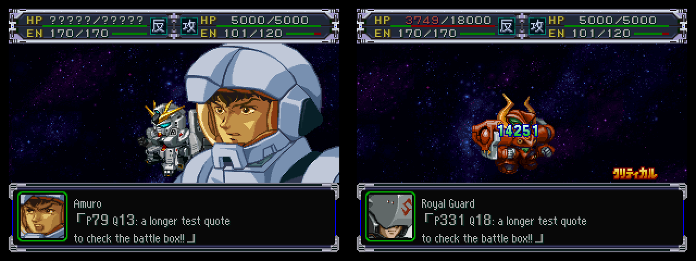

# BATTLE/BXCLIST.BIN: frases de combate

Estado: **formato decodificado por completo** (análisis estático, 2026-09-27). Herramienta: `tools/src/bxclist.py`
(`dump`, `build`, `selftest`). Volcado: `dump/bxclist.jsonl` (18.128 frases).

Fuentes de la verdad:
1. **Datos**: los 470 bloques se parsean byte a byte con aserciones estrictas (ver "Validación").
2. **Código**: el overlay de batalla `OVL/BTL_GRP.BIN` (se carga en `0x8011308c`; la base sale de `ovl_base.py`
   y la confirman los `jal` internos) contiene el parser de la cabecera y los selectores de frase. Las funciones
   se leyeron desensamblando a mano (no hay objdump MIPS en la máquina; se usó un desensamblador mínimo en Python).

| Función (RAM) | Qué hace |
|---|---|
| `0x8011d44c` | lee los primeros 0x4000 bytes del archivo (la tabla de offsets) a un buffer compartido `0x80121d54` (buf[0] = LBA) |
| `0x80120b68` / `0x80120bd0` | lee el bloque del piloto: tamaño = `offset[id+1] - offset[id]`, **buffer con malloc de ese tamaño** (`0x80014220`), lectura por byte-offset (`0x8001db50`) |
| `0x80120dc0` | parsea la cabecera del bloque a un contexto de 156 bytes (dos contextos: atacante y defensor) |
| `0x80121620` | elige la frase de **ataque** |
| `0x80121934` | elige la frase de **defensa** (situación 0-9) |
| `0x801212b8` | interpreta una entrada de arma `[modo, a, b, c]` |
| `0x801211f8` | decodifica una "entrada" u16 y elige una alternativa al azar |
| `0x80121574` | decodifica un byte de situación (`índice<<2 | cantidad`) y elige al azar |
| `0x80121104` | arma la lista de mensajes: texto, hablante, expresión, id de frase |

## Archivo

| Offset | Contenido |
|---|---|
| `0x0000` | `u32 offset[2048]` absolutos. Índice = **id de piloto** (`UNITPRAM/PILOT.BIN`). Usados: 0..469 (contiguos); resto `0xCDCDCDCD` |
| `0x2000` | bloques uno tras otro, en orden de id, alineados a 4 |

- El juego calcula el tamaño de un bloque como `offset[id+1] - offset[id]` → los bloques tienen que quedar
  contiguos y en orden (el `build` lo respeta).
- 129 bloques miden 28 bytes en cero (pilotos sin frases: cabecera vacía, el registro por defecto cae sobre
  la cabecera y no produce frase). El bloque 469 mide 0 bytes (su offset = fin de archivo; `offset[470]` es
  `0xCDCDCDCD`, el piloto 469 nunca pide frases).
- 340 bloques con frases, pero solo **291 distintos** (p. ej. 17/18, 29/30, 97/98, 226/227 y los pares de los
  protagonistas originales 259/261/262, 263/265/266…). Útil para no traducir dos veces.

## Bloque

Todo little-endian. Offsets relativos al **inicio del bloque**.

### Cabecera (0x1C bytes)

| Off | Tipo | Campo (contexto) | Significado |
|---|---|---|---|
| +0 | u8 | nW | grupos de frases de ataque (tabla W) |
| +1 | u8 | nX | armas (tabla X; también el ancho de cada registro R) |
| +2 | u8 | lo: nU · hi: nE | frases de ataque por **unidad propia** / contra **unidad enemiga** |
| +3 | u8 | lo: nR · hi: nP | tablas de armas alternativas por **copiloto** / frases contra **piloto enemigo** |
| +4 | u8 | nS | grupos de frases de defensa (tabla S) |
| +5 | u8 | lo: barrera · hi: piloto propio | cantidad de registros de defensa de cada tipo |
| +6 | u8 | lo: unidad propia · hi: unidad enemiga | ídem |
| +7 | u8 | lo: copiloto · hi: piloto enemigo | ídem |
| +8 | u32 | A | registros de defensa + tabla S |
| +0xC | u32 | B | `u32` por frase |
| +0x10 | u32 | C | `u16` hablante/expresión por frase |
| +0x14 | u32 | D | `u16` offset de texto por frase |
| +0x18 | u32 | E | área de textos |

### Parte de ataque (desde +0x1C hasta A, en este orden; confirmado en `0x80120dc0`)

| Tabla | Tamaño | Formato |
|---|---|---|
| W | nW × 2 (+2 de relleno en 0 si nW impar) | u16 "entrada" (ver abajo) |
| X | nX × 4 | `[modo, a, b, c]`: a/b/c = índice en W, `0xFF` = nada. X[k] = arma k de la unidad |
| R | nR × (4 + 4·nX) | `u16 id copiloto, u16 0xFFFF` + una tabla X completa alternativa |
| P | nP × 4 | `u16 id piloto enemigo, u16 entrada` |
| U | nU × 4 | `u16 id unidad propia, u16 entrada` |
| E | nE × 4 | `u16 id unidad enemiga, u16 entrada` |

**Entrada u16** (`0x801211f8`): bits 0-8 = primera frase, bits 9-12 = cantidad de alternativas, bits 13-15 =
frases por alternativa. El juego elige una alternativa al azar y muestra sus frases seguidas (así se arman los
diálogos piloto/copiloto: Show y Cham, Uso y Haro, Kouji y Sayaka…). Vistas: 1 (16.656 frases), 2 (1.352),
3 (114) y 6 (6) frases por alternativa.

**Modo de X** (`0x801212b8`):

| Modo | Cuántas | Comportamiento |
|---|---|---|
| 0 | 2.374 | atacando: W[a]; contraatacando: W[b] (si b=FF, W[a]); después se agrega W[c] (grito con el nombre del arma). Con c≠FF hay 1/8 de probabilidad de decir solo W[c] |
| 1 | 20 | W[a], W[b], W[c] en secuencia (ataques en dos tiempos: "Getter Shine" → "Shine Spark", SRX) |
| 2 | 0 | los bytes 2-3 son una entrada u16 directa (el código lo soporta; no se usa) |
| 3 | 8 | 50 %: W[a]; 50 %: W[b] + W[c] (Uso/Haro). Si c=FF lee W[-1] = bytes 26-27 de la cabecera = 0 → nada |
| 0xFF | 14 | sin frase (entrada entera `FFFFFFFF`) |

**Selección de ataque** (`0x80121620`): primero busca coincidencias en P (clave = piloto enemigo), U (unidad
propia) y E (unidad enemiga); si hay alguna, 3/4 de probabilidad de usar una de ellas al azar. Si no, y el arma
existe en X: si el piloto lleva copiloto (slots +6/+8 del combatiente) con registro R, usa la tabla X de ese R;
si no, la X por defecto. Arma ≥ nX → usa X[0].

### Parte de defensa (desde A)

Registros de 12 bytes: `u16 clave` + 10 bytes, uno por **situación**. Cada byte = `(índice en S << 2) | cantidad`
(cantidad 0-3 entradas consecutivas de S; el juego elige una al azar y dentro de ella una alternativa).
Orden en el archivo y clave con la que se compara (`0x80120dc0` / `0x80121934`):

| # | Registro | Cantidad en | Clave comparada | Visto |
|---|---|---|---|---|
| 0 | por defecto (clave 0) | siempre 1 | — | 340 |
| 1 | unidad propia | b6 lo | unidad propia (+10 del combatiente) | Ramba en Gouf: "¡La Gouf no es una Zaku!" |
| 2 | unidad enemiga | b6 hi | unidad enemiga (+10) | Gorgon contra Mazinger Z |
| 3 | copiloto | b7 lo | copiloto 1 (+6) y copiloto 2 (+8) | hadas de Show, tripulación de Combattler/Dancouga |
| 4 | piloto enemigo | b7 hi | piloto enemigo (+4) | Hamon contra Amuro |
| 5 | piloto propio | b5 hi | piloto propio (+4) | nunca usado |
| 6 | barrera | b5 lo | campo +12 del combatiente | claves 0 AT Field, 1 aura barrier, 5 campo TK, 6 inertial canceller, 7-9 barreras antihaz |

Toma el primer registro de cada tipo cuya casilla de esa situación no sea 0; si juntó alguno, 3/4 de
probabilidad de usar uno al azar; si no, el registro por defecto. Luego viene **S**: nS × u16 entrada
(+2 de relleno en 0 si nS impar).

**Situaciones** (índice del byte). Los nombres salen del contenido de las frases, no del código:

| Byte | Situación | Ejemplo |
|---|---|---|
| 0 | derribado | 「ちっ、ここまでか……」 |
| 1 | daño grave | 「くっ、パワーダウンかよぉ!」 |
| 2 | daño medio | 「くぅっ! 意外とやるじゃないの!」 |
| 3 | daño leve / sin daño | 「大したことないぜ!」 |
| 4 | esquiva | 「当ったるかよ!!」 |
| 5 | ataque anulado (barrera/blindaje) | 「効かんよ!」, 「対ビーム対策は万全ってね!」 |
| 6 | no puede contraatacar | 「しまった、反撃できない!」 |
| 7 | atacado desde fuera de su alcance | 「ちっ! 射程距離外からの攻撃か!」 |
| 8 | defensa con escudo | 「シールドッ!」, 「ダイターンファン!」 |
| 9 | imagen residual (esquiva especial) | 「ゲッタービジョン!!」, 「マッハスペシャル!!」 |

### Tablas por frase (n = (C − B) / 4)

| Tabla | Formato |
|---|---|
| B | n × u32: id global de frase. Mismo id ⇒ siempre el mismo texto (8.974 ids, 0 conflictos); un texto puede tener varios ids. Se copia a la estructura del mensaje; uso desconocido |
| C | n × u16: bits 0-9 = **id del piloto que habla** (el juego busca cuál de los 3 slots de piloto del combatiente es, para mostrar su retrato), bits 10-12 = **expresión** (0-5 vistas). +2 bytes en 0 si n impar |
| D | n × u16: offset del texto desde E. +`FFFF` si n impar |
| E | textos Shift-JIS terminados en NUL, **contiguos y en el orden de D**; relleno con `*` (0x2A) hasta múltiplo de 4 |

Los rangos de frases de W, P, U, E y S (en ese orden) cubren 0..n−1 sin huecos ni solapamientos. Como los textos
son lo último del bloque y solo D apunta a ellos, **alargar una frase solo exige rehacer D, los textos y la tabla
de offsets del archivo**; A..E no cambian.

### Textos

- 18.128 frases (7.155 distintas), 401.701 bytes de texto con NUL.
- Máximo 84 bytes por frase y **49 bytes por línea**. 502 frases tienen salto manual: `" \n　"` (espacio ASCII,
  0x0A, espacio de ancho completo como sangría).
- ASCII dentro del japonés: `!` (26.000), espacio 0x20 (4.404), `?`, dígitos y siglas (`G`, `O`, `Z`, `V2`…).
- `dump` agrega hablante (`speaker`, `speaker_name`, `expr`) y contexto (`grupo`, `tipo`, `alt`, `linea`,
  `lineas`, `usos` = armas/papel o registros/situación, `clave`).

## Herramienta

```
work/.venv/bin/python work/tools/src/bxclist.py selftest
work/.venv/bin/python work/tools/src/bxclist.py dump                  # → work/dump/bxclist.jsonl
work/.venv/bin/python work/tools/src/bxclist.py build entrada.jsonl salida.BIN
```

- `build` toma los textos sin traducir del archivo original (no recodifica el japonés, así que no hay pérdidas
  cp932) y codifica el inglés con espacio → `0xA0` y `\n` → `0x0A`. Vuelve a parsear el resultado y avisa si
  algún bloque supera el más grande del original (6.676 bytes).
- Identificación de una frase: `(pilot, idx)`.

## Validación (2026-09-27)

- `parse` exige, en los 470 bloques: offsets A..E iguales a los calculados, rellenos exactos (0 / `FFFF` / `*`),
  `FFFF` en el segundo u16 de cada R, clave 0 en el registro por defecto, textos contiguos, cobertura exacta de
  las n frases por W/P/U/E/S, índices de X/R < nW y bytes de situación dentro de S. **Pasa sin excepciones.**
- Toda frase de W y S está referenciada por alguna arma o registro (0 huérfanas).
- `selftest`: reconstrucción sin cambios **idéntica** (602.908 bytes); rearmado forzado de cada bloque desde
  sus partes también idéntico; prueba de estrés reemplazando **las 18.128 frases** por textos más largos
  (archivo de 864.556 bytes, bloque mayor 11.212) → se vuelve a parsear con cabeceras intactas y textos correctos.
- `dump` → `build` sin traducciones → archivo idéntico (`cmp`).

Correcciones a notas anteriores: son 18.128 frases (no 18.127), hay saltos de línea (502) y el máximo es 84
bytes por frase (49 por línea).

## Preguntas abiertas / sin verificar

1. **Memoria**: el bloque se lee a un buffer de `malloc` del tamaño exacto, así que no hay tope fijo en el
   formato, pero se cargan dos bloques a la vez (atacante y defensor) en el heap de batalla. No se sabe cuánto
   margen hay: probar en emulador con los bloques más grandes (149 Show, 150, 154-160) después de traducir.
2. ~~**Ancho de la ventana**~~ ✅ 2026-09-28 (#31, `tools/ancho_test.sh bx`, todas las frases = regla de dígitos,
   ruta CP04): **2 renglones × 240 px**. El juego agrega `「` al principio y `」` al final (12 px c/u, como en
   DEADMESS): `「` + 28 dígitos (236 px) entra, 29 no. Más ancho: parte solo por carácter; el 3.er renglón se dibuja
   **debajo de la caja**. `check_text.py` reserva los corchetes (una frase de un renglón: 240 − 24 px).
3. ~~**Espacios**~~ ✅ 2026-09-28 (#31): 0x20 sí se dibuja, pero con **8 px fijos** (igual que los dígitos): en inglés
   deja huecos enormes. 0xA0 = espacio del VWF (3 px). No es un fallo: el japonés usa 0x20 como relleno de ancho fijo.
4. **Nombres de las situaciones** 0-9: deducidos del texto, no del código que llama a `0x80121934`
   (no se rastreó quién pasa el número de situación).
5. **Campo +12 del combatiente** (clave de los registros "barrera"): se infiere que es la barrera/defensa que
   anuló el ataque por el contenido (AT Field, aura barrier, campo TK…). Falta confirmar en el código de combate.
6. **Ids de unidad**: las claves de U/E/registros de unidad coinciden con los índices de `ROBOT.RAF`
   (`dump/robot.jsonl`) en todos los casos revisados (Gouf, Big Zam, V2, Getter, Mazinger, Dancouga, Epyon), pero
   no se verificó la correspondencia completa.
7. **u32 de la tabla B** (id global de frase): se guarda en la estructura del mensaje, uso desconocido
   (¿historial, "ya dicha"?). Se conserva tal cual.
8. **Expresión** (bits 10-12 de C): se asume índice de cara del retrato; no se comprobó qué cara es cada valor.
9. **Nombres de PILOT.BIN** en los ids de los protagonistas originales (259-290) no coinciden con quien habla
   (p. ej. bloque 262 "Amuro" = frases de Brooklyn, 286 "(無人)"): son ids alternativos de los protagonistas
   seleccionables. El `speaker_name` del volcado es más fiable que `pilot_name` en ese rango.


## Prueba en el juego (2026-09-27) ✅


ISO `build/bx_test`: **las 18.128 frases** reemplazadas por inglés de 2 líneas, más largo que el original (archivo 1,2 MB,
bloque mayor 15.164 bytes = 2,3 × el máximo original), + PILOT.BIN con nombres en inglés. Repitiendo la grabación CP04
(Amuro vs. guardia): las frases se ven en dos líneas, el combate termina y vuelve al mapa. **La memoria dinámica alcanza**
(pregunta abierta 1, cerrada al menos para estos bloques; los mayores —Show, 149— sin probar todavía).
