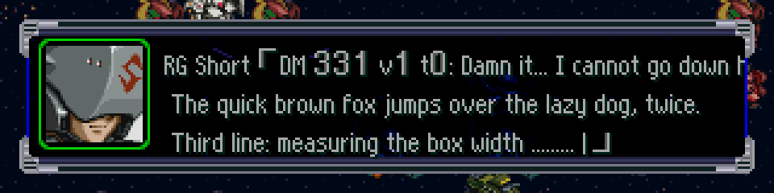
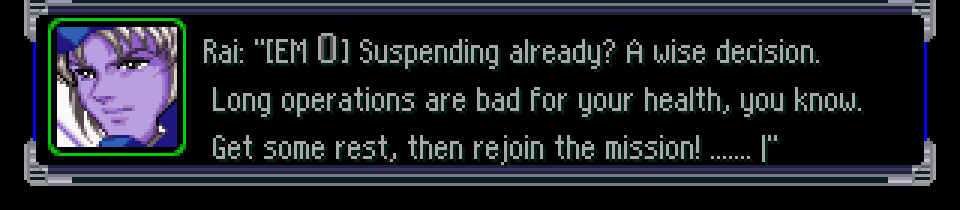

# DEADMESS.BIN y EM.BIN (SNMAP) — 2026-09-27

**Resuelto por análisis estático (sin emulador): extracción y reinserción, con texto más largo que el japonés
hasta llenar el slot fijo.** Herramienta: `tools/src/deadmess_em.py`
(`dump` → `dump/deadmess.jsonl` + `dump/em.jsonl`; `build deadmess|em entrada.jsonl salida.BIN`; `selftest`).
**Todavía no probado en el juego.**

Ninguno de los dos archivos tiene punteros ni compresión: son slots de tamaño fijo con SJIS terminado en NUL.

## DEADMESS.BIN — frases al ser derribado (262.208 bytes)

| Offset | Tamaño | Contenido |
|---|---|---|
| `0x0000` | 64 | bitmap de 512 bits, **LSB primero**: bit `j` = el piloto `j` tiene frase |
| `0x0040` | 1024 × 256 | slots; `slot = 2·piloto + variante` (2 variantes por piloto) |

Slot de 256 bytes: `u32 tipo` + 252 bytes de texto SJIS terminado en NUL, relleno con `00`.

- **Clave = ID de piloto** de `UNITPRAM/PILOT.BIN` (verificado con los nombres: 0 Slegger Lau, 1 Gihren, 2 Kycilia,
  4 M'Quve, 79 Amuro, 130 Heero…). La tabla tiene lugar para 512 pilotos; PILOT.BIN tiene 469; el último con frase es el 460.
- **Bitmap verificado**: coincide 512/512 con "el par de slots tiene texto". 272 pilotos con frase → 544 slots con
  texto (219 textos distintos); 480 slots vacíos (todo en cero, incluido el `u32`).
- **Variantes**: 266 pilotos repiten el mismo texto en las dos. Solo difieren 6: Elpeo Ple (62), Puru Two (63), Heero (130),
  Duo (132), Trowa (134), Quatre (136). *Sin verificar* cómo elige el juego la variante (¿azar? ¿ruta/escenario?).
- **`u32 tipo`**: valores 0 (156 slots), 1 (16), 2 (356), 3 (8), 4 (4), 5 (4). *Sin verificar*. Hipótesis: expresión del
  retrato (1 = Kyara Soon riéndose; 5 = Rosamia "空が…落ちる…！", Kaworu). No hace falta tocarlo para traducir.
- **Basura después del NUL** en 4 slots (126, 216, 260, 268): restos de textos anteriores. Se conserva al reconstruir sin
  cambios; al reemplazar un texto el slot se rellena con ceros. Por eso el par del piloto 108 (Connie) difiere en bytes
  aunque el texto sea igual.
- Texto: 1–3 renglones (384 de 1, 130 de 2, 30 de 3), máximo 42 bytes por renglón (21 caracteres de ancho completo),
  88 bytes en total. Los renglones 2 y 3 empiezan con espacio de ancho completo `　` (sangría bajo el nombre).
  Sin variables `$` ni glifos σ/ρ.

## EM.BIN — mensajes al suspender la partida (85.264 bytes)

"EM" = probablemente *End Message*: los personajes comentan que el jugador interrumpe la partida (中断) y se despiden
(Ryusei promociona *Super Hero Sakusen* y la *Complete Box*, Koji "¡Mazin Go!", Noriko "¡Inazuma Kick!").

| Offset | Tamaño | Contenido |
|---|---|---|
| `0x0000` | 30 × 264 | 30 registros fijos |
| `0x1EF0` | 77.344 | TIM 8 bpp con CLUT de 256, 320×240 (CLUT en VRAM 512,496; imagen en 512,256) |

Registro de 264 bytes: `u16 a · u16 b · u16 piloto · u16 flag` + 256 bytes de texto SJIS con NUL, relleno con `00`.

- **Validación**: los 30 registros se recorren exactos; el TIM empieza justo en `30·264 = 0x1EF0` y sus dos bloques
  (CLUT `0x20C` + imagen `0x12C0C`) terminan exactamente en el final del archivo. No hay basura después de los NUL.
- **`piloto`** = ID de PILOT.BIN (verificado: 292 Rai, 235 Noriko, 236 Kazumi, 311 Hitsukarald, 305 Shu, 303 Masaki,
  291 Ryusei, 293 Aya, 130 Heero, 177 Koji, 173 Banjo, 304 Ryune, 227 Shinji, 57 Scirocco). El nombre del hablante **también
  va dentro del texto** (`ライ「…」`), así que en inglés hay que traducirlo ahí (formato a decidir: `Rai: "…"` o similar).
- **`flag`** (0/1; 1 en Shu, Ryusei, Koji, Scirocco): *sin verificar*.
- **`b`**: agrupa registros consecutivos de una misma "escena" (Noriko–Kazumi–Noriko comparten 75; Ryusei ×6 = 57).
  Hipótesis *sin verificar*: número de BGM (Masaki 1, Shu 2, Ryune 3 — el orden típico de los temas originales en SRW;
  Noriko y Kazumi comparten el tema de Gunbuster). También podría ser un ID de grupo.
- **`a`**: *desconocido* (valores 320..9189 sin patrón visible; no es índice de SNMSG comprobado).
- 13 escenas: Rai (1), Noriko/Kazumi (3), Hitsukarald (3), Shu (1), Masaki (1), Ryusei (6), Aya (2), Heero (2),
  Koji (2), Banjo (2), Ryune (3), Shinji (2), Scirocco (2). La cantidad (30) no está en el archivo → fija en el código.
- Texto: 1–3 renglones, máx. 56 bytes por renglón, 136 bytes en total. Mezcla **ASCII de 1 byte** (`?` ×14, `!` ×23,
  espacio `0x20` ×15) con SJIS: la fuente de esta pantalla ya acepta ASCII (el inglés igual usará `0xA0` para el espacio,
  como en el resto; *sin verificar* que esta pantalla use la misma fuente/VWF que el mapa).
- El TIM es solo el fondo (robots SD en un círculo, ver `img/em_tim.png`): **no tiene texto**, no hay que editarlo.

## Reinserción

- Los dos archivos son de tamaño fijo y sin punteros; se supone que el ejecutable calcula la posición del slot
  (`0x40 + id·512 + var·256` y `i·264`) — *sin verificar en el código* (el nombre de los archivos aparece en la tabla de
  archivos del EXE `SLPS_026.36` y de `OVL/COMM_GRP.BIN`, no se trazó el código que los lee).
- Espacio por texto: **DEADMESS 251 bytes + NUL**, **EM 255 bytes + NUL** (el japonés usa como máximo 88 y 136).
  En la práctica el límite real será el ancho/alto de la ventana, no el slot.
- Agrandar los slots exigiría parchear el código → no hace falta.
- `build` reemplaza solo los textos con `"en"` no vacío; el resto (bitmap, `u32 tipo`, cabeceras de EM, TIM, basura)
  queda idéntico. En DEADMESS, si una variante sin traducir tiene el mismo japonés que su par (`same_as_other_variant`),
  usa la traducción del par. Texto demasiado largo → `ValueError` con el slot y el largo.
- Codificación inglesa: `script_bin.encode_en` (espacio → `0xA0`, `\n` → `0x0A`).

## Evidencia (`deadmess_em.py selftest`)
```
deadmess: 262208 bytes, 544 textos · reconstrucción idéntica: True · textos de 251 bytes: releídos True, cabeceras True, resto True · texto demasiado largo rechazado: True
em: 85264 bytes, 30 textos · reconstrucción idéntica: True · textos de 255 bytes: releídos True, cabeceras True, resto True · texto demasiado largo rechazado: True
OK
```
Además, prueba de `build` con el slot 0 traducido: cambia solo el texto de los slots 0 y 1 (el 1 por el par idéntico).

## Prueba en el juego — DEADMESS (2026-09-28) ✅


ISO de prueba (`tools/src/mk_deadem_test.py`): EXE con VWF + fuente inglesa, **los 512 bits del bitmap en 1** y los
1024 slots con 3 renglones ingleses `DM <piloto> v<variante> t<tipo>: …`; `PILOT.BIN` con el piloto 331 (親衛隊兵) como
completo "Royal Guard Full" / corto "RG Short". Grabación CP04 (Amuro vs. guardia, esc. 64) con las armas del
ν Gundam HWS a potencia 30.000 **en RAM** (`POKE` de `redux_drive.lua`, desde el cuadro 3600: tocar `ROBOT.RAF`
desfasa la grabación). El guardia explota y, de vuelta en el mapa, sale la frase:

- **Dónde**: ventana de mensajes del mapa (retrato + 3 renglones de 240 px), después de la animación de combate. Espera ○.
- **Formato que arma el juego**: `nombre_corto「texto」` — el **nombre corto de PILOT.BIN (+0x29)** y los corchetes los
  agrega el código (`「%s」` en `BTL_GRP` `0x80113124`, única referencia en `0x80116CA0`, junto a la rutina del hablante
  de batalla). El texto de DEADMESS **no** lleva nombre ni corchetes.
- **Anchos**: renglón 1 = 240 − nombre corto − 12 (`「`); último renglón = 240 − 12 (`」`); los del medio 240. Un renglón
  que no entra **se corta** (no hay salto automático). Renglón 2 de 222 px con un espacio de sangría: entra.
  `check_text.py` ya lo aplica (reserva por piloto con `dump/pilot.jsonl`, `short_en` si existe).
- **Bitmap**: el juego lo consulta (el guardia no tenía frase en el original y con el bit en 1 la muestra).
- **Variante**: salió la **v1** del piloto 331 (tipo 0). Con una sola prueba no se sabe si es azar.
- Para traducir: sin sangría japonesa `　` en los renglones 2–3 (un espacio `0xA0` se ve bien); los corchetes 「」
  quedan (el código los pone); si se quisiera `Name: "…"` habría que cambiar `「%s」` (6 bytes + NUL) en BTL_GRP y
  verificar que no lo use otra ventana: las frases de batalla (BXCLIST) **también** reciben 「」 del juego (medido en #31,
  `bxclist.md` pregunta 2), así que es probable que compartan este string.

## Prueba en el juego — EM (2026-09-28) ✅


Misma ISO y partida: después del derribo, ○ en una casilla vacía → menú del mapa (ターン終了 / 精神検索 / 部隊表 /
反撃命令 / 作戦目的 / システム / **セーブ**) → セーブ → 「システムファイルを上書きします。よろしいですか？」 (cursor en いいえ:
↑ y ○) → 「セーブ中です…」 → 「ｾｰﾌﾞが終了しました｡ ｹﾞｰﾑを続けますか?」 (¿seguir jugando?; cursor en はい, ↑ pasa a いいえ) **いいえ** → **pantalla EM** (fondo TIM de robots SD +
ventana de mensajes). Pasados ~12 s (≈700 cuadros, sin tocar nada) el juego vuelve solo al logo de Banpresto.

- **Ventana**: la misma del mapa, retrato (campo `piloto`, acá Rai) + **3 renglones de 240 px**. Los tres renglones
  de prueba (214 / 220 / 192 px) entran; la fuente es la VWF.
- **El nombre va dentro del texto** (`Rai: "…"`): el juego no agrega nombre ni corchetes (a diferencia de DEADMESS).
  Usar el formato de diálogo de la guía (`Nombre: texto`).
- Salió el registro 0 (Rai, escena de un solo registro). Con una sola prueba no se sabe cómo elige la escena.
- `check_text.py`: `em` = 3 × 240 px (antes el ancho era desconocido).
- Recorrido reproducible: **`work/tools/deadem_test.sh dm|em`** (arma la ISO y repite CP04 + `POKE` + `INPUTS`;
  verificado de punta a punta 2026-09-28). Cuadros: ○ 7860, ○ en casilla vacía 8340, ↓×6 desde 8460, ○ 8680, ↑ 8780, ○ 8840,
  ↑ 9500, ○ 9560, EM visible 9780–10500.

## Preguntas abiertas
1. ~~Prueba en el juego de DEADMESS y EM~~ ✅ (arriba).
2. ~~Ventanas~~ ✅: las dos usan la caja del mapa (3 × 240 px).
3. Cómo se elige la variante de DEADMESS; significado de `tipo`, y en EM de `a`, `b`, `flag`.
4. Cómo elige el juego qué escena de EM mostrar (¿azar entre las 13?) y dónde está codificada la cantidad 30.

## Prueba con el texto real (#28, 2026-09-28) ✅


`BUILD=build/<nombre> tools/deadem_test.sh dm|em` arma la ISO con **todos** los reemplazos del build (manifiesto) y copia
una frase real (por defecto el slot 398, Garuda, 3 renglones) al piloto 331 (`tools/src/mk_deadem_real.py`). Resultado:
la frase entra completa (`Imp. Guard「Curses, curses! / I, the Great General Garuda, / shall repay this debt without
fail!!」`) y EM mostró la escena de Ryusei (registros 11 y 12; la escena cambia entre corridas → parece azar).

**Trampa encontrada:** el `POKE` de las pruebas CP04 escribía en `0x801417DC` fijo. Desde #57 (tabla de objetos de texto
0x300 → 0x500) el heap reserva 0x200 × 0x1C = **0x3800 bytes más** y todo lo que se aloja después queda **0x3800 más
abajo** (registro del ν Gundam HWS: `0x8013DFD8`, medido con volcados de RAM). Con la dirección vieja el guardia
sobrevivía (HP 8499), había subida de nivel por el daño y no salía ninguna frase. Ahora la dirección la calcula
`hws_poke` en `env.sh` a partir de `TEXT_OBJS` de `patches/vwf.asm` (la usan `deadem_test.sh`, `menus_test.sh`,
`names_test.sh`). Regla: **cualquier dirección fija del heap cambia si se toca `TEXT_OBJS`**.

## Corchetes 「」 quitados (2026-10-04)
- **Frases de batalla (BXCLIST)**: el `「%s」` de `BTL_GRP` `0x80113124` pasó a `%s` (`translation/menus_en.jsonl`, `menus_map.txt`). El nombre ya iba
  en su propio renglón. Comprobado en emulador (build `srwa_integrado_2_v03`).
- **DEADMESS**: los corchetes NO salen de ese string sino de `SNMP_GRP` +0x5B0 (`「`) y +0x5B4 (`」`) (único uso: código SNMP +0xDC10/+0xDC2C).
  `layout_patch.py` los cambia por `": "` (colon + 0xA0) y `""` → `Nombre: frase`. Comprobado en emulador. Corrige la nota de arriba
  ("única referencia en BTL_GRP").
- `check_text.py`: BXCLIST sin reserva (240 px de línea completa); DEADMESS reserva nombre + `": "` en el renglón 1 y nada al final.
