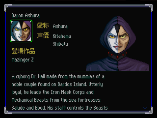
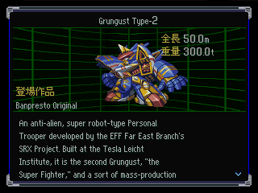

# Diccionarios de personajes y robots (DC / DR) — traducción JP→EN

Encargo 05 (`work/cloud_tasks/05_diccionarios.md`). Estado: **las 801 fichas traducidas**, ninguna necesita más filas que el original.

## 1. Archivos

| Archivo | Qué es |
|---|---|
| `work/translation/dc_en.jsonl` | 351 registros de personajes (id 0 = índice de nombres, id 350 vacío). Mismo `id`, `size` y `fields` que `work/dump/dc.jsonl`, más `en`. |
| `work/translation/dr_en.jsonl` | 450 registros de robots (id 0 = índice, id 449 vacío). Ídem. |
| `work/translation/dict_src/*.txt` | **Fuente editable** de la traducción (un párrafo por línea). Lo que se revise se corrige acá, no en el JSONL. |
| `work/tools/src/dict_build.py` | Regenera los dos JSONL: `python3 work/tools/src/dict_build.py dc dr`. Imprime los problemas (desbordes, campos largos, no-ASCII, series sin mapear, nombres del índice sin traducir). |

Formato de `dict_src`: `#id Nombre | Corto | Seiyuu` (dc) o `#id Nombre` (dr); debajo, un párrafo por línea. Altura, peso y serie salen solos del JSONL japonés (la serie, de la tabla `SERIES` del script).

## 2. Estructura de salida

- `en` es **paralelo a `fields`**: `en[i]` traduce `fields[i]`. Las filas de biografía/descripción (offset ≥156 en dc, ≥180 en dr) se re-fluyen a **≤46 caracteres ASCII**; si sobran slots quedan como `""`.
- `flags: ["paragraphs_merged"]` (36 fichas): para entrar en las filas del original se fundieron uno o más saltos de párrafo (el script quita primero el que más filas ahorra). Es informativo, no un error.
- `en_overflow`: previsto para filas que no entran. **No hay ninguno**: todas las fichas caben en el número de filas japonés.
- **id 0 (índice)**: cada nombre del índice se empareja con la ficha de mismo nombre JP (normalizando `=`/`＝`, `-`/`ー` y furigana). En dr el índice tiene 443 nombres para 448 fichas: SRX, R-1, R-2, R-3 y GR2 no tienen campo de nombre (offset 0 ausente) ni entrada en el índice; su nombre inglés figura solo en `dict_src` como referencia.
- Altura/peso (dr): se copian del japonés. Conversiones: `メット`→`met`, `ルフトン`→`rufton` (unidades de Byston Well), `1800万t`→`18,000,000t` (y 億/万 en general), `～`→`+`, `ｔ`→`t`; errata `17.4mm` (Tallgeese II) → `17.4m`.

### Layout del registro (confirmado 2026-09-28, #15)
Confirmado en las 349 fichas de DC y las 448 de DR: tamaño descomprimido = base + cantidad × 48, sin excepciones.

| | DC (personaje) | DR (robot) |
|---|---|---|
| +0x00 | nombre (48) | nombre (48) |
| +0x30 | nombre corto (20) | altura (32) |
| +0x44 / +0x50 | serie (64) | peso (32) |
| +0x84 / +0x70 | seiyuu (**20**) | serie (64) |
| u32 cantidad de líneas | +0x98 | +0xB0 |
| líneas de 48 bytes desde | +0x9C | +0xB4 |

- Campos de cabecera: texto, NUL, relleno `0xCD`. Líneas: texto, **NUL NUL**, relleno `0xCD` (una línea de DR ocupa
  los 48 bytes sin terminador). Índice (id 0): casilleros de 48 bytes (texto, NUL, `0xCD`…, NUL en el byte 47).
- **Topes reales** (`option_dict.LAYOUT`, los usa `check_text.py`): nombre ≤47, corto ≤19, serie ≤63, **seiyuu ≤19**
  (antes se suponía 23: entre el seiyuu y la primera línea está el u32 de cantidad), altura/peso ≤31, línea ≤46,
  índice ≤46. Las series que en JP llevan `\n` conservan el salto en inglés (dos líneas).
- En `dict_src` un salto dentro de un campo de cabecera se escribe `\n` (escape). Ashura (DC 208, dos seiyuus) quedó
  `Kitahama\nShibata` (16 bytes): antes la segunda línea `H. Shibata` se leía como párrafo y corría la biografía.

### Reempaquetado (`option_dict.py build dc|dr JSONL SALIDA`, etapas `dc`/`dr` del pipeline)
Parte del registro japonés, escribe la cabecera en su lugar y las líneas desde la base; **baja la cantidad de líneas**
a la última línea inglesa no vacía (el registro se acorta). Ficha sin cambios → se copia el bloque comprimido original,
así que la build sin inglés da el archivo original byte a byte (`option_dict.py selftest`, también en `build.sh
--selftest`). Offsets del contenedor alineados a 4 como el original.

### Prueba en el juego ✅ (2026-09-28, `tools/dict_test.sh cue dir dc|dr`)
Título → OPTION (overlay SNDM) → キャラクター事典 / ロボット大図鑑, con la card CP12 (3 fichas de personajes y 6 de
robots desbloqueadas). Lista (índice, id 0), cabecera, serie, seiyuu en 2 líneas (Ashura), biografía con scroll y
fichas acortadas (G Hawk: 4 líneas, sin flecha) se ven bien. La biografía se re-fluye a **46 columnas** (el tope de
bytes): 46 letras ≈ 210 px de los ~270 de la caja; con eso bajan de 82 a 36 las fichas con párrafos fundidos.

 

Siguen en japonés los rótulos del overlay SNDM (愛称, 声優, 登場作品, 全長, 重量, 収録率, キャラクター事典…): van con el
borrador de los menús restantes (#11).

## 3. Convenciones de estilo

- Nombres: `glossary.csv` + `manual.csv` + `decisiones.csv`, con las correcciones de la guía §6 y las excepciones de §5 de esta nota. Armas: `weapons_en.csv` (Tenkuken, Chodenji Ball, Dankuu Sword, Keito Shungoku-ken, G-Sword Diver, High Familiar, Tenjo Tenka Muteki-ken…).
- Sin honoríficos (guía §1.1); rangos en inglés (Lt., Capt., Ens.; en prosa "Rank: lieutenant").
- Tercera persona, presente o pasado según el JP; tono de ficha oficial (manual/enciclopedia), conciso. Para entrar en 44×N se condensó redundancia (no se inventó información); algunos títulos de episodio largos se redujeron a "episode N" (Getter Robo, Voltes V, Mazinger).
- Términos fijos: 強化人間 = **Cyber-Newtype**; 地球連邦軍 = **EFF** (Earth Federation Forces) en fichas SRX / "Federation" en las de Gundam; 極東支部 = Far East Branch; 念動力 = telekinesis; 念動フィールド = T-LINK Field; ＥＯＴ = EOT (Extra-Over Technology); 獣戦機 = beast machine; 獣士 = beast fighter; 機械獣 = Mechanical Beast; 戦闘獣 = Warrior Beast; メカザウルス = Mechasaurus; 使徒 = Angel; Nerv = NERV; 地上人 = surface dweller; 聖戦士 = Holy Warrior; ガウォーク = GERWALK.
- Notas "meta" del original (referencias a los CD *Original Score*, a SRW EX, bromas del redactor) se conservan: son parte del tono de los diccionarios de Banpresto.

## 4. Series (tabla `SERIES` del script)

Títulos oficiales en inglés; donde el glosario difiere:

| JP | EN usado | Nota |
|---|---|---|
| 新機動戦記ガンダムＷ | Mobile Suit Gundam Wing | glosario: *New Mobile Report…* (traducción literal); el título comercial oficial es *Mobile Suit Gundam Wing*. |
| 超時空要塞マクロス 愛・おぼえていますか | Macross: Do You Remember Love? / Super Dimension Fortress Macross: Do You Remember Love? | la versión corta donde no hay `\n`. |
| 魔装機神 THE LORD OF ELEMENTAL | Masou Kishin: The Lord of Elemental | título Atlus. |
| 超獣機神ダンクーガ | Super Beast Machine God Dancouga | **DUDOSO** (ver §6). |
| 超機大戦ＳＲＸ | Super War Machine SRX | sin título oficial; se sigue el glosario. |
| オリジナル | Banpresto Original | |
| トップをねらえ！ | Aim for the Top! Gunbuster | |

## 5. Desvíos respecto de `glossary.csv` (proponer pasar a `manual`)

| Glosario | Usado | Motivo |
|---|---|---|
| Hikaru Ichijou, Hyouma Aoi, Kozo Fuyutski, Claudia Lasalle | Hikaru Ichijo, Hyoma Aoi, Kozo Fuyutsuki, Claudia LaSalle | guía §6 |
| Shahkti Kareen, Maheria Meril, Cony Francis, Cronicle Asher | Shakti Kareen, Mahalia Merrill, Connie Francis, Chronicle Asher | grafía oficial de Victory Gundam |
| Kouichirou Ohta | Koichiro Ohta | Hepburn / subtítulos oficiales |
| Nagisa Kaworu, Keel Lorentz | Kaworu Nagisa, Keel Lorenz | orden/grafía oficial Eva |
| Chuujou Choukan | Chief Chujo | guía §1.2 |
| Vrlitwhai Kridanik, Exsedol Folmo, Quamzin Kravshera, Milia Farina Jenius | Vrlitwhai 7018, Exsedol 4970, Quamzin 03350, Milia Fallyna Jenius | el JP usa la numeración del film (ブリタイ７０１８…); Fallyna es la grafía oficial |
| Grunguest Kai, Jupitoris, Dogosse Giar, Byalant, Recarl, Bosan Saucer, Reinforce Junior | Grungust Kai, Jupitris, Dogos Gear, Byarlant, Ricarl, Boazan Saucer, Reinforce Jr. | erratas / grafía oficial |
| Bruga | Bluegar | ブルーガー; "Bruga" parece error de romanización |
| RX-7 Gazelle | RX-7 Giselle | ジゼル = Giselle |
| ~~Giant Sharkin~~ | Giant Sharkin | 2026-09-28 (#40): se unificó al revés, *Prince Sharkin* / *Giant Sharkin* |
| Uchuu Kaijuu … | Space Monster Soldier/Fast/Lander/Mixed/Fusion | guía §6 y `manual.csv` |
| Gundam Mk-II (AUEG/Titans), Jagd Doga (Gyunei), etc. | nombre sin sufijo | el diccionario JP repite el nombre sin distinguir; la ficha lo aclara |

## 6. Dudas abiertas

1. **Seiyuus con lectura no verificada** (abierta: issue #44): 佐脇君枝 *Kimie Sawaki* (Lila, Illia), 門間葉月 *Hazuki Kadoma* (Chara), 逢坂秀実 *Hidemi Aisaka* (Tod), 江川菜子 *Nako Egawa* (Rei Asuka), 紗ゆり *Yuri Sha* (Lady Une). 山田義χ (Chuck Keith; `χ` es un glifo propio del juego) = 山田義晴 **Yoshiharu Yamada**, verificado. 野島健児 figura como voz de Hikaru: se transcribió tal cual.
2. ~~**EFF vs. EFA**~~ ✅ 2026-09-28 (#44, ronda 1): **EFF** en todo, también en las fichas SRX (en Alpha es una sola organización).
3. ~~**Nombres mantenidos del glosario pero dudosos**~~ ✅ 2026-09-28 (#44, rondas 1 y 2 de `INVESTIGACION_NOMBRES.md`: *Hermodr* confirmado, *Taiso*, *Shokatsuryo Komei*, *Do Zuhl*, *Todd Guinness*, *Prince Sharkin*, *Da/Nyet*…; los que siguen sin fuente verificable, p. ej. *Will Wips* y *Katherine Rii*, están en el issue #54). Lista original: *Hermodr* (la guía §5 propone *Helmoz*), *Do Zuhl*, *Rii Katherine*, *Grawl* (ゲラール), *Neet*/*Dar* (juego ruso *nyet*/*da*), *Will-Wips*, *Gyre-Garing*, *Tod Guines*, *Prince Shakin*, *Koumei Shokatsuryou*, *Taisou*, *Go Gakujin*, *Miia*, *Ropett*, *Zugal*, *Pikudron*, *Mikeros*, *Oberius*.
4. ~~**Unidades de Dunbine** `met` / `rufton`~~ ✅ 2026-09-28 (#44, ronda 2): *met* / **lufton** (coherente con *Luft*).
5. ~~**縮退砲** de Granzon → *Graviton Collapse Cannon*~~ ✅ 2026-09-28 (#47): ficha DR 447 unificada con el glosario (*Degeneration Cannon*; arma `試作型縮退砲` = *Prototype Degeneration Cannon*, decisión del mantenedor 2026-09-27 en `weapons_review.csv`). `dict_build.py` ahora avisa (`arma?`) si una ficha cita un arma del glosario con otro nombre; se corrigieron 8 más: *Null Magne Ray* (DC 225/DR 240), *Torment Blade* (DR 001), *68cm cannon* (DR 030), *Feyadeen Rifle* (DR 062), *Dragon Fang* ×3 (DR 165; oficial en gundam-official.com), *Giacobini Meteor Attack* (DR 290), *Unstoppable Supreme Sword* / *Unstoppable TK Burst Slash* (DR 420). Menciones descriptivas aceptadas: `WEAPON_OK`.
6. ~~**Series**~~ ✅ 2026-09-28 (#44): se mantienen *Dancouga* y *Brave Raideen* (Media Blasters usó *Dancougar – Super Beast Machine God*; Discotek, *Reideen the Brave*).
7. ~~Límites de bytes de §2 y ancho real de la pantalla~~ ✅ 2026-09-28 (#15): layout confirmado con `option_dict.py build` y probado en el juego (`tools/dict_test.sh`); biografías a 46 columnas.
