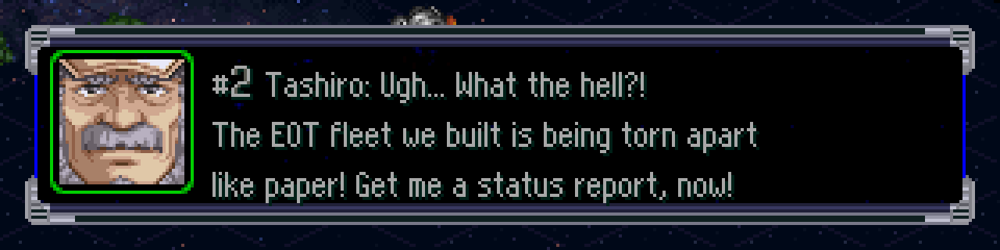
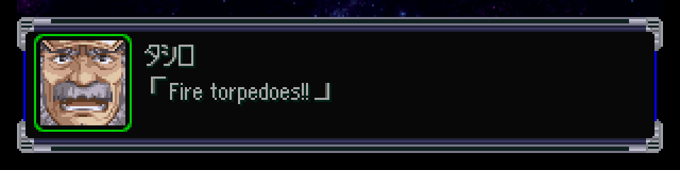

# Fuente inglesa + VWF: evaluación de riesgos y resultado — 2026-09-27



## Resultado
- Fuente nueva de 1 px de trazo + sombra diagonal, **~55 caracteres por línea** (antes 30).
  *"The EOT fleet we built is being torn apart"* (42 caracteres) ocupa 175 de 240 px.
- Probada en el juego: diálogo de mapa (prólogo), menús de intermisión (unidades, pilotos) y escena de intermisión.

## Archivos
| Archivo | Qué es |
|---|---|
| `work/font/en_8px.txt` | **Fuente editable**: cada glifo como dibujo de texto (`#` = tinta). `keep` = conservar el glifo original; `adv=N` = forzar el avance. |
| `work/tools/src/font_build.py` | Inserta los glifos en `8FONT_R.TIM` **y** en la copia de `WINTEX.BIN` (entrada 0), genera `patches/vwf_table.bin` y la vista previa `notes/img/font_preview.png`. |
| `work/patches/vwf.asm` | Parche VWF del EXE (incluye la tabla). |
| `work/tools/src/snmsg.py` | Convierte los espacios del inglés a `0xA0` y valida el ancho con la tabla real. |

```bash
cd work && source tools/env.sh
PYTHONPATH=tools/src $SRW_PY tools/src/font_build.py     # fuente + tabla + preview
armips patches/vwf.asm                                    # EXE con VWF → build/exe/SLPS_026.36
$SRW_PY tools/src/build_iso.py build/x.bin SLPS_026.36=build/exe/SLPS_026.36 \
  FONTWIN/8FONT_R.TIM=build/font/8FONT_R.TIM FONTWIN/WINTEX.BIN=build/font/WINTEX.BIN SNMAP/SNMSG.BIN=...
```

## Decisiones de diseño
- **La fuente del cuadro de diálogo sale de `FONTWIN/WINTEX.BIN`** (entrada 0, un TIM idéntico en tamaño a `8FONT_R.TIM` con 486 bytes distintos). Modificar solo `8FONT_R.TIM` no cambia lo que se ve: hay que modificar las dos.
- Mapeo byte → celda (`FUN_8001885C`): índice = byte − 0x20 (en bytes ≥ 0xA0, − 0x40); celda en la columna 16 + (índice & 15), fila índice >> 4. El ASCII ocupa la mitad derecha, filas 0–5.
- **`0x20` conserva el glifo original y 8 px; los dígitos `0–9` (2026-10-03) están redibujados** (5×8 px, trazo de 1 px, como las mayúsculas) **con `adv=8`**: el glifo japonés medía 11 px de alto con trazo doble y sobresalía del texto. El avance fijo de 8 px mantiene las columnas de los menús (R3). Probado: armas, HP/EN, nivel, Will/Hit %, intermisión (`emu/shots/digitos_v01`).
- **El espacio del texto inglés es el byte `0xA0`** (3 px, celda vacía). El expansor de variables y el maquetador lo tratan como byte simple. `0x7F` no sirve: el expansor lo toma como primer byte de un carácter doble.
- Colores: tinta = índice 1 de la CLUT, sombra = índice 3 (como el original).

## Evaluación de riesgos
| # | Riesgo | Estado | Evidencia |
|---|---|---|---|
| R1 | La zona de la tabla (`0x80059480`) la usa el juego | ✅ **Cerrado** (boot → título → carga → intermisión → escena) | Análisis estático: cero accesos. La zona vecina es una CLUT de 16 colores (32 bytes en `0x80059400`) + relleno hasta una textura en `0x80059600`. Dinámico con breakpoints persistentes: solo la escribe la BIOS durante el boot (limpieza de RAM y carga del EXE por DMA). La tabla está en el segmento de texto del EXE, y el EXE no declara `bss`. |
| R2 | Batallas o intermisiones usan otra rutina de texto | ✅ **Cerrado: intermisiones y batallas usan la misma rutina** | Breakpoint de ejecución en `FUN_80018CC4`: recibe cada línea de la escena ("ラオデキヤ「ゼントラーディ軍の…"). En batalla (prólogo, 2026-09-27) la frase "「光子魚雷、発射!!」" entra por `FUN_80018B74` → `FUN_80018CC4` desde el código de batalla (`ra=0x80116ccc`); también la lista de armas, la vista previa y el ON/OFF de animación. **Ojo:** el nombre del hablante en batalla (`ra=0x80116c7c`) pasa por `B74` pero no por `CC4` (otro camino de dibujo): verificar con nombres en inglés. |
| R3 | El VWF desalinea menús | ✅ **Resuelto** con `keep` en `0x20` y dígitos | Capturas original vs. parcheado de intermisión y listas de unidades y pilotos: números alineados igual. |
| R4 | Rediseño de fuente | ✅ Hecho | Mismo tamaño de TIM; solo cambian las celdas ASCII. |

### Pendientes
- **Batallas**: ✅ R1 y R2 cerrados y texto inglés verificado en pantalla (ver sección "Batalla" abajo).
- Las letras ASCII de la interfaz (`SP`, `EN`, rangos de terreno) se ven con el trazo nuevo: cosmético, se resuelve al traducir la interfaz.
- Ajustes finos de la fuente (kerning de `r`, `f`, `t`; legibilidad de `rn`/`m`) cuando haya texto real.

## Batalla (2026-09-27, server1)


- **Ruta automatizada** a la primera batalla del prólogo: `tools/battle_prologue.sh <cue> <dir> [state|fresh]`. En modo `fresh` bootea desde cero (necesario para probar parches al EXE); llega al combate en ~13.000 cuadros (~4 min en dynarec).
- **ISO de prueba** `build/poc_battle`: VWF + fuente + SNMSG PoC + `BXCLIST.BIN` con 10 frases de Tashiro (bloque 238) reemplazadas **en el lugar** (inglés ≤ largo original, relleno con NUL, espacios `0xA0`). Se ve "「Fire torpedoes!!」" correcto, con ancho variable.
- **R2**: la frase de batalla entra por `FUN_80018B74` → `FUN_80018CC4` (`ra=0x80116ccc`), igual que la lista de armas, la vista previa y el ON/OFF de animación.
- **R1**: tabla de anchos (`0x80059480`, 256 bytes) y código VWF (`0x80018F30`) **idénticos** en volcados de RAM antes, durante (2 momentos) y después del combate. No descarta una escritura temporal que se restaure sola (improbable; el texto se dibuja bien).
- **Pendiente**: el **nombre del hablante** en batalla ("タシロ", `ra=0x80116c7c`) pasa por `B74` pero no por `CC4`: se dibuja por otro camino y sale de `PILOT.BIN` (kana de medio ancho). Hay que probarlo con nombres en inglés.

## Lecciones nuevas sobre PCSX-Redux (corrigen `vwf_investigacion.md`)
- **El valor que devuelve el callback de `addBreakpoint` decide si el breakpoint sigue: `true` = se mantiene, `false` = se elimina.** Con `false`, cada breakpoint se disparaba una sola vez. Eso invalidó las conclusiones "se ejecutó una vez" y "nada escribe la tabla" de la primera investigación; se repitieron las pruebas.
- Los listeners de eventos (`createEventListener`) también deben quedar referenciados (en una global) o el GC los elimina.
- Los save states **nuevos** hacen caer al emulador al cargarlos (`rc=139`); el viejo `poc_prologue.sstate` sí carga. No lo resolví: las pruebas bootean desde cero (`CARD=emu/states/card_1714.mcd` para la intermisión, `FRESH_CARD=1` para el prólogo).
- `-interpreter -debugger` quedaba persistido en `pcsx.json`; `drive.sh` lo restaura al terminar.
- **El intérprete cambia la temporización**: una ruta de botones que funciona en dynarec se desfasa con `-interpreter` (en la batalla terminó en el menú de 反撃命令). Para breakpoints sobre una ruta larga, usar volcados de RAM en dynarec (`DUMP_RAM="f1:ruta;f2:ruta"`) o un checkpoint de memory card cerca del punto.
- **No editar `drive.sh` mientras corre**: bash lo lee a medida que avanza y el final (restaurar `pcsx.json`, convertir capturas) puede no ejecutarse.
- Botones: CIRCLE confirma (CROSS no avanza el diálogo; sobre el mapa abre la ventana de info). Los menús ignoran confirmaciones muy pegadas: espaciar ≥ 90 cuadros y mantener 8. `PCSX.CONSTS.PAD.BUTTON` no tiene L3/R3.
