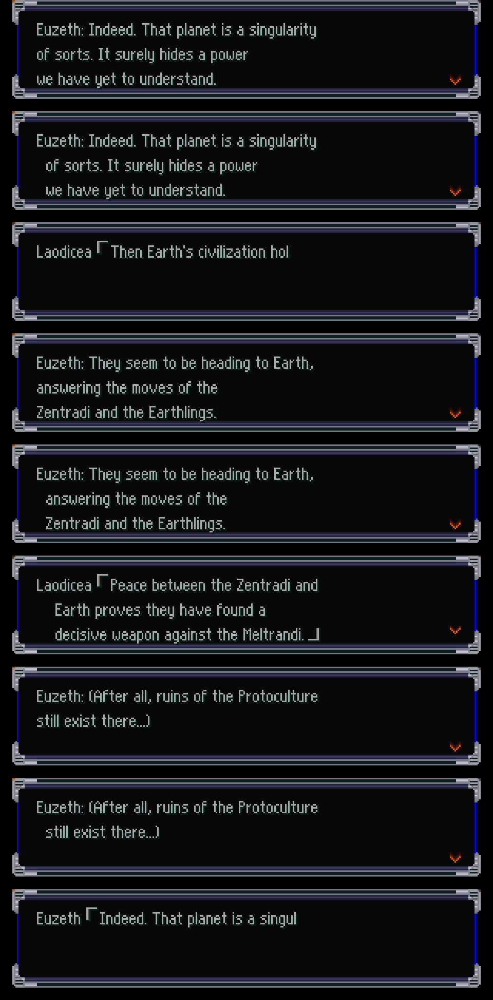
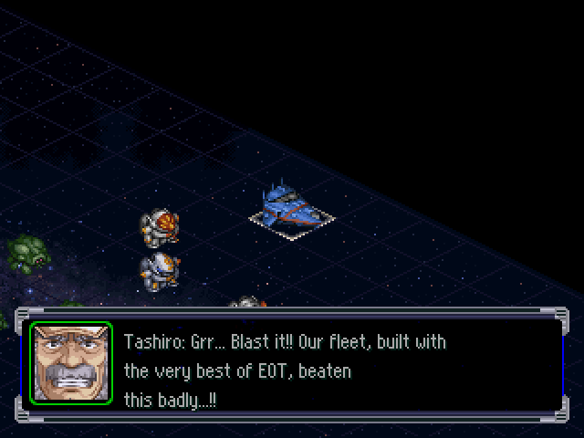

# Guía de voz y estilo de personajes (JP→EN) — v1, 2026-09-27

Guía para traductores de *Super Robot Taisen Alpha*. Complementa el glosario canónico (`work/glossary/glossary.csv`, ver `glosario.md`) y la tabla de hablantes `work/glossary/speakers.csv` (85 filas: variables, 8 protagonistas y 74 personajes).

**Fuentes y método.** Se contaron los hablantes de `work/dump/script.jsonl` (intermisiones, `Nombre「…」` o `Nombre（…）`) y del campo `speaker` de `work/dump/snmsg.jsonl` (diálogo de mapa). Para cada uno se midieron pronombres, finales de frase y formas de trato (`〜さん`, `〜君`, rangos…), y se leyeron muestras al azar. Todas las líneas japonesas de esta guía están en los dumps (acá aparecen sin los saltos `\n` ni la sangría `　`). Las traducciones al inglés son **propuestas de estilo**, no texto final: el ancho de la caja manda (§1.7).

Nombres en inglés: los de `glossary.csv` (`en_final`), salvo donde §6 señala un error del glosario.

---

## 1. Reglas generales

### 1.1 Honoríficos — política recomendada: **quitarlos**

| Opción | Pros | Contras |
|---|---|---|
| **A. Quitar honoríficos y expresar el trato con el inglés** (nombre de pila vs. apellido, rango, tono) | Es lo que hacen las localizaciones oficiales de SRW (OG, T, 30) y la mayoría de las oficiales de las series (Gundam, Macross, Eva de Netflix/ADV en doblaje). Ahorra ancho en una caja de 240 px. Un solo criterio para 70+ personajes. | Se pierden matices (`甲児君` vs `甲児`); hay que compensarlos con el tono. |
| B. Conservarlos todos (`-san`, `-kun`) | Máxima fidelidad | Choca con la terminología OG que pide `CLAUDE.md` §6; cuesta 20–30 px por línea; mezcla rara con rangos en inglés. |
| C. Mixto a criterio de cada traductor | — | Inconsistencia garantizada. |

**Recomendación: A**, con estas reglas:

- `〜さん`, `〜君/くん`, `〜ちゃん`, `〜殿` → **nombre solo**. La distancia se marca con la elección de nombre: **apellido** = trato distante o formal (Misa llama `一条君` → *"Ichijo"*), **nombre de pila** = cercanía. Cuando el japonés cambia de trato en la trama (Misa pasa a `輝さん`), el inglés también cambia (*"Hikaru"*): es un momento de guion.
- `〜様` a la realeza/superiores → título inglés: `シーラ様` *Queen Ciela*, `エレ様` *Princess Ele*, `ミネバ様` *Lady Mineva*, `ラオデキヤ様` *Lord Laodicea*.
- Rangos y cargos (`大尉`, `艦長`, `博士`, `司令`…) → título inglés antepuesto (§1.2).
- Parentesco → inglés: `父さん` *Father* (Shinji, Kenichi; "Dad" solo si el tono es muy casual), `お父様` *Father*, `お兄様` *Brother* (Relena), `お兄ちゃん` *big brother* (Ple).
- **Excepciones que se conservan** por ser parte de la identidad o de la trama:
  - `お姉様` de Noriko a Kazumi → **"Onee-sama"** (término asentado en el fandom y en los subtítulos oficiales de Gunbuster; es un vínculo de la historia).
  - `先輩` de Maya a Ritsuko → **"Senpai"** (✅ decidido 2026-09-28 (ronda 2), G04; el doblaje de ADV también lo conservaba).
  - Apodos: `リュウ` (Aya a Ryusei) *Ryu*, `ミスター` (apodo de Chikara Jinguji en Raideen) *Mister*, `ボス` *Boss*, `コーチ` *Coach*, `委員長` *Class Rep*.
  - Epítetos (✅ decidido 2026-09-28 (ronda 2)): `赤い彗星` *the Red Comet*, `青き巨星` *the Blue Giant*, `連邦の白い奴` *the Federation's white mobile suit* (*"the White Devil"* es `白い悪魔`).
- `先輩` → nombre (*Roy*) o rango si es formal; la única excepción es Maya → Ritsuko (*Senpai*, arriba).
- `貴様`/`てめえ` no tienen honorífico que quitar: se traducen con tono ("you bastard", "you!") según el personaje.

### 1.2 Rangos y cargos

Esquema **decidido** (✅ decidido 2026-09-28 (ronda 2): tabla completa; estilo ejército de EE. UU., que es el de las fichas oficiales de SRW en inglés). **Abreviaturas** para líneas justas: *Lt.*, *Capt.*, *Cmdr.*, *Maj.*, *Col.*, *Gen.*; las series con nomenclatura oficial propia la conservan.

| JP | EN (tratamiento) | Notas |
|---|---|---|
| 少尉 | Ensign | ✅ decidido 2026-09-28 (F01): Gundam oficial y OG (*Ensign Ryusei*). |
| 中尉 | Lieutenant (*Lt.*) | ✅ decidido 2026-09-28 (F02). Eva: no aplica. |
| 大尉 | Captain (*Capt.*) | ✅ decidido 2026-09-28 (mantenedor): *Captain Amuro*. Igual en todas las series: Quattro, Aya, Bernard y *Captain Burning* (0083, sin excepción naval). |
| 少佐 | Major | ✅ decidido 2026-09-28 (F04): Ingram, Focker, Gato. |
| 中佐 | Commander (*Cmdr.*) | ✅ decidido 2026-09-28 (mantenedor), como la localización oficial de Gundam: si se nombra su **rango**, *Cmdr. Bright*; si se lo llama por su **puesto** al mando de la nave (艦長), *Captain Bright*. |
| 大佐 / 准将 | Colonel / Brigadier General | Blex 准将 → *General Blex*. |
| 艦長 | Captain | Siempre *Captain X* (Captain Global, Captain Bright, Captain Henken). |
| 提督 | Admiral | Tashiro. |
| 一尉 / 三佐 (Nerv) | Captain / Major | ✅ decidido 2026-09-28 (ronda 2) (F08): nomenclatura oficial de Eva (Captain Katsuragi → Major Katsuragi). |
| 司令 / 副司令 (Nerv) | Commander / Sub-Commander | ✅ decidido 2026-09-28 (ronda 2) (F08): Commander Ikari, Sub-Commander Fuyutsuki (oficial). |
| 副長 | Vice Captain (corta *XO*) | ✅ decidido 2026-09-28 (ronda 2) (F09): Gunbuster y el resto; *XO* solo donde no hay lugar (operador del puente). |
| 長官 | según el personaje | ✅ decidido 2026-09-28 (F06): 岡防衛長官 *General Oka*, 中条長官 *Chief Chujo*, イゴール長官 *Commander Igor*; si no, *Director*. |
| 博士 / 教授 | Dr. / Professor | *Dr. Shirakawa*, *Professor Yumi*. |
| 所長 | Director | 兜所長 (Kenzo Kabuto). |
| 閣下 | Your Excellency / Lord | Ante Jamitov, Gihren, Dozle. |
| 特佐 (OZ) | Special Lieutenant | ✅ decidido 2026-09-28 (ronda 2) (F07): Zechs ("ゼクス=マーキス特佐"); en el trato, *Lieutenant Zechs*. |

### 1.3 Formato del diálogo: `「」`, `（）`, `『』`

El nombre del hablante va **dentro del texto** (`タシロ「…」`); el retrato sale de otro dato (`poc_snmsg.md`). El campo `en` de los JSONL lleva la línea completa, con nombre.

| Opción | Ejemplo | Ancho | Comentario |
|---|---|---|---|
| **A. `Nombre: texto`** | `Koji: Mazin, Go!!` | el más barato | Convención de muchos parches fan de SRW. Pensamientos: `Koji: (…)`. |
| B. Conservar `「」` | `Koji「Mazin, Go!!」` | +24 px por línea (dos glifos de 12 px) | Se ve "japonés"; sirve para las frases de batalla (ver abajo). |
| C. Comillas ASCII | `Koji: "Mazin, Go!!"` | +8–10 px | Redundante con los dos puntos. |

**Decisión: A** (`Nombre: texto`), **probada en el emulador el 2026-09-28** (#23; `tools/formato_test.sh`):
escena de intermisión (SCRIPT, escenario 62, 27 líneas) y diálogo del mapa (SNMSG, prólogo, 29 slots). El motor **no
depende del `「`**: el retrato que se ilumina, la cámara del mapa, el avance y el ajuste de renglón son iguales con
`Nombre: texto`. `$n` sirve como hablante (`$n: Yes...`) y dentro de la frase (`$n's`). Con sangría de 2 espacios
(variante A2) no se lee mejor y gasta ancho: **sin sangría**. `check_text.py` controla el formato (aviso `speaker`).

Reglas:

- Líneas 2 y 3: en japonés empiezan con `　` (sangría bajo el `「`). En inglés, **sin sangría** (o un solo espacio angosto si la prueba muestra que se lee mejor).
- `Nombre（…）` = **pensamiento/monólogo interno** → `Nombre: (texto)`. No son susurros: son pensamientos.
- `『』` = cita, nombre propio de algo, o rótulo de menú en los tutoriales (`『移動』を選択`) → comillas dobles ASCII: *Select "Move"*. Los rótulos de menú deben coincidir **exactamente** con la categoría `ui` del glosario.
- Frases de batalla (`BXCLIST.BIN`): no llevan nombre; la PoC `build/poc_battle` usa `「Fire torpedoes!!」` y se ve bien. Ahí **conservar `「」`**.
- Nombre del hablante en inglés: la forma corta de `speakers.csv` (*Koji*, *Ryusei*, *Rai*, *Irm*, *Quattro*), nunca el nombre completo.

### 1.4 Signos y glifos especiales

| JP | Uso | EN |
|---|---|---|
| `σ` | Glifo propio de una sola celda = **"!?"** (1.872 en SCRIPT; SNMSG escribe `！？`, 5.823) | `!?` (siempre en ese orden, convención SRW) |
| `ρ` | Glifo propio = **"!!"** (869 en SCRIPT; SNMSG escribe `！！`, 3.906) | `!!` |
| `！！`, `！？` | Igual que arriba | `!!`, `!?` |
| `…`, `……` | Pausa. Las líneas `「………」` (8.364) son silencios o reacciones | `...` Silencio: `Koji: ...`; pensamiento mudo: `Koji: (...)` |
| `な、何だ` | Tartamudeo por sorpresa | `Wh-What!?` (repetir la primera consonante, con guion) |
| `くっそぉぉぉ！！`, `ちきしょおおおっ` | Grito alargado | Alargar con moderación: `Damn iiit!!` / `Damn it all!!` |
| `ッ` al final (`〜ですかッ！？`) | Corte brusco, énfasis | Signos de exclamación, no se transcribe |
| `～` (`ふわ～あ`) | Vocal arrastrada | `Yaaawn...` |
| `ﾔﾟ`, `ﾚﾟ` (medio ancho + ﾟ) | Glifos "MK" y "II" | Escribir `Mk-II` en ASCII (ver `vwf_investigacion.md`) |

**Ojo:** el campo `chs` usa `σ`/`ρ` con otro criterio (a veces `ρ` = un solo `！`). Tomar el significado del japonés, nunca del chino.

### 1.5 Variables del protagonista y la pareja

| Var. | Dónde | Qué es (según `vwf_investigacion.md` y el contexto) |
|---|---|---|
| `$n` | SCRIPT y SNMSG | Nombre (de pila) del **protagonista**. También como hablante. |
| `$N` | SNMSG (5.128) y SCRIPT (51) | Nombre de la **pareja**. En SNMSG también es hablante (1.432 líneas). |
| `$l` | SCRIPT (3.851) | Pareja en SCRIPT: hablante (`$l「…」`) y en el texto (`$l君`). |
| `$L` | SCRIPT (11) | Probablemente nombre completo de la pareja ("$Lと言ったか"). **A confirmar.** |
| `$m` | SCRIPT (2) | Probablemente apellido del protagonista (`$m君` en boca de Blex y Kirk). **A confirmar.** |
| `$f` / `$F` | SNMSG (50 / 66) | Nombre completo (o nombre + sufijo) del protagonista / de la pareja (Levi: "リュウセイ＝ダテと $f"). |

Reglas:

1. **No tocar el token**: ni traducirlo, ni partirlo, ni pegarle letras (`$n's` sí; `$nの` → `$n's`).
2. `$n君` / `$nさん` / `$N君` → `$n` / `$N` (política §1.1).
3. **Género**: en los bloques de 8 variantes (§3) el género es conocido: `$n` variantes 1–4 = varón, 5–8 = mujer; la pareja (`$l`/`$N`) es del género opuesto. **Fuera de esos bloques** (líneas de otros personajes que hablan *del* protagonista), el género no se conoce: **evitar he/she/him/her** y reestructurar con el nombre, "you" o "they".
4. Largo (decidido, `nombres_protagonistas.md`): el apodo (`$n`/`$N`/`$l`) tiene **8 letras como máximo** y el validador le reserva 48 px; `$f`/`$F`/`$L` (nombre completo, hasta 20 bytes) reservan 120 px → ponerlos **en su propio renglón**, como el japonés. Apodos por defecto: Bullet, Yuu, Ryoto, Tasuku, Rio, Leona, Kusuha, Carla. No poner dos variables en la misma línea si se puede evitar.

### 1.6 Dialectos y hablas marcadas

- **Kansai** (Toji `ワシ…や`, Juzo Naniwa de Combattler V): inglés coloquial y rudo, de barrio. **Sin caricatura fonética** ni dialecto regional estadounidense concreto.
- **Kyushu/Hakata** (Daisaku Nishikawa: `〜たい`, `〜とね`, `〜なか`): inglés campechano, cordial ("Well, ain't that somethin'"), con moderación.
- **Habla arcaica/regia** (Heinel `余…申す…わきまえよ`, Laodicea `余…汝`): dicción elevada ("Silence!", "Know your place!", "We shall see…"), **sin** *thee/thou*.
- **Viejos** (Tashiro `ワシ…〜おる`): gruñón, anticuado, frases hechas de marino.
- **Muletillas cómicas** (Boss `〜だわさ`, `〜わよん`): elegir **una** muletilla inglesa fija y usarla siempre (propuesta: rematar con *"…see!"* / *"…ya hear!"*). Registrarla en `speakers.csv` cuando se decida.

### 1.7 Espacio

Diálogo de mapa y de escena: **3 líneas de 240 px** (con VWF, ~34–36 caracteres por línea); lo que sobra se corta sin aviso. `snmsg.py build` valida líneas, píxeles y bytes. Ver `poc_snmsg.md` y `vwf_investigacion.md`. Frases de batalla: ≤ 49 bytes, una línea. Si no entra: primero recortar relleno, después simplificar; **nunca** sacrificar el nombre de un ataque o de una unidad.

---

## 2. Frases recurrentes (combate y escena)

Las más repetidas del juego (conteo en SCRIPT+SNMSG). Fijarlas para que suenen igual en todas partes:

| JP | Veces | EN propuesto | Nota |
|---|---:|---|---|
| `………` | 8.364 | `...` | Silencio o reacción. |
| `！` / `！！` / `！？` | 797 / 283 / 214 | `!` / `!!` / `!?` | Reacción muda de sorpresa. |
| `はい` / `…はい` | 153 / 123 | `Yes.` / `...Yes.` | Con superiores: `Yes, sir/ma'am.` si el registro es militar. |
| `了解！` / `了解です` / `了解しました` | 121 / 68 / 36 | `Roger!` / `Roger that.` / `Understood.` | Pilotos y operadores: `Roger`. |
| `わかりました` | 103 | `Understood.` / `All right.` | Según registro. |
| `何だと！？` | 78 | `What!?` | Varón, enfado. |
| `何だって！？` | 37 | `What did you say!?` | Incredulidad. |
| `何ですって！？` | 34 | `What!?` / `What did you say!?` | Mujer. |
| `くっ…！` | 42 | `Ngh...!` / `Tch...!` | Dolor/frustración. |
| `そ、そんな…` | 33 | `N-No...` / `That can't be...` | |
| `ええ…` / `ああ…` | 70 / 38 | `Yeah...` / `Yes...` | `ええ` = femenino/formal; `ああ` = masculino casual. |
| `こ、これは！？` | 21 | `Wh-What is this!?` | |
| `グルンガスト弐式、起動！` | 28 | `Grungust Type-2, activate!` | Nombre OG oficial. |
| `敵襲` / `敵機接近` | — | `Enemy attack!` / `Enemy units approaching!` | |
| `出撃する！` | — | `Launching!` / `Sortie!` | "Sortie" es el término de menú OG. |
| `撤退する` | — | `Retreat!` / `We're pulling out!` | Frase de retirada enemiga. |

Tutoriales (`『移動』`, `『攻撃』`, `ＥＮ`, `気力`): usar **exactamente** los rótulos `ui` del glosario (*Move*, *Attack*, *EN*, *Will*).

---

## 3. Los protagonistas Banpresto (8 variantes)

**Corrección 2026-09-28** (`traduccion/referencia/protagonistas.md`): el jugador no elige un personaje fijo sino **cara (→ género) y personalidad (4 tipos: 真面目で正義感が強い / 冷静沈着で頭脳明晰 / 内気で心優しい / 陽気で楽天家)**, más nombre, cumpleaños, sangre y tipo; los 8 de abajo son los **preajustes** (género × personalidad) y la variante k corresponde a esa combinación. La pareja sigue el emparejamiento fijo de la tabla. Cada vez que habla el protagonista (`$n`) el juego trae **8 variantes consecutivas** de la misma línea (914 bloques de 8 en SCRIPT y 596 en SNMSG, más bloques de 16/24/32 = varias líneas seguidas). Las líneas de la pareja (`$l` en SCRIPT, `$N` en SNMSG) también vienen en bloques de 8.

**Correspondencia variante → personaje** (✅ **confirmada en el emulador 2026-09-29**, #34: decide la personalidad elegida + el género de la cara; la pareja es fija y su personalidad no se puede cambiar):

| Var. | Protagonista (preajuste · personalidad) | Pareja (variante de `$l`/`$N`) | Pronombre | Pistas en el texto |
|---:|---|---|---|---|
| 1 | Brooklyn "Bullet" Luckfield · ♂ serio y justiciero | Kusuha (7) | 俺 | "Mis apuntes están en inglés" (es estadounidense); kendo |
| 2 | Yuuki Jaggar · ♂ frío y brillante | Carla (8) | 俺 | Té en taza de porcelana; tono frío |
| 3 | Ryoto Hikawa · ♂ tímido y bondadoso | Rio (5) | 僕 | Dojo de karate familiar; tímido |
| 4 | Tasuku Shinguji · ♂ alegre y optimista | Leona (6) | 俺 | "Los exámenes se ganan a ojo" (jugador); mirar chicas en malla |
| 5 | Rio Mei Long · ♀ seria y justiciera | Ryoto (3) | 私 | "Como delegada de clase…"; criada en ciudad lunar; `$l君` |
| 6 | Leona Garstein · ♀ fría y brillante | Tasuku (4) | 私 | `〜かしら`; montaba a caballo en la playa |
| 7 | Kusuha Mizuha · ♀ tímida y bondadosa | Bullet (1) | 私 | Tímida; llama `$l君` a Bullet |
| 8 | Ricarla "Carla" Borgnine · ♀ alegre y optimista | Yuuki (2) | あたし | Musicales, trajes de baño; `君` a Yuuki |

Regla clave: **las 8 variantes son strings distintos: traducir cada una con su voz**, no copiar la misma frase ocho veces. El japonés ya las diferencia; el inglés tiene que diferenciarlas igual o más.

Ejemplo completo (script 1, escena del examen):

| Var. | JP | EN propuesto |
|---:|---|---|
| 1 Bullet | 俺のノート、英語で書いてあるけど、それでいいか？ | My notes are in English. That work for you? |
| 2 Yuuki | それはお前のためにならないな… | That won't do you any good. |
| 3 Ryoto | …それじゃ、君のためにならないと思うけど… | Um... I don't think that'd really help you... |
| 4 Tasuku | 何言ってんだ。試験なんてのはなあ、山勘で勝負するもんだ | What're you talking about? Tests are all about lucky guesses, man. |
| 5 Rio | ダメよ。学級委員として、そういうことは認められないわ | No way. As class rep, I can't allow that. |
| 6 Leona | 別に構わないけど…結果は同じじゃないかしら？ | I don't mind... but won't the result be the same? |
| 7 Kusuha | …それじゃ、兜君のためにならないと思うよ | ...I don't think that would help you, Koji. |
| 8 Carla | ごめん、あたしも誰かにノート借りようと思ってたんだ | Sorry! I was gonna borrow someone's notes too! |

Otro bloque (declaración a la pareja):

| Var. | JP | EN propuesto |
|---:|---|---|
| 1 | それに…俺はもう決めたんだ。月並みな言葉だけど…何があってもお前の傍にいるとな | Besides... I've made up my mind. It's a cliché, but... I'm staying by your side, no matter what. |
| 2 | それに…俺はもう決意した。ありがちな台詞だが…何があってもお前の傍にいると | Besides, I've decided. A trite line, perhaps... but I will stay by your side, whatever happens. |
| 3 | それに…僕はもう決めたんだ。何があっても君の傍にいるって | And... I've decided. I'll stay with you, no matter what. |
| 4 | それに…俺はもう決めたぜ。クサイ台詞だけど…何があってもお前の傍にいるってな | Plus, I've made up my mind. Corny, I know... but I'm sticking by you, whatever happens. |
| 5 | それに…私はもう決めたの。何があっても…あなたの傍にいる…いえ、いたいの | Besides... I've decided. No matter what, I'll stay by your side... No—I *want* to. |
| 6 | それに…私はもう決めたわ。何があっても…あなたの傍にいるって | Besides, I've decided. I will stay by your side, no matter what. |
| 7 | それに…私はもう決めたの。何があっても…あなたの傍にいるって… | And... I've decided. No matter what... I'll be by your side... |
| 8 | それに、あたし、もう決めたんだ。何があっても君の傍から離れないってね | Besides, I've made up my mind! I'm not leaving your side, no matter what! |

Voz de cada uno en inglés:

- **Bullet (1)** — apasionado, directo, deportista. Contracciones, exclamaciones, "Let's go!", "Leave it to me!". Nada de jerga pesada: es el héroe sincero. Llama a Kusuha por su nombre.
- **Yuuki (2)** — frío, lacónico, algo altanero y sarcástico. Frases completas y secas, pocas contracciones, cero exclamaciones innecesarias. Detalle: le gusta el té.
- **Ryoto (3)** — tímido y amable. Dudas ("Um...", "I-I think..."), frases que se apagan, disculpas frecuentes. Formal y cortés con todos.
- **Tasuku (4)** — bromista, informal, jerga y metáforas de apuestas ("I'd bet on it", "jackpot"). Contracciones fuertes ("gonna", "whaddaya").
- **Rio (5)** — enérgica, mandona, responsable ("Honestly!", "Come on, get it together!"). Regaña a Ryoto con cariño.
- **Leona (6)** — aristocrática, altiva, contenida. Inglés correcto y algo distante ("I suppose", "How tiresome"), casi sin contracciones.
- **Kusuha (7)** — dulce, tímida, atenta (hace bebidas de salud temibles). Frases suaves con "...", nunca agresiva.
- **Carla (8)** — alegre, expresiva, coqueta sin malicia. Exclamaciones, "Oh, come on!", "C'mon!". Amante de la música y el baile.

Como pareja (`$l`/`$N`) cada uno mantiene su voz: p. ej. el aviso del ataque de los monstruos mecánicos en el script 1:

| `$l` var. | Quién habla | JP | EN |
|---:|---|---|---|
| 1 | Kusuha | $n君、兜君！大変よ、機械獣がこの街に現れたって…！ | $n, Koji! It's terrible... They say a Mechanical Beast has appeared in town...! |
| 2 | Carla | $n、甲児！大変だよ、機械獣がこの街に現れたって！ | $n, Koji! Big trouble! A Mechanical Beast just showed up in town! |
| 6 | Tasuku | た、大変だ！$n、甲児、機械獣がこの街に現れたってさ！ | Wh-Whoa! $n, Koji, they're sayin' a Mechanical Beast showed up in town! |
| 8 | Yuuki | $n、兜！機械獣がこの街に現れたらしいぞ | $n, Kabuto. A Mechanical Beast has apparently appeared in town. |

Nótese que Yuuki y Bullet llaman **"Kabuto"** (apellido) a Koji y los demás "Koji": el inglés conserva esa diferencia.

---

## 4. Fichas de personajes

Orden: por franquicia; entre paréntesis, líneas totales (SCRIPT + SNMSG). Los ~60 más frecuentes están todos; se suman algunos icónicos con menos líneas.

### 4.1 Mazinger Z / Great Mazinger

**Koji Kabuto** `甲児` (1.637) — protagonista de Mazinger Z, luego piloto del Mazinkaiser.
- Registro: casual y rudo (`〜ぜ`, `〜じゃねえか`, `〜かよ`, `ふざけんじゃねえ`), pero pasa a `です/ます` con Bright, el profesor Yumi y los mayores. Pronombre `俺`.
- Trato: `さやかさん` → *Sayaka*; `ボス`; `鉄也さん` → *Tetsuya*. Grito: `マジーン、ゴー！！` → **"Mazin, Go!!"**.

| JP | EN |
|---|---|
| ふざけんじゃねえ！このマジンカイザーこそＺの生命を、役目を受け継ぐ本物のマジンガー！！ | Don't make me laugh! This Mazinkaiser is the real Mazinger—heir to Z's life and its mission!! |
| やい、あしゅら男爵！やり方が卑怯だぞ！！俺を倒したいのなら、正々堂々と勝負を挑んで来い！ | Hey, Baron Ashura! That's a dirty trick!! If you wanna beat me, face me fair and square! |
| かーっ、しょうがねえなあ | Ugh, fine, whatever. |

- EN: descarado, impulsivo, contracciones y slang de chico de los 70 ("Hey!", "Damn it!", "No way!"). Educado y un poco torpe con los adultos.

**Sayaka Yumi** `さやか` (271) — piloto de Aphrodite A/Diana A, hija del profesor Yumi.
- Registro: chica decidida (`〜わよ`, `〜のよ`, `〜かしら`); `私`/`あたし`. `甲児君` → *Koji*, `お父様` → *Father*.

| JP | EN |
|---|---|
| ダメよ、甲児君！お父様のいうことを聞いて！！ | No, Koji! Listen to what Father says!! |
| ボスのカタキ！行くわよっ！！ | This is for Boss! Here I come!! |

- EN: enérgica, mandona con Koji, cariñosa.

**Professor Yumi** `弓教授` (319) — director del Instituto de Investigación de Energía Fotónica.
- Registro: paternal y formal (`〜たまえ`, `〜かね`, `〜のだ`); `私`/`我々`. `甲児君` → *Koji*.

| JP | EN |
|---|---|
| 待ちたまえ、甲児君！ | Wait, Koji! |
| だが、彼らを迎え撃つ手段が、我々には何もないのだ | But we have no means of intercepting them. |

- EN: calmo, científico, "my boy" como máximo de calidez.

**Boss** `ボス` (133) — piloto del Boss Borot, alivio cómico.
- Registro: `俺様` (35) y muletillas `〜だわさ` (35), `〜わよん`. Llama `兜` (apellido) a Koji.

| JP | EN |
|---|---|
| 俺様もボスボロットで出撃するから心配はいらないだわさ！ | Yours truly's launchin' in the Boss Borot, so no need to worry, see! |
| 兜！聞こえたわよんρそれに、ボスってのはあだ名だわさ、あだ名ρ | Kabuto! I heard that!! And "Boss" is a nickname, see! A nickname!! |

- EN: `俺様` → *yours truly* / *the great Boss*; una muletilla fija (§1.6). Siempre *"Kabuto!"*, nunca "Koji".

**Tetsuya Tsurugi** `鉄也` (99) — piloto de Great Mazinger.
- Registro: profesional, orgulloso, frío; cortés con superiores (`兜所長`). `俺`. `甲児君` → *Koji*.

| JP | EN |
|---|---|
| …俺はグレートマジンガーのパイロットになるため、小さい頃から戦闘訓練を受けている | ...I've been trained for combat since I was a kid, to become Great Mazinger's pilot. |
| 手の内は知り尽くしているからな | I know all their tricks. |

- EN: seguro, algo arrogante, de soldado profesional.

Villanos de Dr. Hell (Baron Ashura `あしゅら` 189, Count Brocken `ブロッケン` 191, Archduke Gorgon `ゴーゴン` 140): teatrales, `〜じゃ`, `〜おる`; inglés de villano de serie de los 70, amenazas pomposas. Ashura habla con voz doble (hombre/mujer): no se refleja en el texto.

### 4.2 Getter Robo

**Ryoma Nagare** `竜馬` (564) — líder del Getter Team (piloto de Getter-1 / Shin Getter).
- Registro: serio y recto; `です/ます` con el Dr. Saotome, llano con el equipo; `俺`/`俺達`. `シンジ君` → *Shinji*. Se llama a sí mismo *Ryo* ("リョウ、ハヤト、ムサシの３名").

| JP | EN |
|---|---|
| 早乙女博士。ゲッターチーム…リョウ、ハヤト、ムサシの３名、そろいました | Dr. Saotome. Getter Team—Ryo, Hayato and Musashi—all present. |
| シンジ君、心配はいらない。ＥＶＡ３号機のパイロットは無事だ | Don't worry, Shinji. Unit 03's pilot is safe. |

- EN: firme, heroico, hermano mayor para los chicos.

**Hayato Jin** `隼人` (347) — piloto de Getter-2. Frío y sardónico (`〜ぜ`, `〜なんざ`); `俺`.

| JP | EN |
|---|---|
| 戦艦一隻で日本に攻め込んで来るなんざ、無謀だぜ | Attacking Japan with a single battleship? That's reckless. |
| 俺達の行く先々は何かとトラブル続きだ。それらが単なる偶然で発生しているとは思えん | Trouble follows us everywhere we go. I don't think it's just coincidence. |

- EN: analítico, seco, levemente amenazante.

(Musashi `武蔵` 121, Benkei `弁慶` 101: cálidos y bonachones, `〜だぜ`; Dr. Saotome `早乙女` 170: científico enérgico.)

### 4.3 Combattler V / Voltes V

**Hyoma Aoi** `豹馬` (528) — piloto principal de Combattler V.
- Registro: callejero impulsivo (`〜だぜ`, `〜ねえ`, `〜かよ`); `俺`. `おっちゃん` a los mayores → *old man* / *pops*.

| JP | EN |
|---|---|
| お前ばっかりにいいカッコさせてたまるかってんだ | Like I'm gonna let you hog all the glory! |
| へーっ、じゃあ今度みんなで百物語でもやろうぜ！ | Heh, then let's all tell ghost stories sometime! |

- EN: bocón, competitivo, chistoso.

**Daisaku** `大作` (414) — **etiqueta compartida por dos personajes**:
- *Daisaku Kusama* (Giant Robo, la mayoría): niño educado, `僕`, `です/ます`, `〜さん` a todos (`銀鈴さん`, `戴宗さん`, `呉先生` → *Mr. Wu*).
- *Daisaku Nishikawa* (Combattler V, ~12 líneas): dialecto de Kyushu (`〜たい`, `〜とね`, `〜なか`). Se reconoce por el dialecto y porque habla con Hyoma/Juzo.

| JP | EN |
|---|---|
| 中条長官、僕はロボで戦います！ | Chief Chujo, I'll fight with Robo! *(Kusama)* |
| 豹馬の言う通りたい！こうなったら、合体するしかなか！ | Hyoma's right, y'know! Now we've got no choice but to combine! *(Nishikawa)* |

**Kenichi Go** `健一` (404) — líder de Voltes V. Heroico y sincero; `俺`/`俺達`; `父さん` → *Father*.

| JP | EN |
|---|---|
| ド＝ズール！絶対に許さん！！ | Zu Zane*! I'll never forgive you!! *(ver §6: nombre de ド＝ズール)* |
| ようし、みんな！行くぞ！！ | All right, everyone! Let's go!! |

- EN: líder clásico de sentai: frases cortas, determinación.

**Kentaro Go** `剛健太郎` (297) — padre de los hermanos Go (Boazanio). Solemne (`〜のだ`, `です/ます`); `私`.

| JP | EN |
|---|---|
| 健一、お前が気にすることはない…全て私が悪いのだ | Kenichi, you mustn't blame yourself... All of this is my fault. |

**Prince Heinel** `ハイネル` (314) — príncipe de Boazan, rival de Kenichi.
- Registro regio arcaico: `余` (100), `〜おる`, `〜せよ`, `申す`, `わきまえよ`.

| JP | EN |
|---|---|
| 無礼なことを申すな！己が置かれている立場をわきまえよρ | Hold your insolent tongue! Know your place!! |
| くっ…やるな！ここは余の負けを認めよう！ | Ngh... Impressive! I concede this battle! |

- EN: orgulloso, noble, honorable en la derrota. `余` = *I* con dicción elevada, sin *thee/thou*.

**General Oka** `岡` (384) — comandante de defensa de la base; da los briefings (EOT, SDF). Rígido (`〜のだ`, `〜くれ`); `私`/`我々`.

| JP | EN |
|---|---|
| そしてＥＯＴは『エクストラ・オーバー・テクノロジー』の頭文字を取ったものだ | And "EOT" stands for "Extra-Over Technology." |
| よく無事で戻ってきてくれた | I'm glad you made it back safely. |

(Dr. Hamaguchi `浜口` 144; Garuda `ガルーダ` 164, villano Campbell altivo; Zu Zane `ド＝ズール` 172.)

### 4.4 Gundam (UC): Gundam / Zeta / ZZ / CCA / 0083 / F91 / Victory

**Amuro Ray** `アムロ` (802) — as de la Federación, era CCA.
- Registro: maduro, reservado (`〜だな`, `〜のか`); `俺`, `僕` en recuerdos. Cortés con superiores.

| JP | EN |
|---|---|
| …やれやれ。とんでもない脚色がされているな。撃墜数が全然違うよ | ...Good grief. They've really embellished it. My kill count's way off. |
| 藤原少尉の言いたいことはわかる。しかし、これ以上無意味な犠牲を出したくはない | I understand what you're saying, Lt. Fujiwara. But I don't want any more pointless sacrifices. |

- EN: calmo, veterano cansado, humor seco. Nada de gritos salvo en combate.

**Quattro Bajeena** `クワトロ` (994) — Char Aznable bajo alias (AEUG).
- Registro: formal y sentencioso (`〜だ`, `〜のだ`, `〜ではない`); `私`. `$n君` → *$n*.

| JP | EN |
|---|---|
| 今の私は、クワトロ＝バジーナだ。シャア＝アズナブルではない | I am Quattro Bajeena now. Not Char Aznable. |
| 私はそこまで自惚れてはいない。ただ、人の革新を見届けたいだけだ | I'm not that conceited. I merely wish to witness mankind's evolution. |

- EN: sin contracciones o casi, frases pulidas, aforismos. *Newtype*, *Earthnoid*, *Spacenoid* con la grafía oficial.

**Bright Noa** `ブライト` (1.492) — capitán del buque insignia de Londo Bell.
- Registro: mando (`〜しろ`, `〜くれ`, `何だと！？`); `です/ます` con Blex y superiores. `私`/`我々`.

| JP | EN |
|---|---|
| 何だと！？降下目的地を割り出せ！ | What!? Calculate their drop point! |
| 君達がバイストン・ウェルに帰れるまで、本艦にいてくれても構わない | You're welcome to stay aboard until you can return to Byston Well. |

- EN: órdenes secas, capitán exasperado pero justo.

**Kamille Bidan** `カミーユ` (845) — piloto del Zeta Gundam.
- Registro: cambiante: `です/ます` con mayores, explosivo con enemigos (`貴様`, `〜んだ！`). `俺` (a veces `僕`).

| JP | EN |
|---|---|
| カミーユが男の名前で何で悪いんだ！俺は男だよρ | What's wrong with Kamille being a guy's name!? I'm a man!! |
| シロッコに従うパイロット、目を覚ませ！奴に正義なんかない！ | You pilots following Scirocco, wake up! He has no justice! |

- EN: intenso, idealista, de mecha corta.

**Judau Ashta** `ジュドー` (617) — piloto del ZZ.
- Registro: callejero y descarado (`〜だよ`, `〜かよ`, `あんた`); `さん` a Kamille/Amuro (respeto). `俺`.

| JP | EN |
|---|---|
| あんた達、まだ状況がわからないのかよ！もうジオンの時代じゃないんだよ！ | Don't you people get it yet!? Zeon's time is over! |
| ビーチャ、あとは頼んだ！ | Beecha, I'm counting on you! |

- EN: optimista, irreverente, slang juvenil.

**Kou Uraki** `コウ` (470) — piloto de los GP (0083).
- Registro: oficial joven y sincero; `です/ます` con superiores; `俺`/`僕`/`自分` (el `自分` militar → *I*).

| JP | EN |
|---|---|
| これ以上の戦いは無意味だ！自分の本当の敵が何なのか見極めろ！ | This fight is pointless! Figure out who your real enemy is! |
| これがガンダム試作３号機か… | So this is the Gundam GP03... |

**Anavel Gato** `ガトー` (223) — as de Zeon (0083).
- Registro: retórico y fanático (`〜のだ`); `私`/`我々`.

| JP | EN |
|---|---|
| 星の屑は完遂した。このコロニーは間違いなく地球へ落下する… | Operation Stardust is complete. This colony will fall to Earth. |
| しかし！私はこの戦いで散っていった多くの同胞のためにも、ここで退くわけにはいかんのだ！ | But I cannot retreat—not for the sake of all my comrades who fell in this war! |

- EN: solemne, idealista, discursivo; *"the Nightmare of Solomon"*.

**Paptimus Scirocco** `シロッコ` (418) — líder de los Jupitorianos. Altivo, filosófico (`〜ろう`, `〜がな`); `私`/`我々`.

| JP | EN |
|---|---|
| やはり人はよりよく導かれねばならん。指導する絶対者が必要だ | Humanity must be guided properly. It needs an absolute ruler. |
| 私だけが……死ぬわけが……貴様の心も一緒に連れて行く…カミーユ＝ビダン……… | I can't... die alone... I'll take your heart with me... Kamille Bidan... |

**Haman Karn** `ハマーン` (282) — regente de Axis / Neo Zeon. Imperiosa (`〜せよ`, `貴様`, `貴公`); `私`/`我々`. `ミネバ様` → *Lady Mineva*.

| JP | EN |
|---|---|
| 貴公らはアクシズの領域を侵犯している。我が方と戦闘を行うつもりがなければ、即刻停戦せよ | You are violating Axis territory. If you have no wish to fight us, cease fire at once. |
| 黙れ！私の敵となったお前に用はない！ | Silence! I have no use for you now that you're my enemy! |

**Uso Ewin** `ウッソ` (700) — piloto del V Gundam, 13 años.
- Registro: niño educado (`です/ます`, `〜さん` a todos); `僕`. Estallidos `〜ですかッ！？`.

| JP | EN |
|---|---|
| カテジナさん、あなたはそこまでやるんですかッ！？ | Katejina, would you really go that far!? |
| ダメだ、シャクティ！ダメだよ！それじゃ敵に利用されるだけだ！ | No, Shakti! You can't! They'll just use you! |

- EN: cortés, serio para su edad; el `さん` se traduce en respeto, no en "Miss".

(Katejina `カテジナ` 168: cruel y despectiva; Shakti `シャクティ` 160: dulce, pacifista; Gomes `ゴメス` 184: capitán veterano bonachón; Emma `エマ` 210: oficial correcta; Nina `ニナ` 230: ingeniera; Bernard Monsha `モンシア` 145: fanfarrón mujeriego; Bask/Yazan: brutos.)

**Elpeo Ple** `プル` (179) — Newtype infantil (ZZ). `あたし`; `お兄ちゃん` → *big brother* (a Judau), `ジュドー`.

| JP | EN |
|---|---|
| あたしを捜しに来たんでしょ、お兄ちゃん？ | You came looking for me, didn't you, big brother? |
| やだよー！嘘つきグレミーなんて大っ嫌いだ！ | No way! I hate that liar Glemy! |

### 4.5 Gundam Wing

**Heero Yuy** `ヒイロ` (311) — piloto del Wing Gundam (Zero).
- Registro: lacónico, plano, técnico; `俺`.

| JP | EN |
|---|---|
| 俺の顔を見たからには…お前を殺す！ | Now that you've seen my face... I'll kill you! |
| 任務了解。極東地区日本へ移動するため、退学手続きを開始… | Mission accepted. Initiating withdrawal procedure for relocation to Japan... |

- EN: frases mínimas, sin muletillas; *"Omae o korosu"* → **"I'll kill you."** (doblaje oficial).

**Duo Maxwell** `デュオ` (529) — piloto del Deathscythe.
- Registro: burlón y jergal (`〜ぜ`, `〜ねえ`, `〜かよ`); `俺`. `死神` → *the God of Death*.

| JP | EN |
|---|---|
| お前達を地獄へいざなう死神さ！ | I'm the God of Death, here to escort you to hell! |
| ったく、お前は美人にゃからきし弱いんだから… | Geez, you're a total pushover for a pretty face... |

**Quatre Raberba Winner** `カトル` (406) — piloto del Sandrock. Amable y cortés (`です/ます`, `君/さん`); `僕`. Con el sistema ZERO se vuelve helado.

| JP | EN |
|---|---|
| ありがとうございます、グローバル艦長 | Thank you very much, Captain Global. |
| 僕の邪魔をするんだね。なら…死ぬよっ！ | So you're getting in my way. Then... you'll die! |

**Relena Darlian / Peacecraft** `リリーナ` (262) — pacifista. Formal (`です/ます`, `致します`); `私`. `お兄様` → *Brother*.

| JP | EN |
|---|---|
| 全世界の皆さん…武装を解除し、私達と共存する道を…選んでください | People of the world... lay down your arms, and choose to live alongside us. |

**Treize Khushrenada** `トレーズ` (206) — aristócrata de OZ. Filosófico, elegante; `私`.

| JP | EN |
|---|---|
| 若き息吹は敗者の中から培われていく… | The breath of youth is cultivated among the defeated... |

**Zechs Merquise / Milliardo Peacecraft** `ゼクス` (94) / `ミリアルド` (112) — la misma persona; el juego cambia la etiqueta cuando revela su identidad: **respetar la etiqueta de cada escena**. Formal, noble; `私`/`我々`.

| JP | EN |
|---|---|
| 聞こえるか？こちらはＯＺのゼクス＝マーキス特佐だ | Can you hear me? This is Lieutenant Zechs Merquise of OZ. |
| だから私はゼクス＝マーキスという仮面を被り、血塗られた道を歩むことを選んだのだ！ | That is why I donned the mask of Zechs Merquise and chose to walk a path of blood! |

(Wufei `五飛` 99: rígido, obsesionado con la justicia y "los débiles"; Trowa `トロワ` 91: callado.)

### 4.6 Neon Genesis Evangelion

**Shinji Ikari** `シンジ` (1.212) — piloto de la Unidad 01.
- Registro: inseguro, suave, pausas (`…`); `僕`; `さん` a los adultos; `父さん` → *Father*.

| JP | EN |
|---|---|
| 逃げちゃ駄目だ、逃げちゃ駄目だ、逃げちゃ駄目だ、逃げちゃ駄目だ…ρ | I mustn't run away, I mustn't run away, I mustn't run away, I mustn't run away...!! |
| 父さんとは…会いたくないんだ | I don't... want to see Father. |
| 僕には…それが許せない！僕が今までどんな思いをして戦ってきたか、父さんにはわからないんだ！ | I... can't forgive that! You have no idea what I've been through fighting all this time, Father! |

- EN: frases cortadas, dudas, disculpas. La frase de "no huir" es la **oficial**: no reinventarla.

**Asuka Langley Soryu** `アスカ` (558) — piloto de la Unidad 02.
- Registro: abrasivo y orgulloso (`〜のよ`, `〜わよ`, `〜じゃない`); `私` (a veces `あたし`). `あんた` a Shinji; `サードチルドレン` → *Third Child*; `加持さん` → *Mr. Kaji*.

| JP | EN |
|---|---|
| あんた、バカ？弐号機で使徒をやっつけに行くのよ！ | What are you, stupid? We're going to beat the Angel with Unit 02! |
| 言っとくけどね、私は他人に助けてもらうのはイヤなの！特にあんたなんかにはρ | Just so you know, I hate being helped by other people! Especially by you!! |
| フフッ…チャ～ンス！行くわよ、サードチルドレン！ | Heh... My chance! Let's go, Third Child! |

- EN: mordaz, competitiva, insultos rápidos. **"Anta baka?" → "What are you, stupid?"** (ADV) o *"Are you an idiot?"*; fijar una. El texto japonés del juego no tiene interjecciones alemanas: **no agregarlas**.

**Rei Ayanami** `レイ` (220) — piloto de la Unidad 00. Mínima, plana; `私`; `碇君` → *Ikari*.

| JP | EN |
|---|---|
| 心を開かなければ、ＥＶＡは動かないわ | If you don't open your heart, the Eva won't move. |
| …使徒を倒せっていう命令だもの | ...Those are my orders. To defeat the Angel. |

- EN: declarativas cortas, sin contracciones ni exclamaciones.

**Misato Katsuragi** `ミサト` (1.512) — jefa de operaciones de Nerv.
- Registro doble: órdenes secas (`です/ます`, imperativos) / femenino casual e irónico (`〜わね`, `〜のよ`). `私`. `シンジ君` → *Shinji*.

| JP | EN |
|---|---|
| …シンジ君、エントリープラグを排出！急いで！ | ...Shinji, eject the entry plug! Hurry! |
| 本部への直接攻撃が目的ってワケか。しゃらくさいわね | So they're after a direct attack on HQ. How cheeky. |

- EN: mandona en el puesto, relajada y burlona fuera; hermana mayor.

**Gendo Ikari** `ゲンドウ` (478) — comandante de Nerv. Lacónico y frío; `私`/`我々`.

| JP | EN |
|---|---|
| 問題ない。たった今、もう一人の予備が届いた | No problem. A spare has just arrived. |
| 乗るなら早くしろ。そうでなければ…帰れ！ | If you're going to pilot it, do it now. Otherwise... leave! |

- EN: mínimo, sin emociones; *"No problem."* es su muletilla.

**Kozo Fuyutsuki** `冬月` (305) — subcomandante. Seco, irónico (`〜だな`, `〜かね`); llama `碇` → *Ikari* a Gendo.

| JP | EN |
|---|---|
| 老人達が焦るわけだ | No wonder the old men are nervous. |

**Ritsuko Akagi** `リツコ` (402) — jefa científica. Fría (`〜わね`, `〜わよ`); `葛城一尉` → *Captain Katsuragi* (formal) / *Misato* (personal).

| JP | EN |
|---|---|
| 越権行為よ、葛城一尉！それに、使徒との戦闘に多大な支障が出ることは明白よ！ | You're overstepping your authority, Captain Katsuragi! And it'll clearly hamper the fight against the Angel! |

**Maya Ibuki** `マヤ` (261) / **Makoto Hyuga** `日向` (251) — operadores del puente de Nerv. Informes técnicos (`です/ます`, `〜完了`, `〜突破`).

| JP | EN |
|---|---|
| ダミープラグ、拒絶！ダメです、反応ありません！ | Dummy plug rejected! It's no use, no response! *(Maya)* |
| エアロゲイターの機体と推測されますが、認識データのどれにも当てはまりません | It's presumably an Aerogater unit, but it doesn't match any known data. *(Hyuga)* |

- EN: jerga oficial de Eva (*entry plug*, *sync ratio*, *A.T. Field*, *Central Dogma*, *Bakelite*).

**Kaworu Nagisa** `カヲル` (122) — sereno, poético; `僕`; `シンジ君` → *Shinji*.

| JP | EN |
|---|---|
| ガラスのように繊細だね、特に君の心は… | Delicate as glass... your heart especially. |

**Toji Suzuhara** `トウジ` (125) — dialecto de Kansai, `ワシ`.

| JP | EN |
|---|---|
| な、何や！？この中、水やないか！？ | Wh-What the heck!? It's full of water in here!? |
| あ、あれが鉄の城、マジンガーＺかいな | S-So that's the Castle of Iron, Mazinger Z, huh. |

(Kaji `加持` 133: seductor relajado; Aoba `青葉` 174: operador.)

### 4.7 Macross (TV / Do You Remember Love?)

**Bruno J. Global** `グローバル` (1.212) — capitán del SDF-1 Macross. Paternal y mesurado (`〜かね`, `〜たまえ`); `私`/`我々`.

| JP | EN |
|---|---|
| まあまあ、待て。心配するな。ここまで来れたんだから、もう一度フォールドすれば必ず帰れる | Now, now, hold on. Don't worry. We made it this far—one more fold and we'll surely get home. |
| 本艦の被害状況は！？ | Damage report! |

- EN: capitán veterano, tranquilo; *fold*, *defold* (términos oficiales).

**Misa Hayase** `未沙` (861) — oficial de puente.
- Registro: militar (`です/ます`, `〜せよ`, coordenadas); fuera del puesto firme y regañona (`〜わよ`). `一条君` → *Ichijo*.

| JP | EN |
|---|---|
| デルタ１より各機へ。コース修正３０８、プラスＡ１５！ | Delta 1 to all units. Course correction 308, plus A15! |
| フォッカー少佐！おしゃべりはそれぐらいにして、敵機の迎撃をお願いします！ | Commander Focker! Enough chatter—please intercept the enemy! |

**Hikaru Ichijo** `輝` (717) — piloto de VF-1. Joven, `です/ます` con superiores, casual con Minmay; `俺`/`僕`. `フォッカー先輩` → *Roy*.

| JP | EN |
|---|---|
| あ、あの！サインしてもらえますσ | Um, excuse me! Could I get your autograph!? |
| まずいな…フォッカー先輩、すっかり酔っぱらっちゃってるよ… | This is bad... Roy's totally plastered... |

**Roy Focker** `フォッカー` (584) — líder del Skull Squadron. Fanfarrón de hermano mayor; `俺`.

| JP | EN |
|---|---|
| スカルリーダーより各機へ！聞いての通りだ。赤い彗星を議事堂までエスコートするぞ！ | Skull Leader to all units! You heard the man. We're escorting the Red Comet to the parliament building! |
| 結構、結構。ま、男はそれぐらいでなくっちゃな | Good, good. That's how a man oughta be. |

**Lynn Minmay** `ミンメイ` (388) — idol. Dulce, femenina; `私`. `カイフン兄さん` → *Kaifun*.

| JP | EN |
|---|---|
| でも、不思議よね…。私がミス・マクロスに選ばれるなんて | Isn't it strange, though... Me, being chosen Miss Macross. |

**Claudia LaSalle** `クローディア` (360) — operadora. Informes y cuentas regresivas; cálida con Misa.

| JP | EN |
|---|---|
| メイン反応炉が臨界に達するまであと１分です | One minute until the main reactor reaches critical. |

(Max `マックス` 134, Vanessa `ヴァネッサ` 122, Britai `ブリタイ` 131, Exsedol `エキセドル` 169: Exsedol habla como archivero erudito; Britai, militar seco.)

### 4.8 Gunbuster

**Tatsumi Tashiro** `タシロ` (527) — almirante, capitán de la Exelion. Viejo marino: `ワシ`, `〜かね`, `〜たまえ`, `〜おる`; `諸君`. **Ojo:** el glosario también tiene *Tassilo Vago* (V Gundam) con `タシロ`; en los diálogos es siempre el de Gunbuster.

| JP | EN |
|---|---|
| あとは頼むぞ、若者達よ… | It's up to you now, young ones... |
| それは百も承知だ。それに、本艦はマクロスと違って当初から戦艦として建造されておる | I'm well aware of that. Besides, unlike the Macross, this ship was built as a warship from the start. |

**Noriko Takaya** `ノリコ` (503) — piloto de la Gunbuster. Entusiasta e insegura; `私`/`あたし`. **`お姉様` → "Onee-sama"**; `コーチ` → *Coach*.

| JP | EN |
|---|---|
| 悩みがあったって…努力と根性で乗り越えられるわ | Whatever the problem... hard work and guts will get you through! |
| 合体したガンバスターを…ただのマシンと思わないでよ | Don't think of the combined Gunbuster... as just a machine! |

**Kazumi Amano** `カズミ` (245) — la "Onee-sama". Elegante, madura (`〜わ`, `〜わね`); `コウイチロウさん` → *Koichiro*.

| JP | EN |
|---|---|
| いいのよ、ノリコ。あなたと私はコンビなのだから… | It's all right, Noriko. You and I are partners, after all... |

(Koichiro Ohta `オオタ` 242: el "Coach", severo; Vice Captain `副長` 197: informes.)

### 4.9 Aura Battler Dunbine

**Sho Zama** `ショウ` (490) — el "Holy Warrior". Joven serio, directo; `俺`. `シーラ様` → *Queen Ciela*.

| JP | EN |
|---|---|
| あれは…トッドか！？間違いない…あのオーラ力の感じはトッド＝ギネスだ！ | Is that... Todd!? No doubt about it... That aura power is Todd Guinness! |
| 俺なんかで地球の危機を救うことなんか出来るのか…？ | Can someone like me really save the Earth...? |

**Ciela Lapana** `シーラ` (343) — reina de Na. Keigo regio (`です/ます`, `下さい`); `私`.

| JP | EN |
|---|---|
| では、私に一つ約束をして下さい | Then, please make me one promise. |

**Ele Hanm** `エレ` (245) — princesa/sibila de Byston Well. Keigo sereno, místico.

| JP | EN |
|---|---|
| 恐れることはありません。これは…人の意志のなせる技です… | There is nothing to fear. This is... the work of human will... |

(Chum Huau `チャム` 186: hada chillona, `あたし`, regaña a Sho; Drake `ドレイク` 132, Shot Weapon `ショット` 156, Neal Given `ニー` 129.) *Aura power* (`オーラ力`), *aura battler*, *surface dweller* (`地上人`) según terminología oficial de Dunbine.

### 4.10 Dancouga

**Shinobu Fujiwara** `忍` (588) — piloto del Eagle Fighter / Dancouga. Muy rudo (`てめえ`, `ちきしょう`, `〜ねえ`); `俺`. Grito **`やってやるぜ！`** → fijar una sola forma (propuesta **"Let's do this!!"**; alternativas "Bring it on!!", "I'll do it!!").

| JP | EN |
|---|---|
| 誰がてめえなんかに降伏するか！これ以上沙羅を惑わすんじゃねえ！！やってやるぜっっ！！ | Like hell I'd surrender to you! Stop messing with Sara's head!! Let's do this!! |
| 何だ、あいつら…？やる気ねえのかよ！？ | What's with those guys...? They're not even trying!? |

**Sara Yuki** `沙羅` (307) — piloto del Land Cougar. Ruda y callejera (`〜さ`, `〜かい`, `〜だね`, `あんた`); `あたし`.

| JP | EN |
|---|---|
| いくら無神経なあんたでも言っていい事と悪い事があるんだよ！ | Even someone as thick as you should know there are things you just don't say! |
| …一応、礼は言っておくよ | ...Guess I'll say thanks, anyway. |

**Shapiro Keats** `シャピロ` (347) — traidor con complejo de dios. `私` formal / `俺` privado; `〜のだ`.

| JP | EN |
|---|---|
| 悪魔…それも良かろう。ならば、お前達を地獄に誘ってやる… | A devil... So be it. Then I shall lead you all to hell... |

(Ross Igor `イゴール` 247: comandante de la base, NO Alan Igor; Masato `雅人` 139, Ryo `亮` 144.)

### 4.11 Raideen, Daitarn 3, Giant Robo

**Akira Hibiki** `洸` (283) — piloto de Raideen. Apasionado; `さん` + `です` a los mayores; `俺`. `ミスター` → *Mister*.

| JP | EN |
|---|---|
| よし！ミスター、麗、行くぞ！ | All right! Mister, Rei, let's go! |
| 今日がお前の最期だ！覚悟しろ！！ | Today's your last day! Prepare yourself!! |

**Banjo Haran** `万丈` (645) — piloto de Daitarn 3. Caballero ingenioso, cortés; usa `僕` (no `俺`).

| JP | EN |
|---|---|
| それに、蛇の道は蛇、というでしょう？ | Besides, it takes a snake to know a snake's path, doesn't it? |
| さすがは碇司令。ならば、本当のことを聞きましょう | As expected of Commander Ikari. Then let's hear the truth. |

- EN: suave, seguro, galán de los 70 ("the name's Banjo Haran" es su estilo). Nunca vulgar.

Giant Robo: Daisaku (ver §4.3), Ginrei `銀鈴` (199), Chief Chujo `中条` (103), Wu Yong `呉学人` (105). Inglés formal de "Expertos" (*Experts of Justice*). BF Group (`ＢＦ団`) y sus Magnificent Ten: epítetos oficiales (*Shocking Alberto*, *Fitzcarraldo the Magnificent*…).

### 4.12 SRX y Banpresto (no protagonistas)

**Ryusei Date** `リュウセイ` (1.587) — piloto del R-1 / SRX.
- Registro: casual y entusiasta (`〜ぜ`, `〜ねえ`, `すげえ`); `俺`. Llama `アヤ`, `ライ` a sus compañeros y `教官`/`少佐` a Ingram.

| JP | EN |
|---|---|
| す、すげえ…さすがＳＲＸ計画の最新鋭機だな | Wh-Whoa... As expected of the SRX Project's latest machine! |
| そう。スーパーロボットの合体に合い言葉は必要不可欠だからな | Exactly. A super robot combination needs a battle cry—it's essential! |
| 行くぜ、Ｒ－１！！ | Let's go, R-1!! |

- EN: otaku de mechas, hiperactivo, gritón. Referencias a juegos (*Burning PT*).

**Raidiese F. Branstein ("Rai")** `ライ` (492) — piloto del R-2. Frío, sarcástico; `です/ます` con superiores; `俺`.

| JP | EN |
|---|---|
| …そのネーミングセンスは何とかならんのか | ...Can't you do something about your naming sense? |
| イングラム、俺が必要ないと言ったな。だが、貴様を倒すまで、Ｒ－２のシートは俺のものだ！ | Ingram, you said you didn't need me. But until I defeat you, the R-2's seat is mine! |

**Aya Kobayashi** `アヤ` (459) — líder del equipo SRX (R-3). Firme (`〜わ`, `〜なさい`); `私`. Llama **`リュウ`** → *Ryu* a Ryusei (apodo: conservar).

| JP | EN |
|---|---|
| わかったわ、リュウ。私も…イングラム少佐を信じてみる… | All right, Ryu. I'll... try to believe in Major Ingram too... |
| やめなさい！あなたは戦争の道具として利用されているだけなのよ！ | Stop it! You're just being used as a tool of war! |

**Ingram Prisken** `イングラム` (897) — comandante del equipo SRX. Seco, críptico (`〜だな`, `〜しろ`); `俺` / `私` (formal).

| JP | EN |
|---|---|
| 南アタリア島に着くまでに、念を練るトレーニングをしておけ | Train your psychic focus before we reach South Ataria Island. |
| どうした、自信がないのか？ | What's wrong? No confidence? |

- EN: frases cortas, frías; nunca revela más de lo necesario.

**Robert H. Ohmiya** `ロバート` (352) — ingeniero jefe. Amistoso (`〜だよ`, `〜だな`); `俺`. Fanático de súper robots.

| JP | EN |
|---|---|
| ここはＳＲＸ計画のラボ兼格納庫なんだ。俺達スタッフはみんな現場主義なんでね | This is the SRX Project's lab and hangar. We staff like to be where the action is. |

**Viletta Vadim** `ヴィレッタ` (240) — agente misteriosa. Fría, profesional; `私`.

| JP | EN |
|---|---|
| ええ。本日からロンド＝ベル隊へ参加することになったわ | Yes. I'll be joining Londo Bell as of today. |

**Irmgard "Irm" Kazahara** `イルム` (187) — piloto de Grungust Type-2 (antes). Mujeriego seguro; `俺`; `〜ぜ`, `てめえ`.

| JP | EN |
|---|---|
| 当たり前だ。俺を誰だと思ってんだ！？ | Of course. Who do you think I am!? |
| …お互い、生き延びられたら、また会おうぜ | ...If we both make it out alive, let's meet again. |

**Euzeth Gozzo** `ユーゼス` (611) — subcomandante de la flota de los Inspectores (Aerogaters). Grandilocuente, cruel; `私`/`我`; risa `フハハハ`.

| JP | EN |
|---|---|
| リュウセイ＝ダテはお前の手で殺せ。できるな…？ | Kill Ryusei Date with your own hands. You can do that...? |
| フハハハハハ！！ | Fwahahahaha!! |

**Laodicea Judecca Gozzo** `ラオデキヤ` (276) — comandante de la flota. Imperial (`余`, `汝`, `〜せよ`).

| JP | EN |
|---|---|
| 弱者には死を。それが宇宙の原理だ | Death to the weak. That is the principle of the universe. |
| 余の前へ出よ、イングラム＝プリスケン | Come before me, Ingram Prisken. |

**Levi Tolar** `レビ` (324) — comandante de la Judecca. Fría e imperiosa; tras el rescate, confusa y frágil. `ラオデキヤ様` → *Lord Laodicea*.

| JP | EN |
|---|---|
| 私の役目はラオデキヤ様の障害となる者達を排除すること…！ | My role is to eliminate all who stand in Lord Laodicea's way...! |
| …助けられた…？私が…？ | ...Saved...? Me...? |

### 4.13 Masou Kishin

**Masaki Andoh** `マサキ` (828) — piloto de Cybuster. Campechano y rudo (`〜ねえ`, `〜じゃねえ`, `〜ぜ`); `俺`.

| JP | EN |
|---|---|
| 決めた！ディスカッター乱舞の太刀！これにするぜρ | Decided! Discutter Rapid Slash! That's what I'm calling it!! |
| リューネ！エアロゲイターに操られるなんてお前らしくねえぞ！早く正気に戻れ！！ | Lune! Getting controlled by the Aerogaters isn't like you! Snap out of it!! |

- EN: impulsivo, justiciero, se pierde siempre (gag).

**Shu Shirakawa** `シュウ` (613) — científico genio, piloto de Granzon. Keigo impecable (`です/ます/でしょう`) con condescendencia; `私`.

| JP | EN |
|---|---|
| さあ、ゲートが開きます。異邦人の方々…これでお別れです。またお会いすることもあるでしょう | Now, the gate is opening. Farewell, travelers from another world... I'm sure we'll meet again. |
| では、地球人だけで異星人と戦うしかありませんね | Then it seems Earthlings will have to fight the aliens on their own. |

- EN: cortés, sin contracciones, amenaza velada; nunca alza la voz.

**Lune Zoldark** `リューネ` (245) — piloto de Valsione R. Marimacho descarada (`〜さ`, `〜かい`, `〜だよ`); `あたし`; `親父` → *my old man*.

| JP | EN |
|---|---|
| はん！親父の頭脳はあんた達にとって利用価値があるんだろ。そう簡単に殺せるのかい？ | Hah! My old man's brain is worth something to you, right? Think you can just kill him? |
| でも…本当にありがとう、マサキ。助けてもらって、嬉しかったよ | But... thanks, really, Masaki. I'm glad you saved me. |

(Kuro `クロ` 136 y Shiro `シロ` 121: familiares gatos con humor de dúo cómico, Kuro es la "seria", Shiro el "tonto"; Chika `チカ`: charlatana.)

---

## 5. Facciones, naves y lugares recurrentes

Conteo = apariciones en SCRIPT+SNMSG. **Fuente**: `gl` = `glossary.csv`; `of` = nombre oficial conocido de la franquicia/OG; `prop` = propuesta (decidir y pasar al glosario).

| JP | Veces | EN | Fuente |
|---|---:|---|---|
| エアロゲイター | 847 | Aerogaters | of (OG) |
| ジオン / ネオ・ジオン | 793 / 342 | Zeon / Neo Zeon | of |
| ティターンズ | 728 | Titans | of |
| ロンド＝ベル（隊） | 707 | Londo Bell | of |
| マクロス | 630 | Macross (SDF-1) | gl |
| 連邦軍 / 地球連邦 | 566 / 73 | Federation Forces / Earth Federation | of |
| 使徒 | 561 | Angels | of |
| ヒュッケバイン | 488 | Huckebein | of (OG) |
| ＳＲＸ計画 / ＳＲＸチーム | 451 / 96 | SRX Project / SRX Team | of (OG) |
| コロニー | 430 | colony | of |
| ジュピトリアン | 420 | Jupitorians | prop (Scirocco + Zanscare) |
| ＳＤＦ | 364 | SDF | tal cual (sigla del juego) |
| グルンガスト弐式 | 328 | Grungust Type-2 | of (OG) |
| 極東支部 | 310 | Far East Branch | of (OG) |
| 南アタリア島 | 298 | South Ataria Island | of (Macross) |
| 宇宙怪獣 | 281 | Space Monsters | of (Gunbuster) — ver §6 |
| サイコドライバー | 272 | Psycho Driver | of (OG) |
| エンジェル・ハイロゥ | 266 | Angel Halo | of (V Gundam) |
| ＥＯＴ | 251 | EOT (Extra-Over Technology) | of (OG) |
| エゥーゴ | 246 | AEUG | of — ver §6 |
| アーガマ | 236 | Argama | gl |
| Ｎｅｒｖ | 225 | NERV | of |
| ＤＣ / ディバイン・クルセイダーズ | 223 / 7 | DC / Divine Crusaders | of (OG) |
| 念動力 | 210 | telekinesis (T-LINK) | of (OG) |
| ＯＺ / ロームフェラ | 206 / 62 | OZ / Romefeller Foundation | of |
| ニュータイプ | 201 | Newtype | of |
| ゼントラーディ / メルトランディ | 196 / 83 | Zentradi / Meltrandi | of — ver §6 |
| バイストン・ウェル | 178 | Byston Well | of |
| ヱクセリヲン | 176 | Exelion | gl |
| ボアザン | 164 | Boazan (Empire) | of (Voltes V) |
| 帝国監察軍 | 151 | Imperial Inspection Army | ✅ decidido (A02). *Aerogaters* solo donde el japonés dice エアロゲイター; 辺境銀河方面監察軍 = *Galactic Frontier Inspection Army* |
| ＢＦ団 / 国際警察機構 | 129 / 38 | BF Group / International Police Organization | of (Giant Robo) |
| Ｄｒ．ヘル | 128 | Dr. Hell | of |
| オーラ力 | 127 | aura power | of |
| アクシズ | 125 | Axis | of |
| 木星 | 113 | Jupiter | — |
| リーンホース | 112 | Reinforce Jr. | gl |
| マオ社 / マオ・インダストリー | 107 / 82 | Mao Industries | of (OG) |
| グラン・ガラン / ゴラオン | 105 / 81 | Gran Garan / Goraon | gl |
| カラバ | 80 | Karaba | of |
| ゼ＝バルマリィ（帝国） / バルマー | 76 / 28 | **Ze Balmary Empire** / Balmar | ✅ decidido (A03), sin guion |
| 地上人 | 75 | surface dweller(s) | of (Dunbine) — prop |
| 光子力研究所 | 72 | Photon Power Laboratory (corta *Photon Lab*) | ✅ decidido (A05); 光子力 = *Photon Power* |
| ラー・カイラム | 70 | Ra Cailum | gl |
| ホワイトベース | 66 | White Base | gl |
| 獣戦機隊 | 62 | Cyber Beast Force | of (Dancouga) |
| コンペイ島 | 58 | Konpei Island | of |
| ゼーレ | 51 | SEELE | of |
| 妖魔帝国 | 46 | Demon Empire | ✅ decidido (B04, Raideen) |
| ドレイク軍 | 44 | Drake's army | prop |
| 第２新東京市 | 43 | Tokyo-2 | of (Eva) |
| ダカール | 43 | Dakar | of |
| クロスボーン（・バンガード） | 42 | Crossbone Vanguard | of |
| 超機人 | 39 | Choukijin | of (OG) |
| ラ・ギアス / ラングラン | 35 / 4 | La Gias / Langran | of (Masou Kishin OG) |
| ミケーネ | 33 | Mycenae (Empire) | of (Great Mazinger) |
| 特脳研 | 32 | Special Brain Research Institute | prop |
| スカル小隊 | 30 | Skull Squadron | of |
| 聖戦士 | 29 | Holy Warrior | ✅ decidido (A04): SRW X y Bandai |
| 早乙女研究所 | 27 | Saotome Research Institute | of |
| 人類補完計画 | 26 | Human Instrumentality Project | of |
| 恐竜帝国 | 21 | Dinosaur Empire | of |
| プラーナ | 21 | prana | of (Masou Kishin) |
| ヘルモーズ | 20 | Helmoz | of (OG) |
| ジオフロント | 19 | GeoFront | of |
| ビッグファルコン | 16 | Big Falcon | of (Voltes V) |
| ルナツー | 15 | Luna II | of |
| ムートロン | 10 | Mutron | of (Raideen) |

---

## 6. Problemas detectados en `glossary.csv` (a corregir con `status = manual`)

> ✅ **Aplicado 2026-09-28 (#46)**: Fuyutsuki, Ichijo, Hyoma, LaSalle, AEUG y Meltrandi están en `decisiones.csv` (y `glossary.csv` con `status = manual`), con la política del mantenedor: **nombre oficial si existe; si no, Hepburn sin macrón** (no se usa ō/ū). *Tashiro* y *大作* ya estaban resueltos en `speakers.csv`/`hablantes.csv`; *Do Zuhl* se mantiene. Queda abierto *Space Monster* (unidad vs. piloto) → #40.

| Entrada | Problema | Propuesta |
|---|---|---|
| `冬月コウゾウ` = *Kozo Fuyutski* | Falta una "u" | **Kozo Fuyutsuki** |
| `一条輝` = *Hikaru Ichijou* | Macross oficial: *Ichijo* (o *Ichijyo*) | **Hikaru Ichijo** |
| `葵豹馬` = *Hyouma Aoi* | Mezcla de romanizaciones | **Hyoma Aoi** |
| `クローディア・ラサール` = *Claudia Lasalle* | Oficial: *LaSalle* | **Claudia LaSalle** |
| `ガンダムMk-II (エゥーゴ用)` = *(AUEG)* | Errata | **(AEUG)** |
| `メルトランディ` = *Meltlandi* vs `メルトラン兵` = *Meltran Soldier* | Inconsistente | ✅ **Meltrandi** / *Meltrandi Soldier* (y *Zentradi Soldier*, D12) |
| `宇宙怪獣・…` (unit) = *Uchuu Kaijuu …* vs pilot = *Space Monster …* | Dos criterios | **Space Monster** en ambos |
| `タシロ` | Mapea a *Tassilo Vago* y a *Tatsumi Tashiro* | En diálogos, siempre **Tashiro** (Gunbuster) |
| `大作` | Dos personajes (Kusama / Nishikawa) | Distinguir por dialecto (§4.3) |
| `ド＝ズール` | No aparece en la búsqueda simple (grafía `ド＝ズール`/`ド=ズ-ル`) | Verificar su `en_final` (Voltes V: *Zu Zane* en el doblaje filipino; decidir) |
| `ゼクス` / `ミリアルド` | Dos etiquetas, una persona | Mantener ambas; `speakers.csv` las lista por separado |

---

## 7. Incertidumbres y pendientes

1. ~~**Correspondencia variante → protagonista** (§3)**~~: inferida por el contenido de las líneas (té, kendo, dojo, ciudad lunar, delegada de clase, musicales…) y coherente en SCRIPT y SNMSG. ✅ Confirmada en el emulador 2026-09-29 (#34).
2. **`$L`, `$m`, `$f`, `$F`**: el significado exacto sale del expansor `FUN_800E50F8`; lo de esta guía es probable, no confirmado.
3. ~~Formato `Nombre: texto`~~ (§1.3): ✅ probado en el emulador (escena + mapa) el 2026-09-28; adoptado.
4. **Rangos** (§1.2): cotejar con los textos oficiales de OG (Atlus) antes de fijar el esquema, sobre todo 少尉/中尉 y la nomenclatura naval de Macross/Zeon.
5. **Muletillas fijas** a decidir: Boss (`だわさ`), Shinobu (`やってやるぜ`), Asuka (`あんたバカ`), `聖戦士`. Registrar la decisión en `speakers.csv` (columna `notes`).
6. Frases de batalla (`BXCLIST.BIN`) y nombres de ataques: no cubiertos acá (van con el glosario de armas de `robot.jsonl`).
