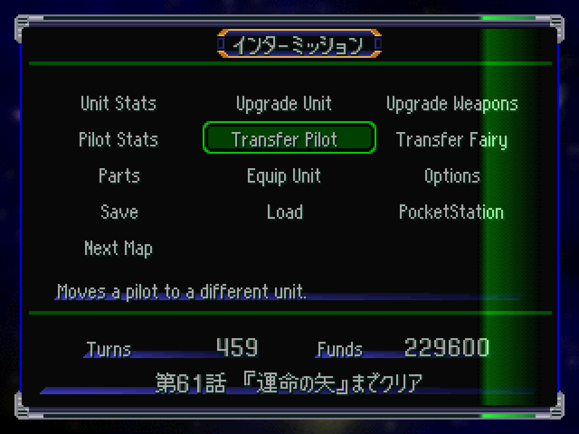

# Menús y mensajes en código (EXE + overlays) — investigación, 2026-09-27

Herramientas: `tools/src/ovl_base.py` (dirección de enlace por votación de punteros), `tools/src/ovl_strings.py`
(inventario → `dump/ovl_strings.jsonl`: dirección, lugar disponible, referencias).

## Overlays: formato y dirección de carga
- `OVL/*_GRP.BIN`: el primer u32 es un **ID** (5..17; PRM no tiene). Se cargan **completos, tal cual**, en una dirección
  fija por overlay (enlazados para esa dirección: el código usa direcciones absolutas).
- Hay **cuatro zonas**; cada overlay de una zona reemplaza al anterior. Verificado con volcados de RAM (PRM, SNMP, COMM,
  BTL, SNDU) y por votación de punteros (el resto; MOVE/MPWP/COMA/PRO por punteros internos y destinos de `jal`).

| Zona | Base | Overlays | Tamaño máximo (hasta la zona siguiente) |
|---|---|---|---|
| PRM | `0x800A8920` | PRM | 186.552 (termina donde empieza la zona A) |
| A | `0x800D61D8` | SNMP (mapa), IMIS (intermisión), END (créditos), SNDM, PRO (prólogo) | **167.864** = tamaño de SNMP (lleno); IMIS deja ~21 KB libres |
| B | `0x800FF190` | TITL (título), COMM, COMA | **81.660** = tamaño de TITL (lleno); COMM ~16 KB, COMA ~11 KB libres |
| C | `0x8011308C` | BTL (batalla), ENTR (datos del protagonista), SNDU, MOVE, MPWP | límite superior sin determinar |

- El EXE (`SLPS_026.36`) carga en `0x80010000` (cabecera 0x800).

## Cómo se referencian los textos
- ~9.200 candidatos a string; muchos son bytes de código que parecen SJIS (hay que filtrar).
- Con referencia directa: palabras de 32 bits en tablas (`ptr`) o pares `lui`+`addiu` en el código (`code`).
  Mayoría en IMIS (~330), END (~470, créditos), PRM (~300), TITL (~210), SNMP (~75), ENTR (~70), SNDM (~50).
- Sin referencia directa pero reales: **mensajes contiguos** (p. ej. errores de memory card en IMIS),
  **tablas de ancho fijo** (efectos de partes en PRM: "限界反応+20"), **títulos/letras de canciones** (SNDM/TITL).
  Se acceden por base + índice × tamaño o por la dirección de la tabla: hay que ver cada caso.

## Estrategia de reinserción (propuesta)
1. **In situ** cuando el inglés entra en el lugar disponible (`room`: bytes hasta el próximo dato; los strings están
   alineados, así que suele haber relleno). Muchas etiquetas cortas entran (kanji = 2 bytes; inglés = 1 byte/letra).
2. **Reubicar** los que no entran: al final del overlay (si la zona tiene lugar) o en zonas libres del EXE, y corregir
   las referencias (`ptr`: la palabra; `code`: el par `lui`/`addiu`, cuidando el signo del `addiu`).
3. Tablas de ancho fijo: si el campo no alcanza, abreviar o cambiar la rutina que las indexa (caso a caso).
4. Los textos se dibujan con la misma rutina (`FUN_80018B74` → `FUN_80018CC4`, VWF), así que el inglés se ve bien.

## Prueba en el juego (2026-09-27) ✅

Traza con breakpoint en `FUN_80018B74` (el string va en **a1**; se dibuja una sola vez al entrar al menú, ~f4850):
el menú de intermisión sale entero de IMIS — etiquetas en IMIS+0x1D5C… (muchas en **kana de medio ancho**, 1 byte por
letra), descripciones en IMIS+0x04… con tabla de punteros en IMIS+0x1FB28, opciones de sistema en IMIS+0x2034….
`tools/src/ovl_patch.py` con 29 textos: 22 in situ, 7 reubicados al final de IMIS (146.316 bytes, dentro de la zona A)
con punteros corregidos. **Todo se ve bien en el juego** (ISO `build/menu_test`, ruta CP12 → intermisión).

## Espíritus, habilidades y partes (PRM)
- Nombres de espíritus desde PRM+0x528 (熱血, 魂, てかげん…), empaquetados y alineados a 4; tabla de punteros en
  PRM+0x267CC… (uno por espíritu). Habilidades (ﾆｭｰﾀｲﾌﾟ, 強化人間…) y partes (ﾌﾞｰｽﾀｰ, 超合金Z…) desde PRM+0xE00, con
  punteros en PRM+0x26A4C…. Todo reubicable por puntero.
- **PRM llena su zona exacta (186.552 bytes)**: no se puede agregar al final. Igual SNMP (zona A) y TITL (zona B).
- **Estrategia para zonas llenas: reempaquetar el bloque de strings.** Si todos los strings de un bloque se referencian
  por puntero, se reescriben compactados en el mismo espacio y se corrigen los punteros: el presupuesto es la suma de
  los lugares, no el de cada string. Medición (nombres oficiales del glosario, descripciones aún en japonés): 90 strings de espíritus/habilidades/partes
  ocupan 1.567 bytes; en inglés empaquetados 1.212 → **alcanza** (margen 355). Falta implementar el reempaquetado.

## Reempaquetado y referencias por código (2026-09-28)
`tools/src/ovl_patch.py` (reescrito) toma `translation/menus_en.jsonl` y parchea los 8 overlays del borrador
(`--files`, `--out build/menus`; informe en `build/menus/report.csv`). Cada overlay se relee al final (`verify`):
todo texto se lee en su dirección final y cada referencia la apunta.

- **Pool de espacio libre** = lugar de los strings reubicados + sobrante de los in situ + cola de la zona (solo zonas
  con límite conocido: PRM/A/B). Asignación de mayor a menor, primer hueco. Así PRM/SNMP/TITL (zonas llenas) se
  **reempaquetan** dentro de su propio tamaño.
- **Lugar seguro**: in situ se usa el `room` completo (campos de ancho fijo: nombres de ENTR de 0x15 bytes, partes de
  PRM); para el pool solo hasta la alineación a 4 (más allá podría haber variables en cero). Nunca más allá del
  próximo destino de una referencia (3 punteros de PRM apuntan a ceros de relleno = strings vacíos/datos).
- **Fragmentos** (resuelto 2026-09-29, #9): eran las colas de descripciones de varios renglones; el inventario no
  admitía `0x0A` dentro de un string. Ahora cada descripción es una fila completa (`jp` con `\n`). Las filas cuyo byte
  anterior ≠ NUL que quedan son ruido de código, sin traducción en el mapa.
- **`lui/addiu`**: no se toca el `lui` (puede compartirse con otras instrucciones o cargas); el texto va a un hueco con
  el mismo `%hi` y solo se reescribe el `addiu`/`ori`. Resuelve las 41 filas "reubicar (código)" cuando hay lugar en
  la ventana (COMM: la cola libre queda fuera → forma corta).
- Preferencia: `en` in situ → `en` reubicado → `en_short` in situ → `en_short` reubicado → japonés.
- Espacio extra en el EXE: **no hay** (única corrida de ceros sin referencias = la tabla VWF en `0x80059480`).

| Overlay | tamaño | pool | in situ | reubicados | forma corta | sin cambio |
|---|---:|---:|---:|---:|---:|---:|
| BTL | = | 60 | 16 | 0 | 2 | 0 |
| COMM | = | 16.404 | 17 | 0 | 1 | 0 |
| ENTR | = | 751 | 87 | 21 | 1 | 0 |
| IMIS | +400 | 24.932 | 272 | 131 | 3 | 0 |
| PRM | = (lleno) | 2.427 | 309 | 119 | 28 | 1 (fragmento `使い捨て。`) |
| SNDU | = | 66 | 10 | 1 | 2 | 0 |
| SNMP | = (lleno) | 275 | 86 | 7 | 8 | 0 |
| TITL | = (lleno) | 913 | 179 | 21 | 68 | 0 |

Los **114 textos acortados** (sin lugar para el completo) están en `translation/menus_acortados.csv` para revisar
(regenerar con `tools/src/menus_short_list.py` después de `ovl_patch.py`).

**Anchos fijos encontrados en pantalla** (el `room` en bytes no alcanza: hay recuadros y columnas de ancho fijo en px):
`修理費` → "Repair" ("Repair Cost" pisaba el número), `精神ｺﾏﾝﾄﾞ` → "Spirits" (chocaba con "SP"), `反撃命令` →
"Counter" ("Counter Orders" se salía del menú del mapa), terreno `空 陸 海 宇` → **Air / Lnd / Sea / Spc** (la letra de
rango va en x fija: "Land"/"Space" la pisaban). Anotado en la columna de notas de `menus_map.txt`.

**Strings de un carácter** (2026-09-28): `ovl_strings.py` pedía ≥ 2 caracteres y se perdía `空 陸 海 宇` (terreno),
`機` (contador de derribos), los espíritus `魂`/`愛`, `森 山 橋 月`, `姓 名 男 女`… Ahora se incluyen los de un carácter
SJIS que empiezan tras un NUL **y tienen referencia** (+221 filas; las 14.161 anteriores quedan idénticas). En
`menus_map.txt`: Air/Land/Sea/Space, Soul/Love, Forest/Mountain/Bridge/Moon, Last/First/Male/Female y `機` = `{blank}`
(string vacío: "Kills 36"). Sin traducir todavía (contexto sin ver): `残`, `総`, `％` (IMIS) y (hasta #285) las 16 abreviaturas
de espíritus de PRM (`熱 手 狙 閃 努 幸 集 必 鉄 隠 加 覚 激 捨 撹 挑`).
**#285 (resumen de unidad en el mapa)**: tabla de punteros PRM+0x26858 → strings PRM+0x640 (4 B/slot); 挑 aparte en PRM+0x13E0
(`addiu` en PRM+0x1E600). Loop de dibujo en `0x800C6EC4` (16 flags, columnas de 0x18 px). Ahora Val/Mrc/Snp/Fls/Gai/Lck/Foc/Stk/
Wal/Stl/Acl/Zel/Fry/Rkl/Jam/Tnt (in situ, 3 letras+NUL). Pendiente: confirmar el ancho en pantalla con captura.

**Prueba en el juego** (`tools/menus_test.sh`, ISO `build/menus_test` = EXE VWF + fuente + 8 overlays, recorrido CP04):
arranca, carga ("Loading. Do not remove the Memory Card."), mapa (Move/Attack/Spirit/Status; End/Spirit Search/Unit
List/Counter/Objectives/System/Save), ventana de armas (Weapons, Ammo, Terrain, Will, EN Cost, Req. Skill, Critical),
vista previa (Animation ON/OFF), batalla, Level Up / Funds / EXP y los diálogos de guardado ("Overwrite the system file.
OK?", "Saving…", "Save complete. Continue playing?"): **todo en inglés, sin cortes ni cuelgues**.
Siguen en japonés (no están en el inventario de strings: gráficos o tablas aparte): encabezados de la ventana de armas
`武器名 攻撃力 射程 命中` y las letras de terreno `空 陸 海 宇`.

## Posiciones de texto: menús y títulos (#66, 2026-10-03)
**Síntoma**: con VWF el inglés queda corrido: menú del mapa con sangrías desparejas (Unit List/System/Save más
adentro que End Turn/Counter/Objectives), títulos de barra (Spirit Search, Ally List) a la izquierda de su recuadro, y
"Transform" fuera del menú de comandos de la unidad.
**Causa**: las x están precalculadas para el ancho japonés.
- SNMP tiene una **tabla de layouts** en `0x800FCF2C` (archivo +0x26D54), registros de 12 B: u8 posiciones · u8 textos
  fijos · 2 B · puntero a posiciones (`int16 x, y`, relativas a la ventana) · puntero a punteros de texto. Los textos
  fijos van en las primeras posiciones; las demás son para lo que pone el código. Ej.: menú del mapa = +0x26D9C
  (x 12,12,18,12,12,20,24 = centrado de ﾀｰﾝ終了/部隊表/ｼｽﾃﾑ…). Títulos de barra: y = 9. La lista de unidades toma su
  título de PRM (味方部隊表/敵方部隊表, PRM+0x26C70) en la posición 4 de +0x26E20 y +0x26E2C.
- Menú de comandos (PRM `FUN_800C7794`, llamado desde COMM): `FUN_8001963C(obj, 7, x, y, ancho=0x30, alto, …)`, cursor
  de 0x26 (`FUN_800AC310`); la ventana Sí/No de "Separate?/Disconnect?" (`FUN_800C78C0`) se abre en x + 0x30.
**Arreglo**: `tools/src/layout_patch.py` (etapa `layout`, después de `titles`): títulos y menús chicos centrados con el
ancho real (VWF), menús de comandos (mapa, respuesta al ataque, órdenes de contraataque) alineados a la izquierda, y
menú de comandos de la unidad a 64 px (comando más ancho + 20) con cursor y ventana vecina corridos.
`layout_patch.py report <SNMP> <PRM>` lista los cambios sin escribir.

**Menú «Combine» (issue #8 del repo público, 2026-10-17)**: el layout SNMP +0x26E74 tiene 3 textos fijos (あと, 回合体出来ます,
合体しますか?) y el número de combinaciones lo dibuja el código en la posición 3 (x = 28, justo después de あと). «Left» (18 px VWF)
pisaba el número ("Left3  combines left"). `layout_patch.py` deja «N combinations left»: el texto 0 apunta a un NUL (cadena vacía, solo
en este layout; la selección de unidades de salida +0x26D54 sigue con «Left»), el número va en x = 12 y el texto 1 a 16 px (campo de
2 dígitos). **Pendiente de verificar en el juego** (dígitos 1 y 2, que «combinations left» —reubicada— no pise otra cadena).

## Decisiones
- **Letras de canciones en TITL (≈190 strings): quedan en japonés** (decisión del responsable, 2026-09-28).

## Tope de objetos de texto (#57, 2026-09-28)
**Síntoma**: con ENTR en inglés, la ficha del protagonista perdía el título y los valores, y el editor de nombre el
título, el menú izquierdo y las primeras letras del nombre. Con solo la mitad de las filas en inglés (cualquiera de las
dos) todo se veía: no era una fila rota ni la reubicación.
**Causa**: cada carácter en pantalla es un objeto de 0x1C bytes en una tabla global que el EXE reserva una vez al
arrancar (`0x80014AC4: jal FUN_80018B28` con `a1 = 0x300` en `0x80014AC8` → `FUN_80018578` hace malloc de
`n × 0x1C`). Estado en `gp` = `0x8005C1A8`: `+0x1A8` puntero a la tabla, `+0x1B0` capacidad, `+0x1B2` primera libre.
Si no hay objeto libre, el asignador devuelve -1 y ese texto no se dibuja. Aparte hay 441 celdas de VRAM de 8×16
(`0x80051D28`, cursor `+0x1B4`) solo para caracteres dobles (kanji/kana); el inglés usa la textura de la fuente
directamente y no gasta celdas.
**Medido** (volcado de RAM, `+0x1B2`): japonés 447 (ficha) / 473 (editor); inglés > 768 (tabla llena); con 1024,
863 / 923; con 1280, 843 / 903.
**Arreglo**: `patches/vwf.asm` → `TEXT_OBJS equ 0x500` (1280 objetos, +14 KB de heap). Regresión boot/CP04/CP12 OK.
Además "Blood Type" y "Personality" (TITL) pasan a *Blood* / *Nature*: la columna de valores está a ~40 px del rótulo.
**Regla**: si en otra pantalla falta texto, volcar la RAM y mirar `+0x1B2` antes de sospechar de los punteros.

## Siguiente paso
Traza dinámica: breakpoint en `FUN_80018B74` en cada pantalla (título, intermisión, listas, mapa, batalla) para saber
qué strings se dibujan realmente y desde qué dirección (necesita `-interpreter -debugger`; en dynarec no hay hits).
