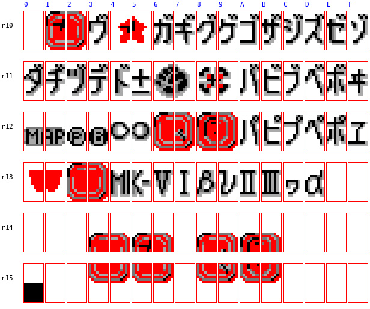
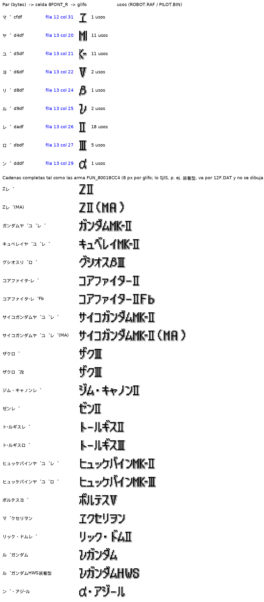
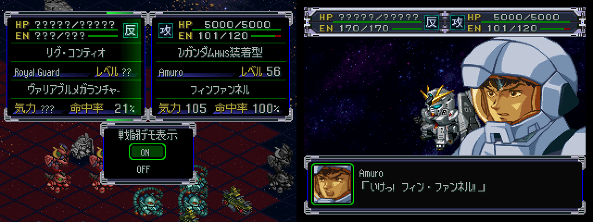

# PILOT.BIN y glifos especiales ﾞ/ﾟ — 2026-09-27

Herramienta: `work/tools/src/pilot_bin.py` (`dump` → `dump/pilot.jsonl`, `build`, `selftest`, `glyphs`).
Análisis estático; no se usó el emulador (solo volcados de RAM ya existentes en `analysis/ram/`).

```bash
cd work/tools/src
../../.venv/bin/python pilot_bin.py dump        # → work/dump/pilot.jsonl (469 pilotos)
../../.venv/bin/python pilot_bin.py selftest    # build sin cambios == original; límites de largo
../../.venv/bin/python pilot_bin.py build entrada.jsonl ../../build/PILOT.BIN   # usa full_en / short_en
../../.venv/bin/python pilot_bin.py glyphs      # → notes/img/glifos_especiales.png
```

## A. Formato de `UNITPRAM/PILOT.BIN`

`u16 n = 469 · u16 0 · 469 registros de 0x70 bytes` (52.532 = 4 + 469 × 0x70). El índice es el id de piloto
(el mismo que usa `BXCLIST.BIN`).

**El juego copia el registro entero a RAM.** En `analysis/ram/interp_2400.bin` (mapa del prólogo) están los
registros de Tashiro (238), Noriko, Kazumi, Jung y los monstruos espaciales, byte a byte (basura incluida),
en slots de 0xB0 desde `0x8015B264` (0x70 del archivo + 0x40 de estado). Los offsets de abajo valen igual en RAM.

| Offset | Tipo | Campo | Confianza / evidencia |
|---|---|---|---|
| +0x00 | u16 | id (0..468) | segura |
| +0x02 | u8 | tipos de unidad que puede pilotar (máscara): 1 = MS UC, 2 = MS de Gundam W, 4 = Mazinger, 8/0x10 = Aura Battler, 0x20 = Valkyrie, 0x80 = hadas; 0 = capitanes de nave y personajes no transferibles | **hipótesis** (agrupación por serie) |
| +0x03 | u8 | ? (1 en 10 pilotos de Gundam W, 2 en Daitarn) | **desconocido** |
| +0x04 | texto | **nombre completo** (kana medio ancho / SJIS / ASCII), NUL | seguro; `=` separa nombre y apellido |
| +0x19..+0x27 | — | ceros, salvo +0x21 = +0x25 = 0x08 en los 469 | constante, no tocar |
| +0x28 | u8 | 0xBE en los 469 | constante; **no** es parte del nombre corto (CHS tampoco lo toca) |
| +0x29 | texto | **nombre corto** (hablante en batalla: "ﾀｼﾛ" en el registro de Tashiro, cuyo nombre completo es "ﾀｼﾛﾀﾂﾐ"; `fuente_en.md` ya vio que el nombre del hablante sale de PILOT.BIN) | seguro |
| +0x36 | u8[6] | stats: 格闘 melee, 射撃 ranged, 回避 evasion, 命中 accuracy, 反応 reaction, 技量 skill | validado (tabla abajo) |
| +0x3C | u8[6] | espíritus (id según la lista de `OVL/PRM_GRP.BIN` 0x528; 0xFF = ninguno) | validado |
| +0x42 | u8[6] | nivel en que se aprende cada espíritu | validado |
| +0x48 | 3 × (u8 + u8[9]) | habilidad con niveles (id según `PRM_GRP.BIN` 0xE00: 0 NT, 1 強化人間, 2 聖戦士, 3 念動力, 4 シールド防御, 5 切り払い) + nivel de piloto en que llega a L1..L9 (0xFF = nunca) | validado |
| +0x66 | u8 | SP base | validado |
| +0x67 | u8 | nivel de doble movimiento (99 = nunca) | validado |
| +0x68 | u8 | habilidades sin nivel (máscara): 1 = 底力, 2 = 天才, 4 = ガッツ, 8 = 野性化 (mismo orden que la lista de PRM_GRP) | validado: 28/28 "Potential", 3/3 "Genius", 7/7 "Guts", 3/3 "Aggressive Beast", combinados 3 y 9 |
| +0x69 | u8 | clase (máscara): 0x10 = originales de Banpresto, 0x20 = genéricos (兵, 人工知能, 無人), 0x40 = pilotos de EVA (シンクロ率), 0x80 = hadas (チャム, ベル, エル) | **hipótesis** por agrupación |
| +0x6A | u8 | personalidad: 0 débil, 1 normal, 2 fuerte, 3 muy fuerte | validado 122/122 |
| +0x6B | u8 | grupo 0..23; 0 = ninguno, crece con el orden de las series (1 = 0080, 2 = 0083, 3 = Z, … 8–10 = Gundam W, 11 = Dunbine, 20 = originales, 21 = SRX…) | **desconocido** (¿BGM, equipo, transferencia?) |
| +0x6C | u8[4] | terreno aire, tierra, mar, espacio: 4 = A, 3 = B, 2 = C, 1 = D, 0 = - | validado |

Las habilidades 集中力, SP回復, 社長, 勇者 y 天才 de los protagonistas originales **no** están en PILOT.BIN
(Ryoto, Rio, Kusuha, Ricarla tienen `+0x68 = 0`): el código debe asignarlas según el protagonista elegido.

### Validación contra `glossary/src_txt/Pilot Database.txt` (Akurasu)
122 pilotos cruzados por nombre (vía `glossary.csv`):

| Campo | Coinciden |
|---|---|
| personalidad | 122/122 |
| SP | 119/122 |
| terreno | 119/122 |
| doble movimiento | 116/122 |
| espíritus (ids, en orden) | 112/122 |
| espíritus + niveles | 96/122 |
| stats (los 6 iguales) | 95/122 (691/732 valores) |
| habilidades con niveles | coinciden en los casos revisados (~60 pilotos a mano) |

Las diferencias son del wiki (errores de tipeo, el orden Reccoa, un nivel 1 donde el archivo dice 10) o de los
registros duplicados (Heero/Duo/Trowa… tienen dos registros con evasión/reacción distintas; Four tiene dos juegos
de espíritus). Donde la base dice "-" en L1–L2 de una habilidad, el archivo pone 1 (arranca directamente en L2/L3).
Ojo al mapear nombres: la base usa la terminología OG — **"Vigor" = 根性 (id 17) y "Guts" = ド根性 (id 18)**.

### Límites de largo de los nombres
| Campo | Bytes | Evidencia |
|---|---|---|
| Completo (+0x04) | **20 + NUL** (+0x04..+0x18) | 1 nombre usa exactamente 20 (ﾗｵﾃﾞｷﾔ=ｼﾞｭﾃﾞｯｶ=ｺﾞｯﾂｫ) y 2 usan 19; +0x18 es 0 o basura; el parche chino tampoco pasa de 20. Coincide con los campos de 0x15 bytes del protagonista (`vwf_investigacion.md`). |
| Corto (+0x29) | **12 + NUL** (+0x29..+0x35) | máx. usado 12 (帝国監察軍兵, en JP y en CHS); +0x35 = 0 en los 469. |

`build` rechaza lo que no entra, pasa los espacios a `0xA0` (espacio angosto del VWF) y rellena el resto del campo
con NUL (limpia la basura; el CHS hizo lo mismo). `selftest`: sin cambios == original, 20/12 bytes entran sin tocar
nada fuera de los campos, 21 bytes se rechaza.

Consecuencia: los 13 nombres ingleses de más de 20 bytes (`glosario.md`) hay que abreviarlos, y los nombres cortos
en inglés tienen 12 bytes (p. ej. "Quatre", "Laodicea", "Brooklyn" entran; con VWF el ancho en píxeles importa menos
que los bytes).

## B. Glifos especiales ﾞ/ﾟ

`FUN_80018CC4` (ver `vwf_investigacion.md`, y el parche `patches/vwf.asm`, que conserva ese código): un byte simple
seguido de `ﾞ` (0xDE) suma 0x30 a la coordenada V del sprite (3 filas de 16 px); seguido de `ﾟ` (0xDF), 0x40
(4 filas). Con el mapeo de `FUN_8001885C` (índice = byte − 0x40 para kana, celda en fila `i>>4`, columna `16+(i&15)`):

- kana + ﾞ → celda `i + 0x30`; kana + ﾟ → celda `i + 0x40`. Las dos cosas ocupan **un solo glifo de 8 px**.
- Los kana con dakuten normales (ｶﾞ…ﾄﾞ, ﾊﾞ…ﾎﾞ, ｳﾞ, ﾊﾟ…ﾎﾟ) caen en glifos precompuestos (ガ, パ…).
- El resto de combinaciones cae en **glifos especiales** (filas 10–13 de `8FONT_R.TIM`):



| Par | Celda (fila, col) | Se dibuja | Uso en ROBOT.RAF |
|---|---|---|---|
| ﾔﾟ | 13, 20 | `M` (la mitad de "MK") | Mk-II / Mk-III |
| ﾕﾟ | 13, 21 | `K-` | Mk-II / Mk-III |
| ﾗﾟ | 13, 23 | Ⅰ | (sin uso) |
| ﾖﾟ | 13, 22 | Ⅴ | ボルテスⅤ |
| ﾚﾟ | 13, 26 | Ⅱ | Zガンダム Ⅱ… 18 nombres |
| ﾛﾟ | 13, 27 | Ⅲ | ザクⅢ, トールギスⅢ, グシオスβⅢ, ヒュッケバインMk-Ⅲ |
| ﾘﾟ | 13, 24 | β | グシオスβⅢ |
| ﾙﾟ | 13, 25 | ν | νガンダム, νガンダムHWS装着型 |
| ﾝﾟ | 13, 29 | α | α・アジール |
| ﾏﾟ | 12, 31 | ヱ | ヱクセリヲン |
| ﾏﾞ | 11, 31 | ヰ | (sin uso) |
| ﾜﾟ | 13, 28 | kana chico (¿ｯ?) | (sin uso) |
| ﾐﾟﾑﾟ / ﾀﾟﾁﾟ | 13, 16–17 / 12, 16–17 | iconos rojos / "MAP" | iconos de interfaz (ver abajo) |
| ｱﾞｲﾞ, ｴﾞｵﾞ, ｶﾟｷﾟ, ｸﾟｹﾟ, ﾂﾟ, ﾃﾟ, ﾄﾟﾅﾟ, ﾒﾟﾓﾟ… | 10–13 | iconos (estrella, esfera, Ⓔ, Ⓑ, ○○, recuadros) | strings de menú de `PRM_GRP.BIN` (`ｸﾟｹﾟ`, `ｶﾟｷﾟ`, `ﾀﾟﾁﾟ`, `ﾂﾟ`, `ﾃﾟ`, `ﾄﾟﾅﾟ`, `ｵﾟ` en 0x1354–0x138C) |

Todos los usos en nombres (52 pares en 23 nombres distintos, solo en nombres de **unidades**; ningún nombre de piloto ni de arma los usa):



**Para la traducción:** en inglés estas marcas se reemplazan por ASCII normal ("Gundam Mk-II", "Zeta Plus"/"Z II",
"Zaku III", "Nu Gundam", "Voltes V", "Excelion", "Alpha Azieru"): no hace falta conservar los pares. Solo hay que
**evitar escribir ﾞ/ﾟ (0xDE/0xDF) detrás de cualquier byte** en el texto inglés, porque el maquetador los consume
como marca. Si se quieren los glifos Ⅱ/Ⅲ/ν en inglés, se pueden seguir usando (ocupan 1 byte de pares = 2 bytes, 8 px).
La fuente de 12 px (`12F.DAT`, 3321 glifos: tabla de códigos SJIS big-endian desde +4, relleno de 2 bytes, glifos de
36 bytes = 12×12 a 2 bpp, píxel bajo primero) también trae Ⅰ Ⅱ Ⅲ Ⅴ α β ν ヰ ヱ como SJIS normal.

## Preguntas abiertas
1. **Nombre corto en batalla con inglés**: el hablante se dibuja por otro camino (`ra=0x80116c7c`, no pasa por
   `FUN_80018CC4`). ¿Respeta el VWF, el espacio `0xA0` y los pares ﾞ/ﾟ? Probar en el emulador con un nombre inglés.
2. **¿Se lee algo de +0x19..+0x27 o +0x28?** Los tres son constantes; no sé si el código usa la zona como parte del
   nombre (lo que permitiría hasta 35 bytes). Hasta verificarlo en el código, el límite seguro es 20.
3. **Partidas guardadas**: si la memory card guarda el registro copiado (0x70 bytes con nombres), una partida vieja
   seguiría mostrando nombres japoneses. Verificar.
4. Significado de +0x03, +0x6B y confirmación de +0x02 / +0x69.
5. ~~Campo de nombre de ROBOT.RAF~~ **resuelto (2026-09-28, #13)**: 21 bytes + NUL en +0x00..+0x15
   (+0x16..+0x19 = `aa ab ac ad` constante). Ver `compresion.md` / docstring de `robot_raf.py`.

## Nombres en inglés (2026-09-28, #14)
`pilot_bin.py fill` llena `full_en`/`short_en` de `dump/pilot.jsonl` y deja el informe `glossary/pilot_names_en.csv`
(id, jp, en y fuente de cada campo). Prioridad:
- **completo** (≤ 20 B): `glossary/pilot_names_manual.csv` > `traduccion/referencia/correcciones.csv` > `glossary.csv`
  (`en_final`). Resultado: 439 del glosario, 18 corregidos, 12 manuales (los nombres de más de 20 bytes).
- **corto** (≤ 12 B): `pilot_names_manual.csv` > `traduccion/referencia/hablantes.csv` (la misma etiqueta que se usa
  como hablante en los diálogos). Resultado: 383 de hablantes, 86 manuales (genéricos, Ángeles, monstruos espaciales,
  apodos por defecto del protagonista y los que no tenían etiqueta).
Falla si algo queda sin traducción o no entra. El pipeline (`build.sh`, etapa `pilot`) usa `dump/pilot.jsonl`;
después de cambiar el glosario, correr `fill` otra vez.

Formas cortas decididas para los nombres completos largos: Quatre R. Winner · Great Dark General · Raidiese Branstein ·
Laodicea J. Gozzo · Fabulous Fitzkarald · Dazzling Cervantes · Neo Zeon / Zanscare Cyber Sldr · D. Higashiyama ·
Chaos Lord Hanzui · Stormy Kawarazaki (en diálogos siguen las formas largas).


## Prueba en el juego (2026-09-27) ✅


ISO `build/pilot_test` (VWF + fuente + PILOT.BIN con Amuro = "Amuro"/"Amuro Ray" y 親衛隊兵 = "Royal Guard"), repitiendo la
grabación CP04: el nombre corto se ve bien **en la vista previa y en la caja de diálogo de batalla** (la rutina
`ra=0x80116c7c`), con VWF y el espacio 0xA0. Pregunta abierta 1: cerrada.
Nota: con la ISO modificada el azar del combate cambia (otro resultado y otras frases que en la grabación original).
