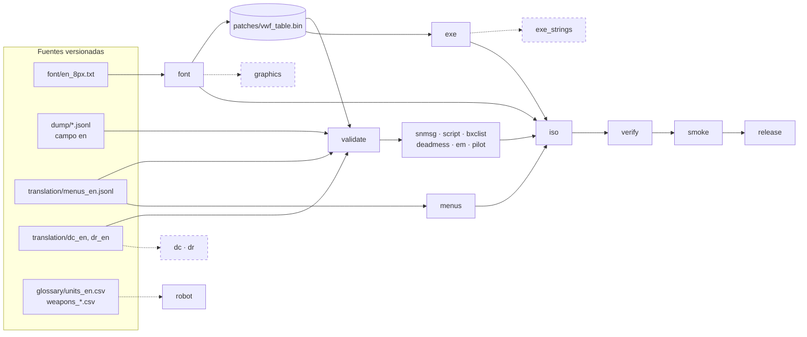

# Pipeline de build completo — borrador (2026-09-28)

Un solo comando que toma **todas las fuentes en inglés** (volcados con `en`, traducciones de `translation/`, la fuente)
y produce una **ISO verificada** con un manifiesto de qué entró. Las etapas cuya herramienta todavía no existe quedan
declaradas como `pendiente`: el pipeline las muestra y sus archivos quedan en japonés, así la estructura ya está
completa y cada pieza nueva se enchufa en su lugar.

| Archivo | Qué es |
|---|---|
| `work/tools/build.sh` | Entrada en server1: carga `env.sh` y corre el orquestador con el venv (`$SRW_PY`). |
| `work/tools/src/build_all.py` | **Orquestador**. Tabla de etapas editable (`STAGES`, `TEXT_BUILDS`, `EXE_WINDOWS`…, al principio). |
| `work/tools/src/test_build_all.py` | 21 pruebas: adaptador de menús, controles del EXE, `.cue`, selección de etapas, **verificación con una ISO sintética MODE2/2352**, control de capturas y el pipeline en `--dry-run` sobre los volcados reales. |
| `work/tools/regresion.sh` | Rutas de regresión en el emulador (boot, prólogo, CP04, CP12) + control y comparación de capturas. |
| `work/tools/src/shots_check.py` | Control de capturas: faltantes, pantalla de un solo color, emulador congelado; hoja de diferencias contra otra build. |
| `work/notes/checklist_regresion.md` | **Checklist de regresión** (niveles N0–N4, trazabilidad, síntomas → causa). |

## 1. Uso (server1)

Listar las etapas, en orden, con su estado (lista / pendiente / opcional):
```bash
work/tools/build.sh --list
```

Ver el plan sin tocar archivos del juego (valida textos y arma los specs de menús; funciona también en la nube):
```bash
work/tools/build.sh --dry-run
```

Build completa con autopruebas de las herramientas e integridad de los volcados (la de todos los días):
```bash
work/tools/build.sh --selftest
```

Control del toolchain: ISO sin reemplazos, tiene que salir byte a byte idéntica a la original:
```bash
work/tools/build.sh --null
```

Iterar sobre un formato sin armar la ISO (solo reconstruye `SNMSG.BIN` y valida):
```bash
work/tools/build.sh --only font,validate,snmsg --name prueba_snmsg
```

Build de prueba aunque haya errores de texto (el juego va a mostrar cortes; no publicar):
```bash
work/tools/build.sh --allow-text-errors --name prueba_errores
```

Build + rutas de regresión en el emulador, comparando contra las capturas de una build anterior:
```bash
work/tools/build.sh --smoke --routes boot,prologo,cp04,cp12 --ref work/emu/shots/<build_anterior>
```

Build para publicar: git limpio, parche xdelta3 contra la ISO original y prueba de aplicación:
```bash
work/tools/build.sh --strict --selftest --release
```

Rutas de regresión sobre una imagen ya construida (sin rearmar nada):
```bash
work/tools/regresion.sh work/build/<N>/<N>.cue work/emu/shots/<N> cp04 cp12
```

Ver cuánto ocupa cada build (cada una pesa ~0,65 GB; borrarlas queda a criterio tuyo):
```bash
du -sh work/build/*/
```

## 2. Etapas


Líneas punteadas = etapas **pendientes** (el archivo queda en japonés). `entry` (ingreso de nombre) también está pendiente.

| # | Etapa | Entrada → salida (ruta en la ISO) | Control automático | Estado |
|---|---|---|---|---|
| 1 | `preflight` | — | pide solo lo que usan las etapas elegidas (iso_jp, mkpsxiso, armips, numpy/PIL, BIOS…); avisa git sucio y poco disco; `--strict` exige git limpio | lista |
| 2 | `selftest` *(--selftest)* | iso_jp | reconstrucción sin cambios == original en `snmsg`, `script_bin`, `bxclist`, `deadmess_em`, `pilot_bin`, LZSS de `robot_raf`; pruebas unitarias; **el `jp` de cada fila traducida sigue siendo el original en su clave** (SCRIPT, BXCLIST, PILOT: protege contra filas corridas al pegar traducciones) | lista |
| 3 | `font` | `font/en_8px.txt` → `FONTWIN/8FONT_R.TIM`, `FONTWIN/WINTEX.BIN` (entrada 0) + `patches/vwf_table.bin` | la tabla generada == la que `check_text.py` deriva de `en_8px.txt` (la que usan los validadores en la nube; comprobado hoy con la tabla real: idénticas) | lista |
| 4 | `validate` | todos los `en` | `check_text.py` (errores cortan, avisos no) + `menus_en.jsonl` al día con `menus_map.txt` + `vwf_table.bin` correspondiente a `en_8px.txt` (por si se corre `--only validate` sin `font`) | lista |
| 5 | `exe` | `patches/vwf.asm` → `SLPS_026.36` | tamaño igual; **ningún byte cambiado fuera de las ventanas** (`EXE_WINDOWS`: código VWF y tabla); tabla dentro del EXE == `vwf_table.bin` | lista |
| 6–11 | `snmsg` `script` `bxclist` `deadmess` `em` `pilot` | `dump/*.jsonl` → `SNMAP/SNMSG.BIN`, `BUSTUP/SCRIPT.BIN`, `BATTLE/BXCLIST.BIN`, `SNMAP/DEADMESS.BIN`, `SNMAP/EM.BIN`, `UNITPRAM/PILOT.BIN` | código de salida; líneas `ERROR` de `snmsg.py` cortan; `AVISO` de `bxclist.py` (bloque mayor que el original) se informa | listas |
| 12 | `robot` | `glossary/glossary.csv` (+ `units_en.csv` para robot_id) → `UNITPRAM/ROBOT.RAF` | `robot_raf.py build` (nombre +0 ≤21 B, arma +8 ≤19 B; falla si falta o no entra; informe `logs/robot_names.csv`) | lista (#13) |
| 13–14 | `dc` `dr` | `translation/dc_en.jsonl`, `dr_en.jsonl` → `OPTION/DC.BIN`, `DR.BIN` | — | **pendiente**: reempaquetar campos fijos (0xCD) + LZSS |
| 15 | `menus` | `translation/menus_en.jsonl` → `OVL/{IMIS,PRM,SNMP,BTL,SNDU,TITL,COMM,ENTR}_GRP.BIN` | `ovl_patch.py --jsonl` (reempaquetado + reubicación `ptr` y `lui/addiu`, ver `notes/menus.md`) relee cada overlay: texto en su dirección final y cada referencia apuntándolo; si no, código 1 y la etapa corta. `menus/report.csv` fila por fila, `menus/stats.json` por overlay | lista |
| 16 | `exe_strings` | → `SLPS_026.36` | — | **pendiente**: encadenar sobre la salida de `exe` y sumar sus rangos a `EXE_WINDOWS` |
| 17 | `entry` | → `OVL/ENTR_GRP.BIN`, `TITLE/ENTRYDAT.BIN`, `SLPS_026.36` | — | **pendiente**: topes ya aprobados (apodo ≤ 8, nombre ≤ 9, apellido ≤ 10; `nombres_protagonistas.md`); faltan aplicarlos en `ENTR_GRP`, los nombres por defecto (ENTR y copia en el EXE), teclado y gráficos |
| 18 | `graphics` | títulos, prólogo, texturas, `BATTLE/UNIT.BIN`… | — | **pendiente**; `WINTEX.BIN` se encadena sobre la salida de `font` |
| 19 | `iso` | reemplazos → `<N>.bin/.cue` | solo entran los archivos que **difieren** del japonés | lista |
| 20 | `verify` | la imagen | se relee con `isofs.py`: mismos archivos que el layout; **contenido byte a byte** de todos (o solo reemplazos con `--verify reemplazos`) contra lo esperado; XA/STR por tamaño contra la original; sectores 0–15 (licencia) iguales; `.cue` (un FILE, MODE2/2352, mismas pistas); tamaño ≤ CD-R de 74 min (aviso) / 80 min (error); con `--null`, sha1 == original | lista |
| 21 | `smoke` *(--smoke)* | la imagen | `regresion.sh` + `shots_check.py` (ver checklist N1/N2) | lista, **sin correr en server1** |
| 22 | `release` *(--release)* | original + build → `<N>.xdelta` + `SHA1SUMS` | aplica el parche sobre la original y compara sha1 | lista, **sin correr** |

Estados que imprime cada etapa: `ok` (entra a la ISO) · `sin cambios` (idéntico al japonés: no entra) · `pendiente` ·
`aviso` (terminó con problemas permitidos o para revisar) · `plan` (`--dry-run`) · `error` (corta el pipeline).

## 3. Salidas

```
work/build/<N>/                  (en .gitignore; <N> por defecto = srwa_en_<fecha>_<commit>[-sucio])
├── files/<RUTA_ISO>             archivos reconstruidos (entran a la ISO solo los distintos del japonés)
├── menus/                       <OVL>_GRP.BIN, report.csv (qué texto quedó y dónde), stats.json (ovl_patch.py)
├── logs/<etapa>.log             salida completa de cada herramienta, con el comando exacto
├── selftest/                    volcados frescos para la integridad del "jp" (--selftest)
├── check_text.csv               violaciones del validador
├── font_preview.png             vista previa de la fuente (no pisa notes/img/, que está versionado)
├── <N>.bin  <N>.cue  <N>.xml    imagen + layout de mkpsxiso
├── verify.json                  resultado de la verificación
└── manifest.json                git (commit, rama, sucio), hash de cada fuente y salida, filas con inglés por
                                 formato, reemplazos, estado/tiempo/resumen de cada etapa
```
Fuera de `build/<N>/` solo se escriben salidas generadas y en `.gitignore`: `patches/vwf_table.bin` y
`build/exe/SLPS_026.36` (rutas fijas de `vwf.asm`). Por eso hay un lock (`work/build/.build.lock`): dos builds a la vez
se pisarían. Una carpeta de build existente no se reusa sin `--overwrite`.

## 4. Reglas de orden y trampas que el pipeline resuelve

| # | Trampa | Qué hace el pipeline |
|---|---|---|
| 1 | `vwf_table.bin` es generado (`*.bin` en `.gitignore`) y lo leen `vwf.asm`, `snmsg.py` y `check_text.py` | `font` va primero; `validate` y `exe` después. Se controla que la tabla == la derivada de `en_8px.txt`. |
| 2 | `vwf.asm` escribe siempre a `build/exe/SLPS_026.36` | Se borra antes de correr armips (si falla, no se copia uno viejo) y se copia a `files/`. Los futuros parches de strings del EXE (`exe_strings`) se encadenan **después** sobre esa copia. |
| 3 | `snmsg.py build` **no falla** con errores: los imprime y usa el japonés en ese casillero | Las líneas `ERROR` cortan la etapa (salvo `--allow-text-errors`). |
| 4 | `font_build.py` por defecto pisa `notes/img/font_preview.png` (versionado) | La vista previa va a `build/<N>/`. |
| 5 | `WINTEX.BIN` lo modifican la fuente (entrada 0) y, a futuro, los gráficos | `graphics` tiene que partir de `files/FONTWIN/WINTEX.BIN`, no de `iso_jp`. |
| 6 | Zonas llenas (PRM, SNMP, TITL) y refs `lui/addiu` | Las resuelve `ovl_patch.py` (pool de slots liberados + sobrantes in situ + cola de zona; el `lui` nunca se toca). Hoy: **976 in situ, 300 reubicados (113 con la forma corta), 1 en japonés** (PRM `使い捨て。`, un fragmento que no se mueve). |
| 7 | El "room" in situ cuenta ceros hasta el próximo byte no nulo | In situ se usa todo el hueco (campos de ancho fijo); el pool solo toma espacio alineado a 4 y nunca pasa por encima de un destino de referencia. Probado en el juego (`tools/menus_test.sh`). |
| 8 | Traducciones pegadas en la fila equivocada (el `en` corrido una fila) | `--selftest` compara el `jp` de cada fila con un volcado fresco del original. |
| 9 | Una build con 0 filas traducidas de un formato no debería cambiar ese archivo | Se reconstruye igual (ejercita la herramienta), pero si sale idéntico al japonés **no entra** a la ISO (`sin cambios`). |
| 10 | Archivos que crecen corren los LBA de todo lo que sigue (incluidos XA/STR) | El juego busca por nombre (`CdSearchFile`): probado con SCRIPT ×1,5 y BXCLIST ×2. `verify` controla XA/STR por tamaño; el audio/FMV queda en el checklist manual (N3). |
| 11 | Los nombres por defecto del protagonista están en `ENTR_GRP` (que ya modifica `menus`) **y** en el EXE (`0x800522FC`) | `entry` tiene que partir de `files/OVL/ENTR_GRP.BIN` y `files/SLPS_026.36`, no de `iso_jp` (declarado en la etapa). |

## 5. Decisiones de diseño

**Orquestador**

| Opción | Pros | Contras |
|---|---|---|
| **Python (`build_all.py`)** ✅ | Mismo lenguaje que todas las herramientas; hashes, JSON, manifiesto y verificación sin dependencias; `--dry-run` y pruebas unitarias; corre igual en server1 y en la nube | Más código que un Makefile |
| Makefile | Recompila solo lo que cambió (dependencias por fecha) | Las salidas "sin cambios" y los controles cruzados (EXE, verify, manifiesto) quedan en scripts aparte; fechas de git poco confiables |
| Bash | Cero dependencias | Manejo de errores, JSON y hashes frágil; difícil de probar |

**Formato del parche para distribuir** (etapa `release`)

| Formato | Pros | Contras |
|---|---|---|
| **xdelta3** ✅ | Estándar de las traducciones de fans de PSX con imágenes que cambian de tamaño; Delta Patcher / xdelta UI en Windows; verificable | Exige la imagen original exacta (por eso `SHA1SUMS` incluye la sha1 esperada) |
| PPF 3.0 | Tradición en PSX (PPF-O-Matic, ePSXe) | **No estoy segura** de que los aplicadores más usados agranden el archivo: nuestra ISO crece. Habría que probarlo antes de ofrecerlo. |
| BPS (Floating IPS / beat) | Soporta cambio de tamaño, trae checksums | Poco usado en PSX; imágenes grandes lentas en algunos aplicadores |

## 6. Qué se probó y qué no

| Probado (nube, 2026-09-28) | Resultado |
|---|---|
| `--list`, `--dry-run` sobre los volcados reales | OK en 1,5 s: validación 0 errores / 57 avisos (DC), 956 textos de menú en 8 specs, 7 etapas pendientes informadas |
| `test_build_all.py` (21 pruebas; con pycdlib y Pillow) | OK. Incluye la verificación sobre una **ISO sintética MODE2/2352**: sin cambios y `--null`, reemplazo que cambia de tamaño, contenido alterado con igual tamaño, archivo faltante, STR de otro tamaño, `.cue` mal |
| `regresion.sh` con dobles de `drive.sh` / `battle_prologue.sh` | Cuenta de capturas, hojas, comparación con `REF`, ruta "colgada" detectada (código 1) |
| `test_check_text.py` | 16/16 OK |

| Probado en **server1** (2026-09-28) | Resultado |
|---|---|
| `build.sh --null` | OK en 6 s; la imagen es **byte a byte idéntica** a la original |
| `build.sh --selftest` | OK en 16 s: 9 controles, validación 0 errores, EXE 309 bytes solo dentro de las ventanas VWF, menús 976 in situ / 300 reubicados / 1 en japonés, 11 reemplazos, `verify` OK. Los 8 overlays son idénticos a los de `ovl_patch.py` corrido solo (los probados con `tools/menus_test.sh`) |
| `regresion.sh` (`--smoke`) | `boot` ✅ (recalibrada: START salta el video, cuyos cortes negros caían en cuadros fijos), `cp04` ✅ (mapa, armas, vista previa, Fin Funnel), `cp12` ✅ (intermisión en inglés → escena del escenario 62). `prologo` ❌ desfasada **también en la japonesa** → #52 |
| Determinismo | El arranque en frío da la misma línea de tiempo en la japonesa y en la inglesa (título f2200, ENTR f5000–6600, diálogo f8700) |

**No probado todavía:** `--release` (xdelta3) y DuckStation.

## 7. Próximos pasos del pipeline

1. ~~Primera corrida real en server1~~ ✅ 2026-09-28 (ver §6). Referencia para `--ref`:
   `work/emu/shots/srwa_en_20260928-0128_3eb93f5/` (en server1, sin versionar). Pendiente: #52 (ruta `prologo`).
2. Enchufar las etapas pendientes en este orden (de menor a mayor riesgo): `robot` (formatos y nombres ya listos),
   `dc`/`dr`, `exe_strings`, `entry`, `graphics`.
3. Cuando se midan en el emulador las cajas de SCRIPT/BXCLIST/DEADMESS/EM, pasar esos límites de "supuesto" a
   "verificado" en `check_text.py` (sus violaciones pasan de aviso a error y el pipeline las bloquea).

## 8. Incertidumbres

- El límite superior de la **zona C** (BTL, ENTR, SNDU…) sigue sin medir: `ovl_patch.py` no agranda esos overlays (sin cola de zona).
- Los falsos positivos de punteros al reubicar (`ovl_strings.refs` toma cualquier palabra igual a la dirección) no se
  pueden descartar estáticamente: se cubren con las pantallas del checklist.
- `mkpsxiso` escribe el `FILE` del `.cue` con el nombre que recibe; si pusiera la ruta absoluta, `verify` lo marca como
  aviso (no portable).
