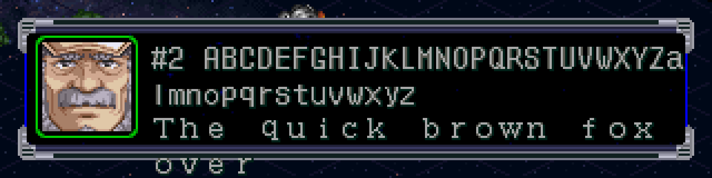
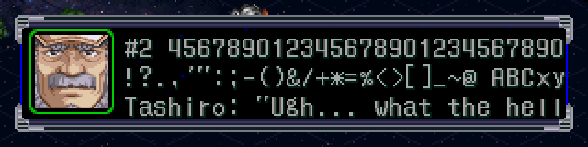

# Prueba de concepto: texto inglés en SNMSG — 2026-09-27

## Pipeline (todo reproducible)
```bash
source work/tools/env.sh; cd work/tools/src
$SRW_PY snmsg.py dump  ../../iso_jp/SNMAP/SNMSG.BIN ../../iso_chs/SNMAP/SNMSG.BIN ../../dump/snmsg.jsonl
$SRW_PY snmsg.py check ../../iso_jp/SNMAP/SNMSG.BIN ../../dump/snmsg.jsonl   # round-trip byte-idéntico
$SRW_PY snmsg.py build ../../dump/snmsg.jsonl ../../build/SNMSG.BIN            # usa "en" si existe, valida ancho
cd ../.. && $SRW_PY tools/src/build_iso.py build/test.bin SNMAP/SNMSG.BIN=build/SNMSG.BIN
tools/drive.sh build/test.cue emu/shots/x LOAD_STATE=$PWD/emu/states/poc_prologue.sstate SHOT_FRAMES=2400 LAST=2400 \
  INPUTS="200:START;500:CROSS;800:CROSS;1100:CROSS;1400:CROSS;1700:CROSS;2000:CROSS"
```
- `dump/snmsg.jsonl`: 32.544 slots, un JSON por línea: `id, speaker, jp, chs, en, notes`. 31.307 slots traen referencia CHS.
- `tools/src/sjis_text.py`: códec reversible (SJIS ↔ texto; bytes raros como `{XX}`).
- `tools/src/build_iso.py`: arma la ISO desde `iso_jp` + reemplazos (sin reemplazos = byte-idéntica al original).
- `tools/drive.sh` + `src/redux_drive.lua`: PCSX-Redux sin intervención (botones por frame, capturas, save states).
- Save state `emu/states/poc_prologue.sstate`: justo antes del mapa del prólogo (el primer mensaje de SNMSG en pantalla es el **slot 2**, Tashiro). Se genera desde cero con `tools/drive.sh <cue> <dir> SHOT_FRAMES=4800 LAST=4800 INPUTS="2000:START;2800:START;3600:START" SAVE_STATE=...` (nueva partida, protagonista por defecto).

## Resultados medidos en pantalla



| Medida | Valor |
|---|---|
| Ancho útil de línea | **240 px** |
| ASCII 0x20–0x7E | Fuente propia de medio ancho, **8 px** → **30 caracteres/línea** |
| Ancho completo SJIS | 12 px → 20 caracteres/línea |
| Exceso de ancho | Se **recorta** en silencio (no hay wrap por ancho) |
| Salto forzado | A los **40 bytes** por línea el motor salta de línea solo |
| Líneas visibles | **3** (una 4ª se dibuja fuera de la caja) |
| Capacidad por mensaje | **~90 caracteres ASCII** |
| Puntuación | Todas las ASCII existen. `'` se ve curvo (’), `"` como ″, `*` como ✳ |

`snmsg.py build` valida ahora ≤3 líneas, ≤240 px y ≤40 bytes por línea (`$n`/`$N` se computan como 64 px, **a confirmar** con el largo máximo del nombre).

## Implicancias
- **Se puede traducir SNMSG ya, sin hackear el motor**, con 30 caracteres × 3 líneas.
- El JP típico ocupa 3 líneas × ~16–20 caracteres; en inglés, 90 caracteres es justo. Algunas líneas van a exigir redacción compacta o partir el mensaje (no se pueden agregar slots sin tocar los scripts de SNDATA).
- Mejora opcional futura: **VWF** (ancho variable) daría ~40–45 caracteres/línea, pero requiere ingeniería inversa de la rutina de dibujo de texto (MIPS). Conviene decidirlo antes de traducir en masa, porque cambia cuánto entra por línea.
- El nombre del hablante va dentro del texto (`タシロ「…」`) y el retrato viene de otro dato. Hay que definir la convención en inglés (p. ej. `Tashiro: Ugh…`) y cuánto espacio consume.

## Pendientes / incertidumbres
- Largo máximo del nombre del protagonista (`$n`) y de la pareja (`$N`) en la pantalla de ingreso.
- Qué glifos corresponden a los kana medio ancho con ﾟ (`ﾔﾟﾕﾟ` = "Mk", `ﾚﾟ` = "II", según el paralelo CHS).
- ~~Mapa slot → escenario~~: **resuelto** en `notes/sndata.md` (los mensajes los usa el opcode `17`/`18`/…, no el `09`).
