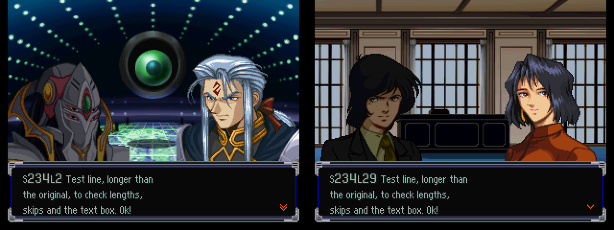

# SCRIPT.BIN (escenas de intermisión) — 2026-09-27

**Resuelto: extracción y reinserción con largo libre, probado en el juego.** Herramienta: `tools/src/script_bin.py`
(`dump` → `dump/script.jsonl`; `build entrada.jsonl salida.BIN`; `selftest` = reconstrucción byte a byte idéntica).

## Formato
- `u32 offset[255]` absolutos → 255 scripts consecutivos (el 0 no tiene texto).
- Instrucción: `u16 op · u16 sub · u16 arg · u16 len` + `len` bytes + relleno hasta múltiplo de 4 (el relleno trae basura
  del compilador, p. ej. `00 d4 41`; se conserva para reconstruir idéntico). Los 255 scripts se recorren exactos.
- `op 0x0010` = línea de texto SJIS con NUL (`sub` 4 u 8: probablemente lado/ventana del retrato; 1 en 149 líneas).
  `0x0A` = salto de línea, `$n` = nombre del protagonista, `σ`/`ρ` = glifos especiales (como en SNMSG).
- Los opcodes parecen flags de bits (0x04, 0x08, 0x10, 0x20, 0x40, 0x100, 0x400, 0x800, 0x1000…); 291 combinaciones op/sub.
  Argumentos ASCII (coordenadas, colores) como strings con largo.
- **Sin saltos por bytes**: ningún op tiene argumentos que caigan sistemáticamente en inicios de instrucción (1–7%,
  azar). Hay líneas variantes consecutivas (según protagonista/personalidad): la lógica condicional no usa offsets.

## Otros textos (#220, 2026-10-01)
- `op 0x0210` (sub 4/8, 281 líneas): línea hablada del protagonista (`$n「…」`), mismo formato que 0x10; viene en bloques de 8
  variantes pegados al bloque 0x10 anterior (script 1: inst 354–361 = 0x10, 362–369 = 0x210; `lote.py` los ve como una corrida de 16).
- `op 0x0080` (sub 1/2, 68 menús en 61 escenas): opciones de decisión `「…」` separadas por 0x0A (2–3), p. ej. script 1 inst 370
  `ロボットに乗る / 恋人を捜す`. Hay 0x80 sin texto (coordenadas ASCII): `script_bin.is_text` las descarta. Comparten la caja 3×272 px.
  En inglés: una opción por renglón, sin 「」 ni `Nombre:`.
- El volcado agrega `op` solo en estas filas; `line` sigue contando solo las 0x10 (las traducciones se casan por `script`+`inst`).

## Volumen
45.712 líneas (45.363 de op 0x10 + 349 de 0x210/0x80) (26.791 únicas), ~1,2 millones de caracteres: **el mayor volumen de texto del juego**.

## Prueba en el juego
ISO `build/scr_test` (VWF + fuente + SCRIPT.BIN con **todas** las líneas reemplazadas por un texto inglés de 3 líneas,
más largo que el original; el archivo pasa de 3,1 a 4,8 MB). CP12 → LOAD → intermisión → 次のマップへ: la escena del
escenario 62 (script 234) muestra L1…L31 en orden, con cambios de escena correctos.
Ruta: `CARD=saves/cards/CP12-… INPUTS="2000:START;2900:LEFT;3500:CIRCLE;4300:CIRCLE;4800:CIRCLE;5600..6200:DOWN×5;6450:CIRCLE"` + CIRCLE cada 150.

## Pendiente
- ~~Ancho de la caja~~ ✅ 2026-09-28 (#31, `tools/formato_test.sh ancho`): **3 renglones × 272 px** (34 dígitos de
  8 px entran, 35 no). Más ancho: el juego **parte solo por carácter** (corta palabras) y corre los renglones; los
  que pasan del 3.º **se pierden** (no abren otra caja). `check_text.py` lo trata como error.
- ~~Cómo elige el juego entre variantes~~ ✅ 2026-09-29 (#34): sin selector en el bytecode; toma la k-ésima de cada bloque de 8
  líneas `$n`/`$l` consecutivas según género × personalidad (`notes/prueba_variantes_34.md`, `referencia/protagonistas.md` §1).
