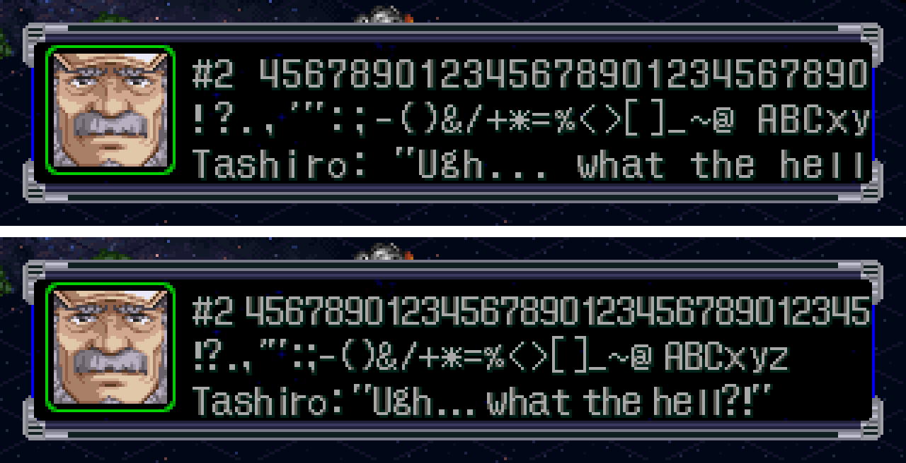

# Investigación de la rutina de texto y VWF — 2026-09-27

## Resultado
**El ancho variable (VWF) es viable y ya funciona como prueba de concepto**: un parche de 18 instrucciones (mismo tamaño que el código original) más una tabla de 256 bytes.



Arriba, el ancho fijo de 8 px: la línea 3 se corta en "hell". Abajo, VWF con los glifos originales: entra completa, y la línea 1 pasa de 30 a 36 caracteres.

## Cadena de dibujo de un mensaje de mapa (SNMSG)
| Paso | Función | Dónde | Qué hace |
|---|---|---|---|
| 1 | `FUN_800E5524` | overlay `SNMP_GRP` (mapa) | Máquina de estados del mensaje: carga el texto (`FUN_800E50CC`), arma la ventana y llama al dibujo cada frame. |
| 2 | `FUN_800E50F8` | `SNMP_GRP` | **Expansor de variables**, en el lugar: `$n $N $m $M $s $S $f $F`. Los datos vienen de las estructuras del protagonista (`*0x8005C248`) y de la pareja (`*0x8005C24C`): `+0x00` = m/M, `+0x15` = s/S, `+0x2A` = n/N (campos de 0x15 bytes = máx. 20 bytes). `$f/$F` = s + sufijo o nombre completo. Con un `$` inválido, el mensaje se reemplaza por un texto de error. |
| 3 | `FUN_800E39EC` | `SNMP_GRP` | Dibuja el retrato (sprite 40×40) y el objeto de texto (`FUN_8001A0C0`). |
| 4 | `FUN_80018B74` → **`FUN_80018CC4`** | EXE `SLPS_026.36` | **Maquetador de texto** (lo usa todo el juego). Cada carácter es un sprite; guarda x/y empaquetados (`x & 0x3FF`, `y << 10`). |

### Detalles de `FUN_80018CC4(obj, texto, flags)`
- `0x0A` = nueva línea (+16 px). `0x09` = tabulación (avance configurable en `gp+0x1C0`).
- SJIS (lead 0x81–0x9F / 0xE0–0xFC) → glifo de 12 px (`FUN_80019090` busca el glifo, `FUN_80018938` lo asigna), **avance 12**.
- Con `flags & 1`: hiragana `0x829F–0x82F1` → glifo de 1 byte (`+0xA0`); con `flags & 2`: katakana `0x8340–0x8396` → `+0x60`. **Avance 8**. El diálogo de mapa usa `flags = 3`.
- Byte simple (ASCII / kana de medio ancho) → `FUN_8001885C(obj, byte)`, **avance 8**. Si le sigue `ﾞ` (0xDE), el glifo se desplaza +0x30; si le sigue `ﾟ` (0xDF), +0x40. Así se forman los glifos especiales (`ﾔﾟ` = "MK", `ﾚﾟ` = "II"…).
- **Salto automático por ancho**: si `x + avance > ancho_máx` (`obj+4`), pasa a la línea siguiente. No hace falta partir líneas a mano, aunque conviene controlar cuántas líneas quedan.
- La fuente de 1 byte es `FONTWIN/8FONT_R.TIM` (256×256, 4 bpp, celdas de 8×16, con sombra de 1 px), cargada en VRAM (x=320, y=256).

## El parche (`work/patches/vwf.asm`)
- Reescribe `0x80018F30–0x80018F74` (18 instrucciones, sin cambiar el tamaño): conserva `ﾞ`/`ﾟ` con avance 8 y, para el resto de bytes simples, usa `avance = VWF_TABLE[byte]`.
- Tabla de 256 bytes en `0x80059480` (dentro de una zona de ceros `0x80059404–0x80059606` que sigue en cero en los volcados de RAM del mapa).
- Tabla generada por `tools/src/vwf_table.py` a partir del ancho de tinta de cada glifo: avance = columna derecha + 1 (la sombra hace de separación); espacio = 4.

```bash
cd work && armips patches/vwf.asm          # (armips = función de env.sh, vía wine)
$SRW_PY tools/src/build_iso.py build/x.bin SLPS_026.36=build/exe/SLPS_026.36 SNMAP/SNMSG.BIN=...
```

## Capacidad estimada
| Configuración | Caracteres por línea (texto inglés típico) |
|---|---|
| Original (8 px fijos) | 30 |
| VWF + glifos originales (esta PoC) | ~34–36 |
| VWF + fuente rediseñada (minúsculas de 4–5 px + sombra) | ~42–46 (estimado) |

## Riesgos / pendientes
1. **La zona de la tabla (`0x80059480`) no está garantizada como libre**: la vi en cero en dos momentos del mapa, pero falta verificar en batalla, intermisión y menús (con breakpoint de escritura en todo el juego o buscando referencias en Ghidra). Alternativa: guardar la tabla en un hueco del código (por ejemplo, funciones de debug sin uso).
2. El maquetador es **global**: los menús también quedan con VWF. Los números en columnas (stats) pueden desalinearse → **conviene dejar los dígitos 0–9 en 8 px** (ancho fijo).
3. El espacio de 4 px se ve algo apretado junto a la puntuación; ajustar al rediseñar la fuente.
4. Glifos con margen izquierdo (`i`, `l`, `!`…) dejan huecos: se corrige al rediseñar la fuente alineada a la izquierda.
5. `snmsg.py` valida con 8 px fijos: hay que pasarlo a la tabla de anchos (y `$n`/`$N`: 20 bytes máx.).
6. Otros textos (batalla, intermisión) pueden usar otras rutinas: verificar cuando se aborden.

## Lecciones sobre las herramientas (PCSX-Redux)
- Los breakpoints de memoria necesitan `-interpreter -debugger`.
- **Hay que guardar referencias a los objetos que devuelve `PCSX.addBreakpoint`**: si el GC de Lua los recoge, el breakpoint desaparece en silencio (`redux_drive.lua` los guarda en `BP_HANDLES`).
- **Las lecturas de 1 byte (`lb`/`lbu`) no disparan breakpoints de lectura**; las de 4 bytes sí (por eso solo aparecía `strlen`). Para seguir texto conviene usar breakpoints de ejecución.
- El stdout del emulador se pierde cuando se llena su buffer: los scripts Lua escriben a `LOG_FILE`.
- Los save states restauran la RAM, **incluido el código del EXE**: para probar parches al EXE hay que bootear desde cero (`drive.sh … FRESH_CARD=1`).
- Recorrido desde boot hasta el primer diálogo (memory card virgen), unos 10.000 frames:
  `INPUTS="2000:START;2800:START;3400:LEFT;3600:START;4200:CIRCLE;5000:DOWN;5200:DOWN;5400:CIRCLE;5700:CIRCLE;6100:DOWN;6300:CIRCLE;6600:CIRCLE;7000:START;7300:CROSS;7600:CROSS;7900:CROSS;8200:CROSS;8500:CROSS;8800:CROSS;9100:CROSS;9400:CROSS"`
